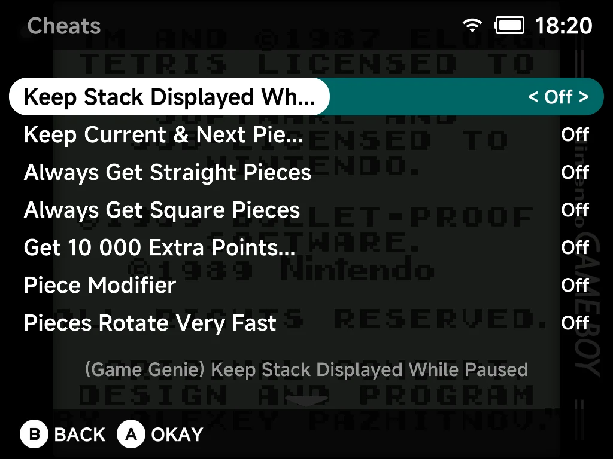
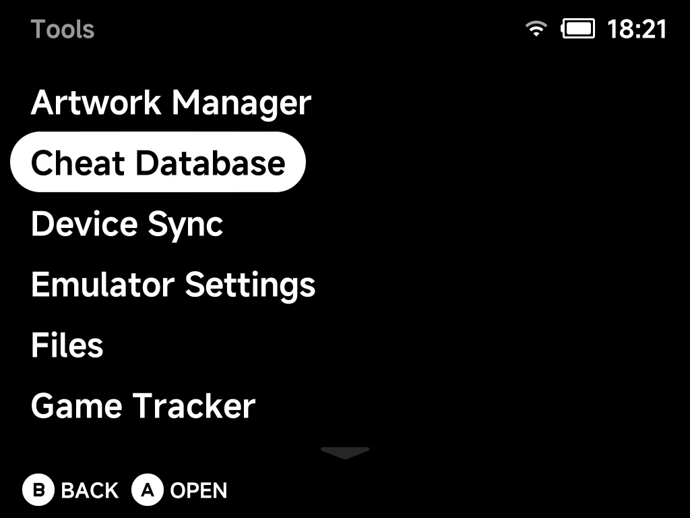
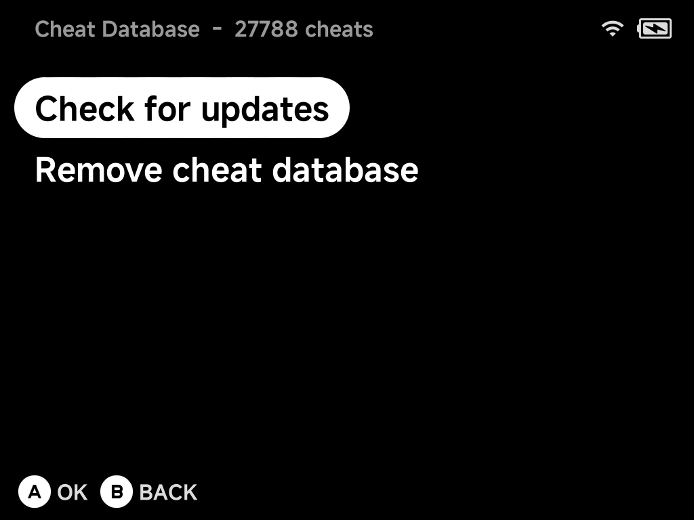

# Cheats

NX Redux can load [libretro](https://www.libretro.com/) cheat files for your
games. Setup takes two steps, all on the device with no computer:

1. Install the small **Cheat Database** tool from the [Xtras Store](xtras.md).
2. Open it from [Tools](tools.md) and **download** the cheat files.

Then turn individual cheats on and off from a game's in-game menu.



## Installing the Cheat Database tool

1. Open **Tools → Xtras**.
2. Press `Right` to switch to the **TOOLS** tab.
3. Select **Cheat Database**.

When it finishes you'll see *"Installed. Open Cheat Database in Tools to
download the cheats."* The entry moves to the *Installed* group in Xtras, and
**Cheat Database** appears in your [Tools](tools.md) menu:



This installs only the small tool (about 1 MB). The cheats themselves are
downloaded from inside it.

## Downloading the cheats

1. Open **Tools → Cheat Database**.
2. The first time, it shows *No cheat database installed*. Press `A`
   **Download**.
3. A progress bar advances system by system as it installs.
4. When it finishes you'll see *"Done. Open a game and see Options > Cheats."*

After that, the tool shows the cheat count and its two options:



One download covers every supported system. You need Wi-Fi and about
**256 MB** free on the SD card.

??? info "More detail"
    The tool downloads the libretro cheat collection (~37 MB) and unpacks it
    onto the SD card, where it takes about **185 MB**.

## Keeping things up to date

There are **two separate kinds of update**, from two places:

| What to update | Where | How |
| --- | --- | --- |
| **The cheat files (data)**: new or corrected cheats | Inside the tool | Open **Tools → Cheat Database → Check for updates**. It checks libretro's latest release and re-downloads if it's newer. Otherwise it reports *"Cheat database is up to date."* |
| **The Cheat Database tool itself (code)**: its menus and behaviour | The **[Xtras Store](xtras.md)** | Update it like any other tool. Xtras labels the entry when a new version is available, and a NX Redux system update refreshes it automatically |

## Using cheats in a game

1. Launch a game on a **built-in emulator core**.
2. Press `MENU` to open the in-game menu and choose **Options** (see
   [Emulator Options](../guide/emulator-options.md#in-game-the-pause-menu)).
3. Choose **Cheats**.
4. Toggle any cheat `On` or `Off`. Changes apply **immediately** while you
   play. Each entry carries a short description you can read from the list.

If no cheats are found for the game, the menu shows *"No cheat file
loaded. Get cheats from Xtras > Cheat Database."* with the file names it
looked for.

!!! tip "Variants are merged automatically"
    Some games have cheat sets from several sources (Game Genie, GameShark,
    Code Breaker, Action Replay). NX Redux loads **all** of them for the
    current game and merges them into one list. Each cheat's description
    under the list starts with its source (for example `(GameShark)`) so you
    can tell them apart.

!!! tip "Keep the region in your ROM names"
    Cheats often differ between the USA, Europe and Japan releases of a game.
    NX Redux picks the cheat file for your ROM's region, read from its name:
    `Tekken 6 (USA).iso` gets the USA cheats. A name without a region, like
    `Tekken 6.iso`, gets whichever region it finds first, which may not match
    your copy.

### Two kinds of cheats

Most cheat files hold **codes** (Game Genie, GameShark, Action Replay,
CWCheat on PSP) that the emulator core decodes. Others are **RAM cheats**: a
value NX Redux writes into the game's memory on every frame, such as "keep
player 1's energy full". RAM cheats come from RetroArch's cheat search, and
the database has about a thousand of them, mostly for systems without
cheat devices: arcade (FBN), Dreamcast, ColecoVision, Atari 7800, Lynx and
MSX, plus some SNES and PC Engine games. Both kinds appear in the same
**Cheats** list and turn on and off the same way.

RAM cheats pause while you play over [netplay](../netplay.md) or a
link cable, since the other player's game would not have the same change.

!!! warning "Turn RAM cheats on once the game is running"
    A RAM cheat changes memory from the moment it's on. Turned on in a cheat
    file before the game starts, it can upset the game's own start-up checks
    (a Neo Geo game, for example, reports a *WORK RAM ERROR*). Turning it on
    from the **Cheats** menu during play is safe.

### Cheats and RetroAchievements

[RetroAchievements](retroachievements.md) on NX Redux is **softcore only**,
so there is no hardcore mode to block cheats. You can turn cheats on with
achievements enabled.

## Systems without cheats { #ds-n64-and-dreamcast }

!!! warning "A few systems can't use the downloaded cheats yet"
    Cheats work on the **built-in emulator cores** (Game Boy, GBA, NES, SNES,
    Mega Drive, PlayStation, PSP, Nintendo 64, Dreamcast, arcade and the
    like). They **don't take effect** on:

    | System | Why |
    | --- | --- |
    | Nintendo DS | It runs on a standalone emulator (DraStic) with its own cheat format |
    | Atari 5200 | Its core doesn't give NX Redux access to the game's memory, which its RAM cheats need |
    | Neo Geo Pocket (Color), Virtual Boy | Their cores have no cheat support |

The Cheat Database still **delivers** files for these systems (for example
under `Cheats/NDS/`). They are shipped for future use.

!!! note "MSX cheats if you downloaded the database earlier"
    Up to NX Redux v2.3.0, the download skipped the MSX cheats. If you
    downloaded the cheat database on v2.3.0 or earlier, `Cheats/MSX/` is
    empty: open **Tools → Cheat Database**, choose **Remove cheat database**,
    then **Download** again. **Check for updates** only downloads again
    when libretro publishes new cheats.

## Where the files go

Cheats are stored as loose `.cht` text files on the SD card, one folder per
system, under `Cheats/`.

??? info "More detail"
    Example paths:

    ```
    /mnt/SDCARD/Cheats/GBA/Advance Wars (USA, Europe) (Code Breaker).cht
    /mnt/SDCARD/Cheats/SFC/...
    /mnt/SDCARD/Cheats/FC/...
    ```

    Each `Cheats/<system>/` folder uses the same short system tag as your
    `Roms` folders (`GBA`, `SFC`, `FC`, `GB`, `GBC`, `MD`, `PS`, and so on).
    That's how the right cheats are matched to the right games automatically.

## Removing cheats and hand-made cheats

**Write your own cheats:** drop a `<Game Name>.cht` file into the matching
`Cheats/<system>/` folder. It is picked up and merged with the downloaded ones,
like any other cheat file.

**Remove the downloaded database:** there are two ways, and **both always keep
your hand-made `.cht` files**.

| Where | What it removes |
| --- | --- |
| **Tools → Cheat Database → Remove cheat database** | Only the files it downloaded, after a confirmation. The tool stays installed so you can download again later |
| Uninstall **Cheat Database** from **Xtras** | The tool **and** its downloaded cheat files, in one step |

You can safely install, download, remove and reinstall without losing your own
cheats.

??? info "More detail"
    Both ways keep a record of exactly what was downloaded and delete only
    that. Any `Cheats/<system>/` folder that still holds one of your own files
    is kept as well.
