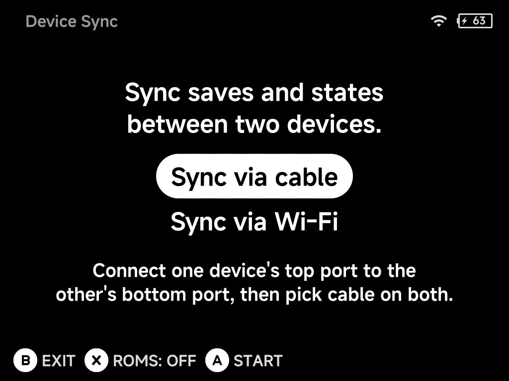

# Device Sync

**Tools → Device Sync** moves your progress between two NX Redux devices,
over a USB cable or Wi-Fi. It is the supported way to carry your progress to
another device.

SD cards are built for one device model, so don't swap them between devices.

## What gets synced

- **Game saves** (`Saves/`)
- **Save states**, with their slot pictures
- **ROMs** — optional: press `X` to toggle `ROMS: ON/OFF` before starting. The
  whole `Roms/` folder travels, including artwork (`.media`) and
  RetroAchievements data (`.retroachievements`).

Everything else stays on each device: settings, recently played, pinned games,
and your RetroAchievements login (sign in on each device).

## How to sync

1. Connect the devices with a **USB cable** (one device's top port to the
   other's bottom port, the same cable as [netplay](../netplay.md)), or put
   both on the **same Wi-Fi network**.
2. Open **Tools → Device Sync** on both devices.
3. Pick **Sync via cable** (the default) or **Sync via Wi-Fi** with `UP`/`DOWN`
   — the same on both devices — and press `A` **Start**. The devices find each
   other and sync.

!!! note
    Sync via Wi-Fi needs an active Wi-Fi connection. If Wi-Fi is off or not
    connected, the tool asks you to turn it on or sync via cable instead. The
    quickest way is the Wi-Fi toggle in the [OSD](../guide/osd.md).

??? info "More detail"
    - Sync never deletes anything. A file missing on one device is copied
      over; when both devices have the same file, the newer one replaces the
      older one.
    - Both devices send and receive in the same session, so one run brings
      both up to date.
    - Save states only work with the emulator core that made them; states for
      a core the other device doesn't have are copied but unused.
    - macOS leftovers (`._*` files, `.DS_Store`) are skipped.

!!! warning "Update both devices"
    A device on an older NX Redux version still sends its settings and recently
    played list, and can't sync over the cable. Update both for the behaviour
    above.
