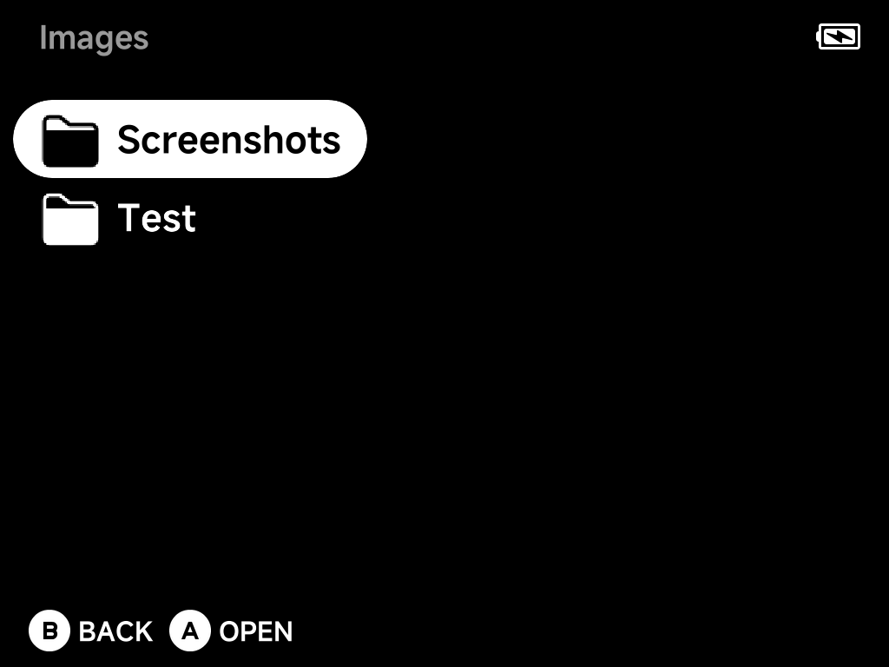
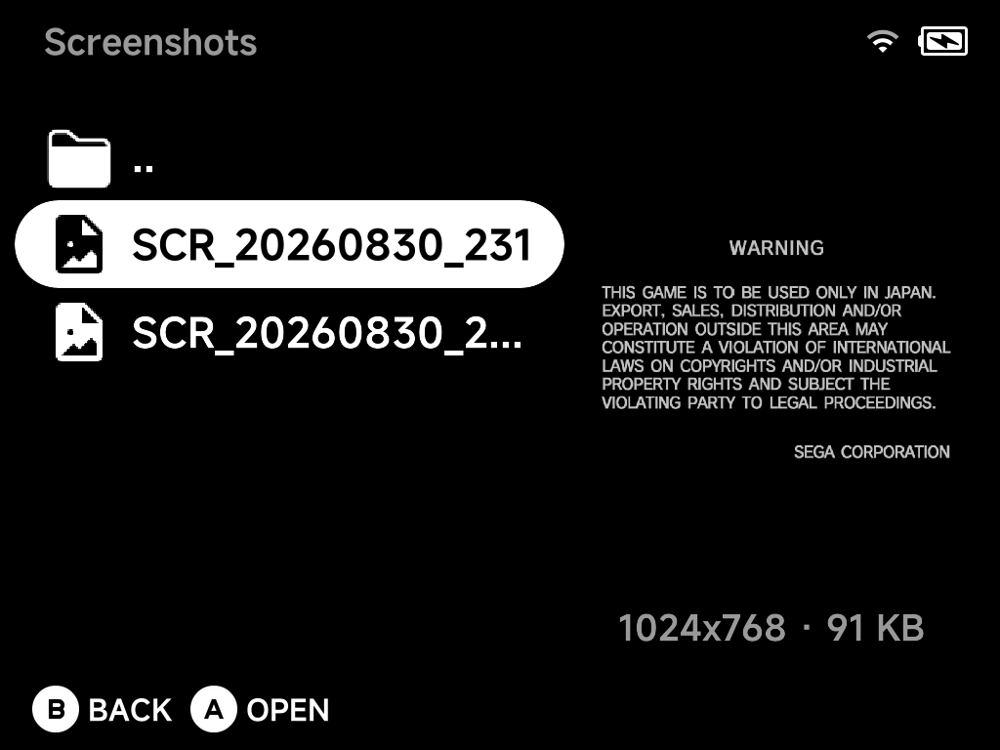
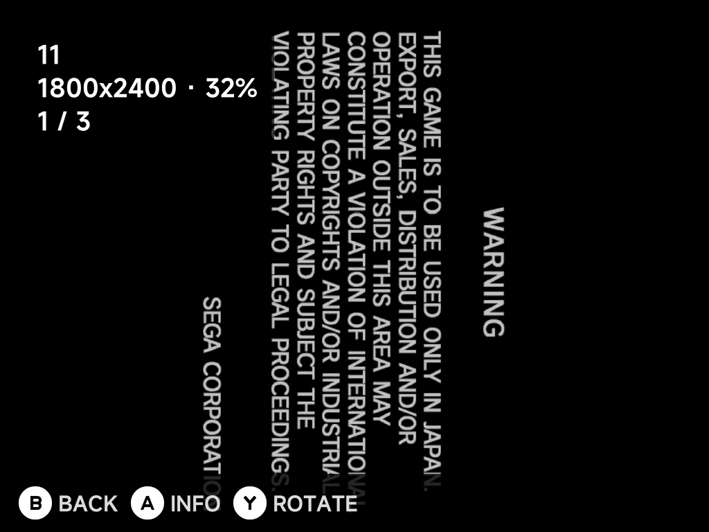
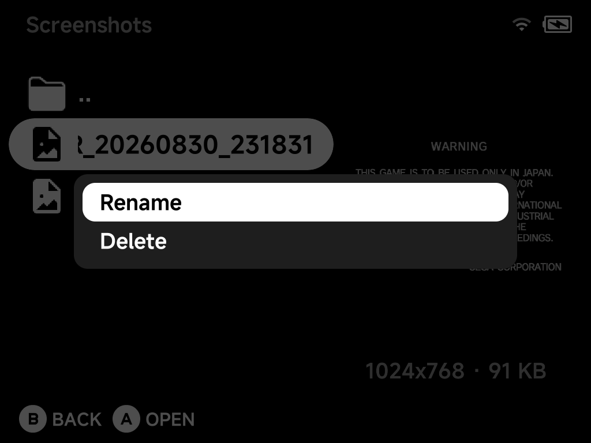

# Image Viewer

A built-in browser and fullscreen viewer for images on the SD card, including
your OSD screenshots. Open it from **Tools → Image Viewer**.

## Library

Image Viewer browses the `Images` folder on the SD card.

- Screenshots taken with the [OSD](../guide/osd.md) land in
  `Images/Screenshots` automatically.
- Any other pictures you drop into `Images` (subfolders included) show up
  here too.

Folders show a folder icon, images a picture icon. Select an image to see a
live preview on the right, with its resolution and file size (for example
`1024x768 · 91 KB`).

- `A` opens a folder, or opens an image fullscreen.
- `B` goes up one folder. At the `Images` root, it exits the app.

Supported formats: `png`, `jpg`, `jpeg`, `bmp`, `gif` (animated GIFs show
their first frame only).

## Viewing

Opening an image switches to a fullscreen viewer, fit to the screen by
default:

| Button | At fit size | While zoomed in |
| --- | --- | --- |
| `Left` / `Right` | Previous / next image in the folder (wraps around) | Pan |
| `Up` / `Down` | — | Pan |
| `R1` / `L1` | Zoom in | Zoom in / out (out of the first step returns to fit) |
| `A` | Toggle the info overlay | Toggle the info overlay |
| `Y` | Rotate 90° clockwise | Rotate 90° clockwise (returns to fit size) |
| `B` | Back to the browser | Back to fit size, then back to the browser |

Zoom steps through **fit → 100% → 200% → 400%**.

The info overlay shown above lists the file name, resolution, zoom level and
your position among the folder's images (e.g. `1 / 2`).

??? info "More detail"
    Zoom skips any step that wouldn't enlarge the image past its fit size,
    so a small image goes straight from fit to the first larger step.

## Rotate

Press `Y` in the fullscreen viewer to turn the image 90° clockwise. Press it
again to keep turning (180°, 270°, back to the start).

The rotation is saved to the file itself, so the picture stays rotated
when you open it again and when you copy it to a computer. This is handy
for screenshots of games you play holding the device sideways.

- The file is saved a second after your last `Y` press, or straight away
  when you move to another image or press `B`.
- `jpg`, `jpeg`, `bmp` and `gif` files are re-saved through FFmpeg. JPG
  screenshots are re-encoded at the same high quality the OSD uses, so there
  is a very small quality loss; animated GIFs keep all their frames.
- `png` files are re-saved without any loss.
- If saving fails, a "Couldn't save rotation" message appears and the
  original file is left as it was.

## Rename & Delete

Press `MENU` on a folder or image in the browser for its context menu:

- **Rename**: opens the on-screen keyboard. The file's extension is kept
  automatically, so retyping it won't double it up. A name already in use is
  refused.
- **Delete**: asks for confirmation first. Deleting a folder removes
  everything inside it, and the dialog warns you before it does.

## Limits

- Anything over 32 MB or 40 megapixels shows an "Image too large" message
  instead of opening.
- A file that can't be decoded shows a "Couldn't load image" message.
