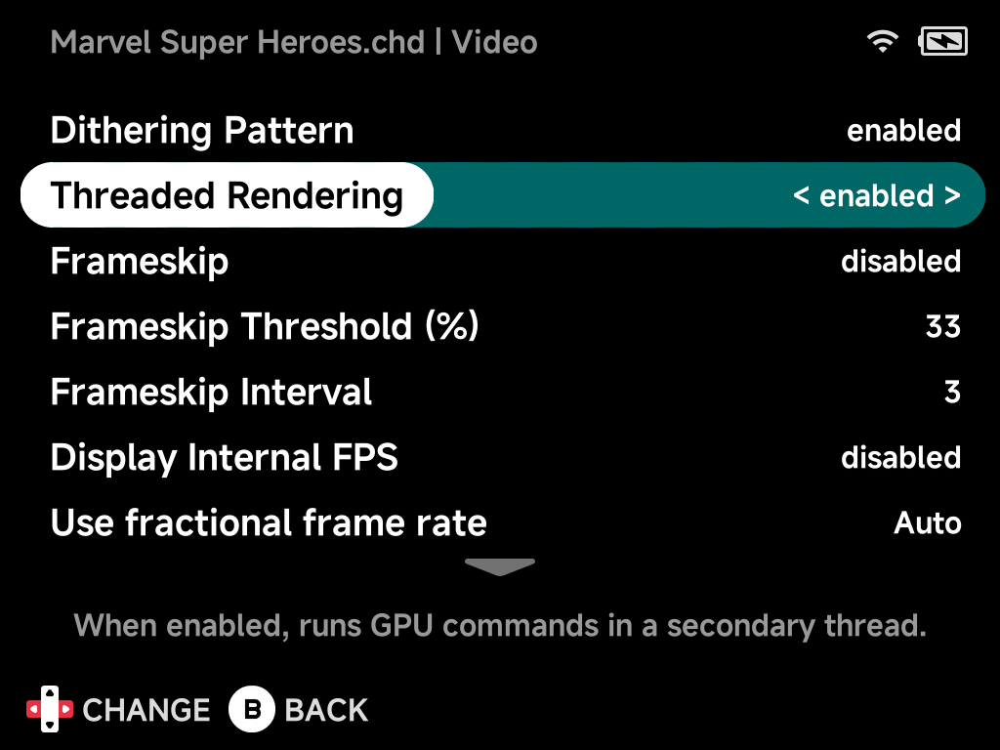

# PlayStation

NX Redux plays PlayStation games with the built-in **PCSX-ReARMed** core, and
ships **[SwanStation](#swanstation)** as a second, more accurate core.

| | PCSX-ReARMed |
| --- | --- |
| Folder | `Roms/Sony PlayStation (PS)/` |
| BIOS | Recommended: `psxonpsp660.bin` or `scph1001.bin` in `Bios/PS/` |
| [Netplay](../netplay.md) | Yes |
| [File types](rom-formats.md) | `chd` `cue` `bin` `img` `iso` `pbp` `toc` `mdf` `cbn` `m3u` `exe` |

Every device runs PlayStation games at full speed at the native resolution.

!!! warning "Use a real BIOS"
    The core has a built-in fallback BIOS, but some games only work with a
    real one.

## Controls

Both cores (PCSX-ReARMed and [SwanStation](#swanstation)) share one
layout, with the DualShock controller selected:

| Device button | PlayStation button (Nintendo layout) | PlayStation button (Xbox layout) |
| --- | --- | --- |
| Right (`A` on the cap) | ○ Circle | ✕ Cross |
| Bottom (`B` on the cap) | ✕ Cross | ○ Circle |
| Top (`X` on the cap) | △ Triangle | □ Square |
| Left (`Y` on the cap) | □ Square | △ Triangle |
| `L1` / `R1` | L1 / R1 | same |
| `L2` / `R2` | L2 / R2 | same |
| Left / right stick | Left / right analog stick | same |
| D-pad | D-pad | same |
| `SELECT` / `START` | Select / Start | same |

With the default Nintendo [Button Layout](../guide/button-layout.md) the face
buttons match the PlayStation pad by position. The Xbox layout swaps them:
Circle stays on whichever button acts as `A`. To switch between the Standard
and DualShock controller, or remap anything, use the in-game menu's
[Options → Controls](../guide/in-game-options.md#controls).

## Enhanced Resolution

**Enhanced Resolution** renders 3D games at twice the native resolution, for
sharper models and textures. Turn it on in the game's
[emulator options](../guide/emulator-options.md).

!!! tip "Keep Threaded Rendering on with it"
    On its own, Enhanced Resolution slows heavy 3D games to about 40 fps.
    With **Threaded Rendering** on as well, the game runs at a steady 60 fps
    again.

| Option | Brick, Brick Hammer, Brick Pro, Smart Pro | Smart Pro S |
| --- | --- | --- |
| Enhanced Resolution | Off | Off |
| Threaded Rendering | **On** | Off: turn it on together with Enhanced Resolution |

Measured in a Wipeout 3 race:

| Setup | Brick | Smart Pro S |
| --- | --- | --- |
| Native resolution (default) | Full speed | Full speed |
| Enhanced Resolution | About 40 fps | About 40 fps |
| Enhanced Resolution + Threaded Rendering | Full speed | Full speed |

??? info "More detail"
    Enhanced Resolution only applies to games that run in the standard
    resolution modes. Games that already use a high-resolution mode, and
    full-motion video, are shown as they are. Threaded Rendering moves the
    drawing work onto its own CPU core, so it no longer slows the emulation
    down.

    - **Why it's on for the Brick family:** even at the native resolution it
      smooths heavy scenes there (Tekken 3 on the Brick: 154 late frames a
      minute without it, 58 with it).
    - **Why it's off on the Smart Pro S:** at the native resolution it doesn't
      help there and costs a few fps.

## SwanStation

**SwanStation** is a second PlayStation system built on a more accurate
emulator. It draws games with the device's GPU, and can render 3D games at a
higher resolution for sharper models and textures.

To use it, copy or move a game into `Roms/Sony PlayStation (PSX)/`. Both
folders show up together under **Sony PlayStation** in the main menu; the
folder a game is in decides which core plays it.

| | SwanStation |
| --- | --- |
| Folder | `Roms/Sony PlayStation (PSX)/` |
| BIOS | Recommended: `scph5500.bin` (Japan), `scph5501.bin` (USA), `scph5502.bin` (Europe) in `Bios/PSX/` |
| [Netplay](../netplay.md) | Yes, with another player on SwanStation |
| [File types](rom-formats.md) | `chd` `cue` `bin` `img` `iso` `pbp` `ecm` `mds` `m3u` `exe` `psexe` `psf` |

- **It has its own BIOS folder.** Without a BIOS file the core uses a
  built-in OpenBIOS, which runs most games; copy your real BIOS into
  `Bios/PSX/` for full compatibility.
- **Saves are separate.** SwanStation keeps its own memory cards
  (`Saves/PSX/`), save states and settings. Progress made in the
  PCSX-ReARMed version of a game does not carry over.

Use PCSX-ReARMed by default, and SwanStation for games that glitch on it.
SwanStation runs at full speed on every device but works the CPU harder.

??? info "More detail: SwanStation speed"
    The heavier CPU load means the odd frame takes longer: about 3 hitches a
    minute, against none on PCSX-ReARMed (measured 2026-10-09).

    | Measured (60 s) | Brick | Smart Pro S |
    | --- | --- | --- |
    | PCSX-ReARMed, native resolution | Full speed, 58% CPU | Full speed, 40% CPU |
    | SwanStation, 2× resolution | Full speed, 77% CPU | Full speed, 74% CPU |

!!! tip "Sharper 3D games"
    SwanStation plays at the native resolution by default. For a 3D game,
    raise **Internal Resolution Scale** to 2x in that game's
    [emulator options](../guide/emulator-options.md); it still runs at full
    speed on every device. Leave 2D games at 1x: at 2x their sprite art
    shows thin seams.

??? info "More detail"
    The same options hold the renderer (hardware or software) and PGXP
    geometry correction, which removes the wobble of PlayStation 3D. The
    software renderer looks like real hardware.
