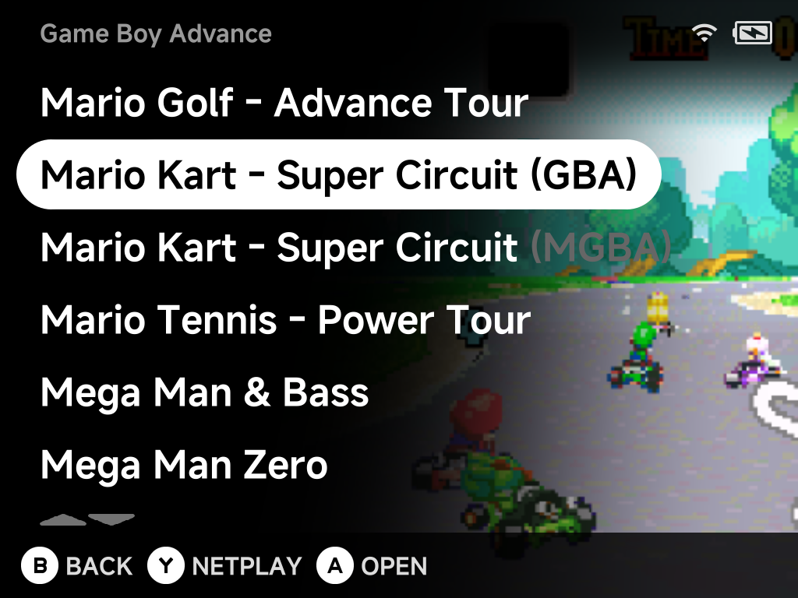

# Super Nintendo

NX Redux ships two Super Nintendo cores, **Snes9x** and **Mednafen
Supafaust**. You choose one per game by which `Roms` folder the game
is in:

| | Snes9x | Supafaust |
| --- | --- | --- |
| Folder | `Roms/Super Nintendo ES (SFC)/` | `Roms/Super Nintendo ES (SUPA)/` |
| Strength | Lighter, the default | More accurate, but heavier |
| [Netplay](../netplay.md) | Yes | Yes |
| BIOS | None | None |
| [File types](rom-formats.md) | `sfc` `smc` `swc` `fig` `bs` `st` | `sfc` `smc` `swc` `fig` |

## Which one to use

Start with **Snes9x** in the `SFC` folder. It is the default core and the
lighter of the two.

Move a game to the `SUPA` folder when you want **accuracy** and the game
doesn't behave right on Snes9x. Supafaust is more accurate but heavier. Some
games may run less smoothly than on Snes9x, especially on lower-end devices.

??? info "More detail"
    Supafaust spreads its work over several CPU cores.

!!! note "Satellaview and Sufami Turbo"
    Only Snes9x opens Satellaview (`.bs`) and Sufami Turbo (`.st`) files, so
    keep those in the `SFC` folder.

## Controls

Both cores share one layout. The SNES pad has the same four face letters as
the device, so each one sits on the button with that letter:

| Device button | SNES button |
| --- | --- |
| Right (`A` on the cap) | A |
| Bottom (`B` on the cap) | B |
| Top (`X` on the cap) | X |
| Left (`Y` on the cap) | Y |
| `L1` / `R1` | L / R |
| D-pad (and the left stick, on devices that have one) | D-pad |
| `SELECT` / `START` | Select / Start |

The face buttons follow the [Button Layout](../guide/button-layout.md)
setting: SNES A stays on whichever button acts as `A`, and so on. Remap
anything in the in-game menu under
[Options → Controls](../guide/in-game-options.md#controls).

## Netplay

Both cores support [Netplay](../netplay.md), so games with a built-in
multiplayer mode can be played together. Both players must use the same
folder, and therefore the same core, for the game.

??? info "More detail"
    SNES netplay runs in lockstep mode.

## Using both

You can keep the same game in both folders. The game list then shows it
twice with the emulator tag, for example `Super Mario World (SFC)` and
`Super Mario World (SUPA)`. Pick the core each time you play (see
[duplicate names](../guide/main-menu.md#duplicate-names)).

Saves are kept per folder, in `Saves/SFC/` and `Saves/SUPA/`. To carry your
progress across, copy the game's save file from one folder to the other.
Save states cannot move between the two cores.

??? info "More detail"
    Battery saves are written in the RetroArch-compatible `.srm` format by
    default, which is why the save file can be copied between the folders.
