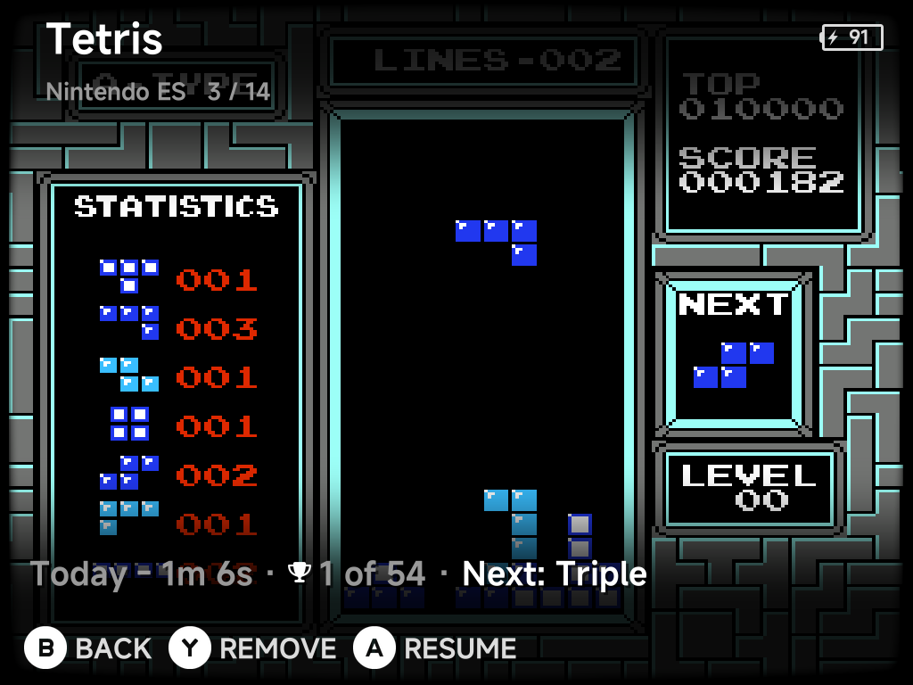
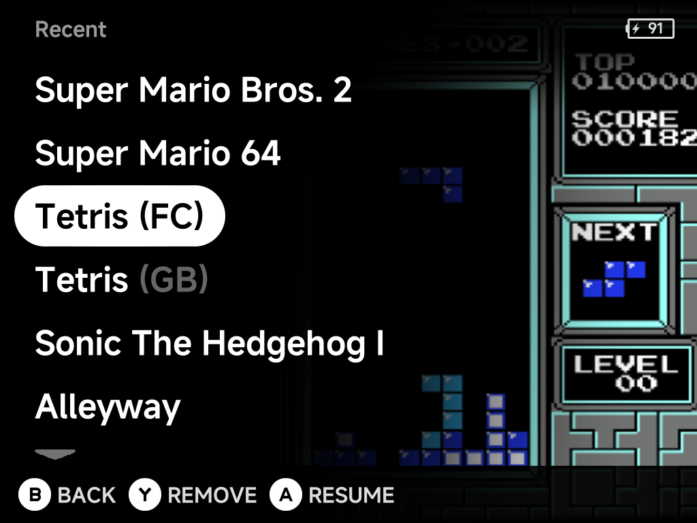

# Game Switcher

Tap `SELECT` anywhere in the menus (or `MENU` + `SELECT` in a game) to open
the Game Switcher — your recent games, ready to resume any of them instantly.
It has two layouts, picked in
[**Settings → Layouts → Game Switcher layout**](../settings/layouts.md#game-switcher-layout):
`Full screen` (the default) and `List`.

## Full screen

One game at a time, its resume frame filling the screen. The top shows the
game's name and, under it, its system and its place in the list
("Game Boy Advance 1 / 12"). The line at the bottom shows when you last played
it, your total play time and your achievement progress.

| Button | What it does |
| --- | --- |
| `Left` / `Right` | Flip through games |
| `A` **Resume** | Continue exactly where you left off |
| `Y` **Remove** | Take the game out of the switcher |
| `B` **Back** | Return to the menu |

## List

Your recent games as a list titled **Recent**, drawn like a game list in the
List style: the selected game's resume frame sits behind the rows, faded in
from the right. Two games with the same name from different systems show the
system's tag after the name, dimmed ("Tetris (GB)").

| Button | What it does |
| --- | --- |
| `Up` / `Down` | Move through games |
| `A` **Resume** | Continue exactly where you left off |
| `Y` **Remove** | Take the game out of the switcher |
| `B` **Back** | Return to the menu |

## Always resumable

Quitting a game with `A` (**Save & Quit**) auto-saves to a hidden slot, so the
Game Switcher resumes exactly where you left off, with no manual save states
needed. To leave without touching that resume point, press `X` (**Quit**) on
Quit instead; see [Playing Games](playing-games.md#the-in-game-menu).

By default the switcher lists **only resumable games**. To see all recent
games, set [**Game Switcher games**](../settings/layouts.md#game-switcher-games)
in **Settings → Layouts** to `All recent games`.

??? info "More detail"
    - **Play time and achievements** follow
      [**Extra info**](../settings/layouts.md#extra-info) and
      [**Button hints**](../settings/layouts.md#button-hints) in
      **Settings → Layouts**. With Extra info hidden there is no play time or
      achievement line. With Button hints hidden, the hint bar's row stays
      empty and the line moves into it; in the List layout the line shows only
      then, as in a List game list.
    - Auto-resume works on every built-in core, Dreamcast, Nintendo 64 and PSP
      included.
    - A game with no resume picture shows its box art instead. With
      `All recent games`, games that can't be resumed start fresh (`A`
      **Start**).
    - Empty switcher: **Nothing played yet** when you have never played a
      game, or **No Resumable Games** when your recent games have no resume
      point.
