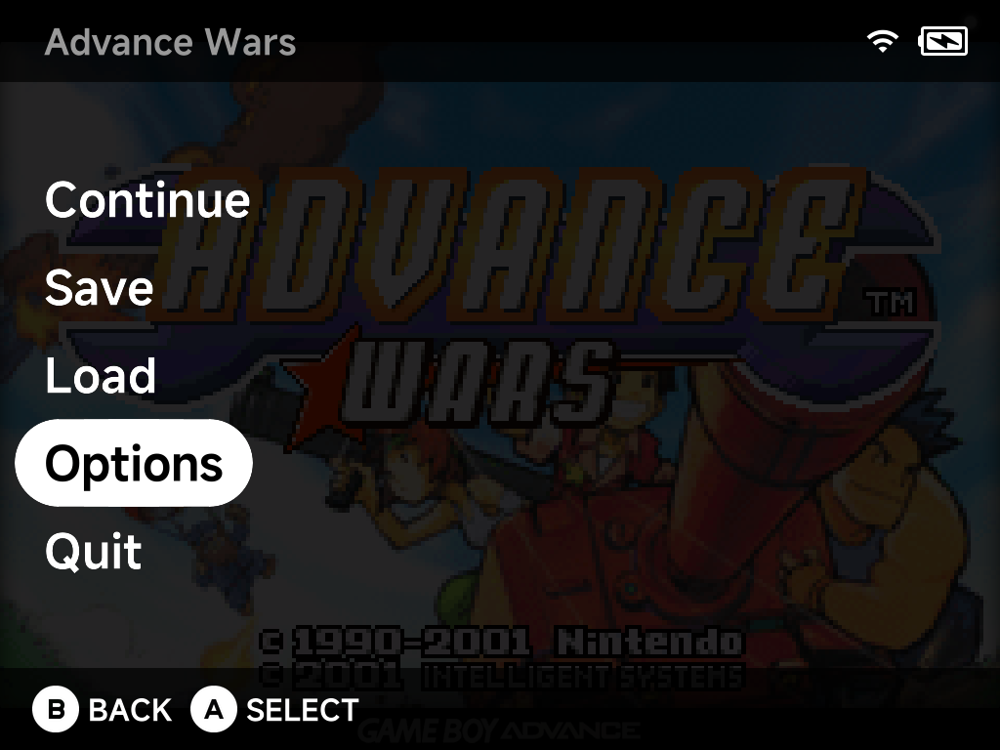
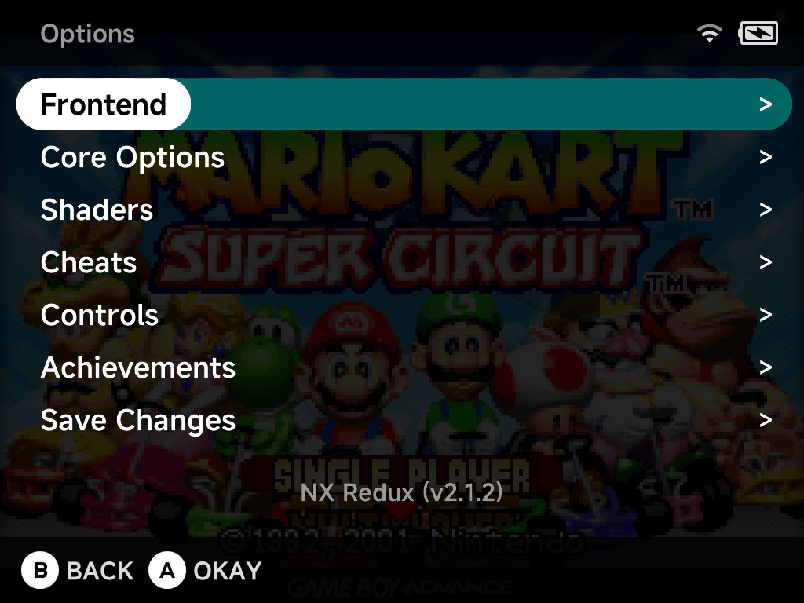
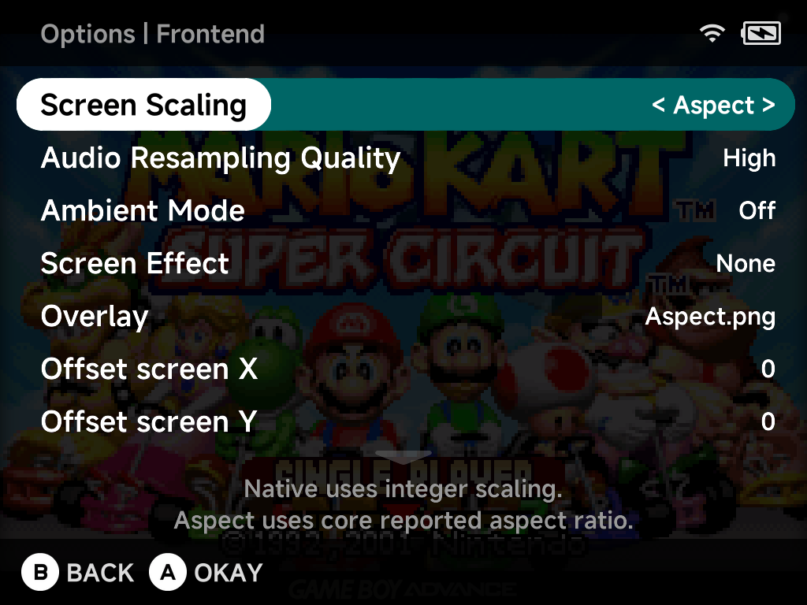

# In-game Options

While playing on a **built-in emulator core**, press `MENU` and choose
**Options** to open the in-game options menu. Most changes apply **live** —
you see the result as soon as you return to the game.

The Options menu contains:

| Entry | What it's for |
| --- | --- |
| [Frontend](#frontend) | Video scaling, screen effects, overlays, CPU speed, fast-forward and rewind. |
| Core Options | The emulator core's own settings — see [Emulator Options](emulator-options.md#in-game-the-pause-menu). |
| [Shaders](#shaders) | The video shader pipeline and shader presets. |
| [Cheats](#cheats) | Turn the game's cheats on and off. |
| [Controls](#controls) | Remap the emulated controller's buttons. |
| [Shortcuts](#shortcuts) | Give this console or game its own emulator shortcuts. |
| [Achievements](#achievements) | Browse the game's RetroAchievements — shown only when achievements are enabled. |
| [Save Changes](#save-changes) | Keep your changes for this system or this game, or restore defaults. |

With Frontend selected, the line below the list shows the NX Redux version;
with Core Options selected, it shows the running core's version.

!!! important "Changes aren't saved until you use Save Changes"
    Everything you change in Options takes effect immediately but only lasts
    for the current session. To keep it, open [Save Changes](#save-changes)
    before you quit. This makes it easy to experiment: to undo a change,
    quit without saving.

## Frontend

Settings handled by NX Redux itself rather than the emulator core, so the
same list appears for every system. Use `LEFT` / `RIGHT` to change a value.

| Option | Values | What it does |
| --- | --- | --- |
| **Screen Scaling** | Native, Aspect, Aspect Screen, Fullscreen, Cropped | **Native** uses integer scaling (sharpest, may leave borders). **Aspect** fills the screen at the core's reported aspect ratio. **Aspect Screen** uses the screen's aspect ratio. **Fullscreen** stretches to fill the screen (non-square pixels). **Cropped** is integer-scaled and then cropped to fill — only on devices that support it. Default: Aspect (some systems ship their own). |
| **Audio Resampling Quality** | Low, Medium, High, Max | Higher quality uses more CPU. Default: High. |
| **Ambient Mode** | Off, All, Top, FN, LR, Top/LR | Makes the chosen LEDs follow the colors on screen. See also [LED Control](../settings/led-control.md). |
| **Screen Effect** | None, Line, Grid | **Grid** simulates an LCD grid, **Line** simulates CRT scanlines. Effects usually look best with Native scaling. |
| **Overlay** | None, or any overlay for this system | A border/bezel image drawn around the game — see [Overlays](playing-games.md#overlays). |
| **Offset screen X** / **Offset screen Y** | −64 to +64 | Shift the game image horizontally/vertically by this many pixels. Default: 0. |
| **Screen Sharpness** | NEAREST, LINEAR | **NEAREST** keeps pixels crisp; **LINEAR** smooths lines, and works best when the final image is high resolution (a high-res core, or upscaling with shaders). Default: LINEAR. |
| **Core Sync** | Auto, Screen, Native, Emulated | What drives the frame rate: **Native** follows the emulator's frame rate, **Screen** follows the display's refresh rate. **Emulated** follows the game's own timing, for GPU-rendered systems such as [Dreamcast](../emulators/dreamcast.md#settings) (its default); for other systems it behaves like Native. **Auto** picks for you. |
| **CPU Speed** | Powersave, Normal, Performance, Auto | Underclock to save battery or overclock for demanding games. **Auto** (default) raises and lowers the speed with the game's load, across the full range. |
| **Debug HUD** | Off, On | Show frames per second, CPU load, resolution and scaler information on screen. |
| **Max FF Speed** | None, 2x – 8x | Cap for fast-forward (it may run slower depending on the game and emulator). Default: 4x. |
| **Fast forward audio** | Off, On | Play or mute audio while fast-forwarding. Default: Off. |
| **Rewind** | Off, On | Enable the in-memory rewind buffer. Uses extra CPU and memory, and needs a [shortcut](../settings/emulator-shortcuts.md) (**Toggle Rewind** or **Hold Rewind**) to use during play. Default: Off. |
| **Rewind audio** | Off, On | Play or mute audio while rewinding. Default: Off. |

Some systems lock individual frontend options to a fixed value; locked
options don't appear in the list.

??? info "More detail: rewind tuning"
    These rows sit between **Rewind** and **Rewind audio** in the list.

    | Option | Values | What it does |
    | --- | --- | --- |
    | **Rewind Buffer (MB)** | 8, 16, 32, 64, 128, 256 | Memory reserved for rewind snapshots — more memory means you can rewind further back. Default: 64. |
    | **Rewind Interval** | 16 ms (~60 fps) – 600 ms | Time between rewind snapshots. Shorter intervals give smoother rewinding but use more CPU and memory. Default: 16 ms. |
    | **Rewind Compression** | Off, On | Compress snapshots to fit more into the buffer, at the cost of CPU. Default: On. |
    | **Rewind Compression Speed** | 1 (best ratio) – 12 (fastest) | Lower values compress more but use more CPU. Default: 2. |

## Shaders

Controls the video shader pipeline. If the `Shaders/` folder is missing or
empty, the menu says so instead.

| Option | What it does |
| --- | --- |
| **Optional Shaders Settings** | Opens the extra parameters exposed by the active shaders (e.g. scanline strength). Shows *"No extra settings found"* when the shaders have none. |
| **Shader / Emulator Settings Preset** | Load a ready-made preset from the `Shaders/` folder (`crt-perfect`, `lcd-perfect`, `real-gameboy`, `scanlines`, `old-tv`, pixel-perfect variants and more). Loading a preset replaces your current shader settings — to just try one out, quit without saving. |
| **Number of Shaders** | `off`, or 1 to 3 shader passes. |
| **Shader 1–3** | The `.glsl` program each pass runs, picked from `Shaders/glsl/`. |
| **Shader 1–3 Filter** | Upscaling method for that pass: NEAREST or LINEAR. |
| **Shader 1–3 Source type** / **Texture Type** | Which resolution the pass scales from: `source` or `relative`. |
| **Shader 1–3 Scale** | Scale the image 1x–8x, or `screen` to scale to the screen's resolution (can hurt performance). |

See [Shaders](playing-games.md#shaders) for more about presets.

## Cheats

Lists every cheat found for the game. Toggle a cheat `On` / `Off` with
`LEFT` / `RIGHT` — it applies immediately. Press `A` on a cheat to read its
full description.

If no cheat file is loaded, the menu lists the file names it looked for and
points you at **Xtras → Cheat Database**. RetroAchievements on NX Redux is
softcore only, so cheats work with achievements on. See
[Cheats](../apps/cheats.md) for where cheat files go and which systems' cheats
work.

## Controls

Remaps the buttons of the emulated controller to your device's buttons. Only
the buttons the running core uses are listed.

- Press `A` on a button, then press the device button (or `MENU` + button)
  you want to assign to it.
- Press `X` to clear a binding (`NONE`).
- For cores that support different controller types (for example
  PlayStation), a **Controller** entry at the top switches between
  **Standard** and **DualShock**.

## Shortcuts

In-game hotkeys (save/load state, fast-forward, rewind, turbo…) are set once
for every console in
[Settings → Emulator Shortcuts](../settings/emulator-shortcuts.md). This page
lists the same shortcuts and lets you change any of them for the console or
game you're playing. A shortcut you set here wins over the Settings one;
the rest keep following Settings.

- Each row shows the button in use. The line below the list says whether it
  comes from Settings or was set here.
- Press `A` on a shortcut, then press a button, or hold `MENU` and press a
  button for a `MENU` + button combination.
- Press `X` to clear a shortcut you set here. It goes back to the Settings
  button.
- Keep them with [Save Changes](#save-changes), for the console or for the
  game.

??? info "More detail"
    - If you give a shortcut a button that Settings uses for a different
      shortcut, that Settings shortcut is off in this console or game, so one
      press never does two things.
    - Clearing a shortcut here can't turn it off for one game: it always goes
      back to the Settings button. To have no shortcut on that button, clear
      it in Settings.
    - `MENU` + `SELECT` can't be bound. It always opens the
      [Game Switcher](game-switcher.md).

## Achievements

Appears only when [RetroAchievements](../apps/retroachievements.md) is
enabled, with your progress (e.g. *12 / 40 unlocked*) next to it. It lists
the running game's achievements, sorted by the **Achievement sort order**
setting in RetroAchievements.

- `A` — open an achievement's details.
- `Y` — switch between showing all achievements and only locked ones.
- `X` — mute or unmute notifications for the selected achievement (marked
  `[M]`), handy for chatty progress trackers.

If the game isn't recognized or has no achievements, a message tells you so.

## Save Changes

Keeps what you've changed in Options: Frontend, Core Options, Shaders,
Controls and the [Shortcuts](#shortcuts) you set here. The entry's description tells you which settings the
game is using right now: *Using defaults*, *Using console config* or *Using
game config*.

| Choice | What it does |
| --- | --- |
| **Save for console** | Save as the defaults for every game on this system (same as [Emulator Settings](../apps/emulator-settings.md)). If this game had its own config, that is removed so the game follows the system settings again. |
| **Save for game** | Save for this game only, overriding the system settings (same as **Emulator Options** in the [context menu](context-menu.md)). |
| **Restore defaults** | Delete the saved config the game is currently using and reset everything to the defaults. |

See [Emulator Options](emulator-options.md) for how system-wide and per-game
settings fit together.
