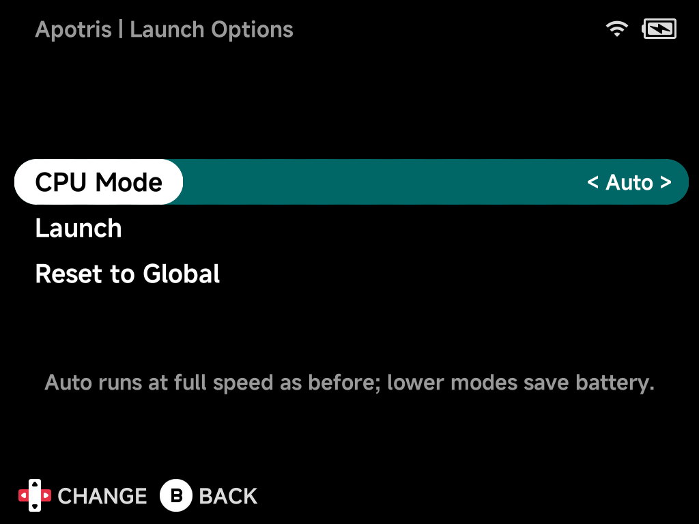

# Launch Options

**Launch Options** set how much of the hardware a game gets: CPU cores, CPU
speed and GPU speed. Lower settings save battery on light games. The highest
settings keep heavy ones smooth. Each game remembers its own choice.

Launch Options are available for [PortMaster](../apps/portmaster.md) ports.

## Opening Launch Options

1. Highlight a port in **Ports** (or on [Home](main-menu.md#home)) and press
   `MENU` to open its [context menu](context-menu.md).
2. Choose **Launch Options**.
3. Change the settings with `LEFT`/`RIGHT` (or `A`).
4. Choose **Launch** to start the game with these settings. Or press `B` to save them and go back to the list.

The game keeps the settings. Launching it later with `A` uses them too, so
you only need this page when you want to change something.

## The settings

| Setting | Choices | Devices |
| --- | --- | --- |
| **CPU Cores** | Auto, 2 Little, 4 Little, 4 Little + 2 Big, All 8 | Smart Pro S only |
| **CPU Mode** | Auto, Powersave, Normal, Performance | All devices |
| **GPU Mode** | Auto, Powersave, Performance | Smart Pro S only |

- **CPU Cores** (Smart Pro S): **4 Little** turns the fast *big* cores off,
  the biggest battery saving and plenty for most 2D games. **2 Little** is for
  very light games, **4 Little + 2 Big** for games that need a little more,
  **All 8** turns every core on.
- **CPU Mode**: **Powersave**, **Normal** and **Performance** each hold the CPU
  at one fixed speed, the same speeds as the in-game CPU Speed option.
- **GPU Mode** (Smart Pro S): **Powersave** lets the graphics chip slow down
  when the game doesn't need it. **Performance** keeps it at full speed.
- **Auto** keeps what ports have always used, so nothing changes until you
  pick something else.

??? info "More detail: speeds and Auto"
    | Device | Auto |
    | --- | --- |
    | Brick, Brick Pro | CPU held at full speed (2000 MHz) |
    | Smart Pro S | All 8 cores on, CPU speed follows the load, GPU at full speed |

    | CPU Mode | Brick, Brick Pro | Smart Pro S |
    | --- | --- | --- |
    | Powersave | 1200 MHz | 1200 MHz |
    | Normal | 1608 MHz | 1680 MHz |
    | Performance | 2000 MHz | 2160 MHz |

    - On the Brick and Brick Pro, **Performance** is the same as **Auto**.
    - The little cores on the Smart Pro S top out at 1416 MHz. With
      **4 Little** or **2 Little**, Normal and Performance both run at that
      speed.
    - GPU Mode **Auto** is the same as **Performance**.

!!! tip "Finding the right setting"
    Start with **4 Little** and **Powersave** on a light game. If it slows
    down or stutters, raise CPU Mode first, then add cores. Games built on
    Godot, Mono or GameMaker use several threads and may stutter on
    **2 Little**.

## A default for every port

To change the starting point for all ports, open
**Tools → [Emulator Settings](../apps/emulator-settings.md)** and choose
**Ports (Launch Options)**. A port uses these settings until you give it
its own. Settings you've made for a single game always win over them.

## Reset to Global

**Reset to Global** at the bottom of the page puts a game's settings back to
the default for all ports. Settings that differ from that default are marked
with `*`.

??? info "More detail"
    - **Where it's saved.** The settings for all ports are in
      `.userdata/<platform>/PORTS-launch/launch.ini`. A game's own settings
      are in `<script name>.ini` in the same folder, for example
      `Apotris.sh.ini`. That file holds only the settings that differ from
      the default, and **Reset to Global** deletes it.
    - **When it applies.** The Ports launcher sets the cores and speeds just
      before the game starts. When you quit, the device goes back to its
      normal menu settings, and the next game or emulator starts fresh.
    - **Ports that set their own speed.** A few port scripts change the CPU
      speed themselves. For those, the port's own setting wins.
    - **No in-game menu.** Ports don't have NX Redux's in-game menu, so
      change these settings from the context menu before launching.
