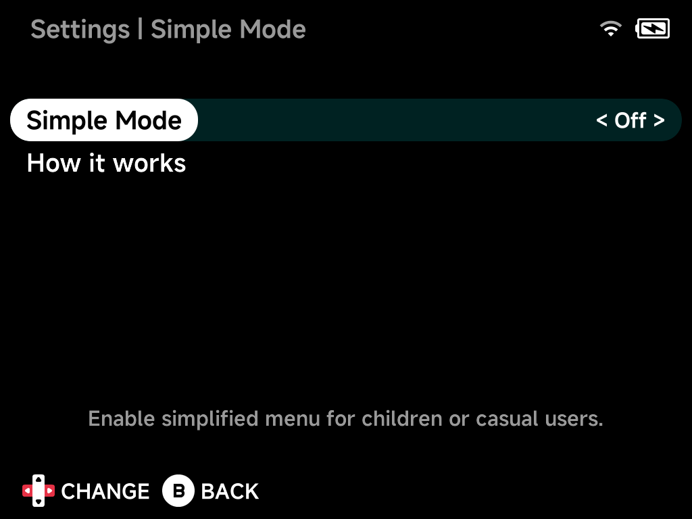

# Simple Mode

Simple Mode is a simplified menu for children or casual users, enabled in
**Settings → Simple Mode**.

When Simple Mode is on:

- The **Tools** tab lists only **Settings**, whatever the
  [Tools tab](../settings/layouts.md#tab)
  setting says.
- **Settings** is protected by a 4-digit PIN that you set when enabling
  Simple Mode. Only you can turn it back off.
- Games and tools can't be pinned or unpinned, and collections can't be
  renamed or deleted, so a curated [Home](main-menu.md#home) stays as you set
  it up.
- A game's **MENU** has no **Delete Rom**, **Rename Rom**, **Add to
  Collection**, **Emulator Options**, **Launch Options** or **Fetch
  Artwork**, so games and their settings stay as you left them.
- In-game, **Options** is replaced with **Reset**, so there are no settings to
  wander into mid-game.
- The F1 / F2 tool keys do nothing, and **Settings** hides
  **Emulator Shortcuts** and **F1 / F2 keys**.

!!! question "Forgot the PIN?"
    Delete `.userdata/shared/enable-simple-mode` from the SD card (from a
    computer) to turn Simple Mode off.
