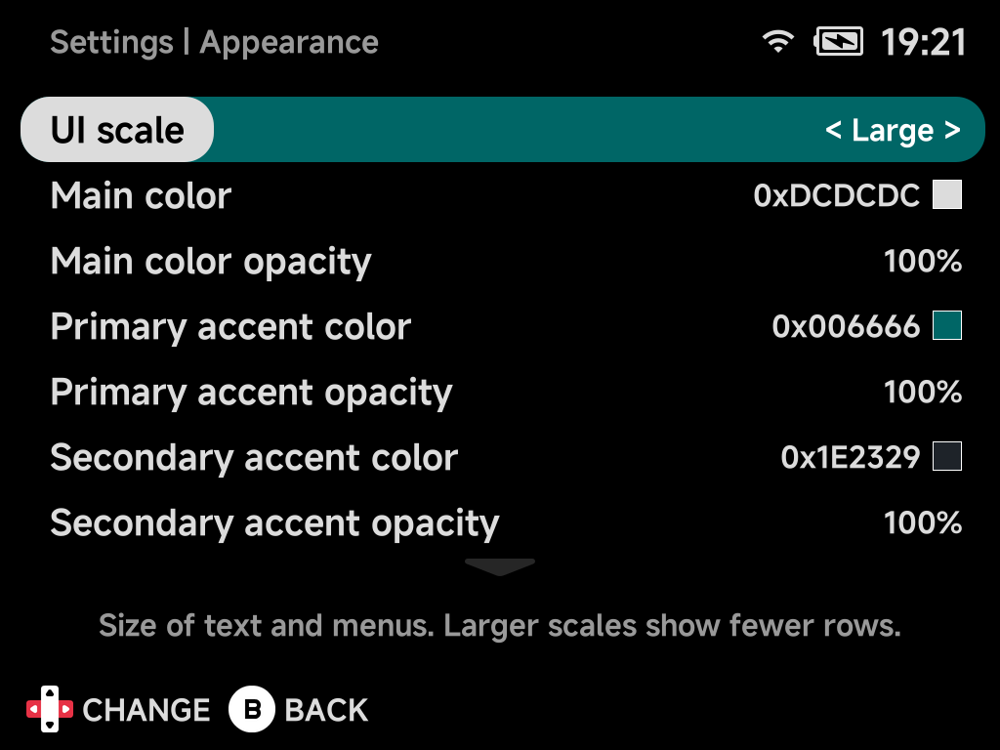
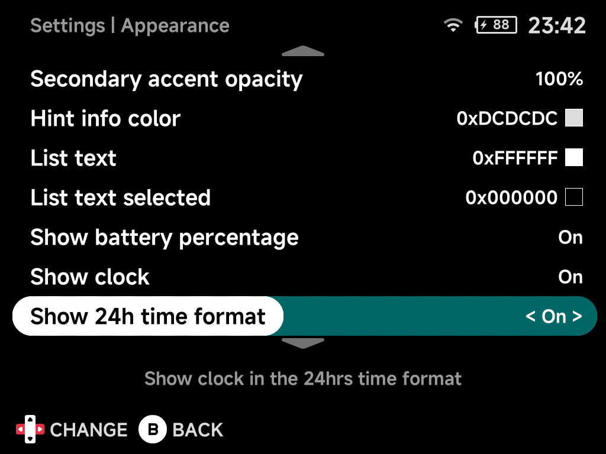
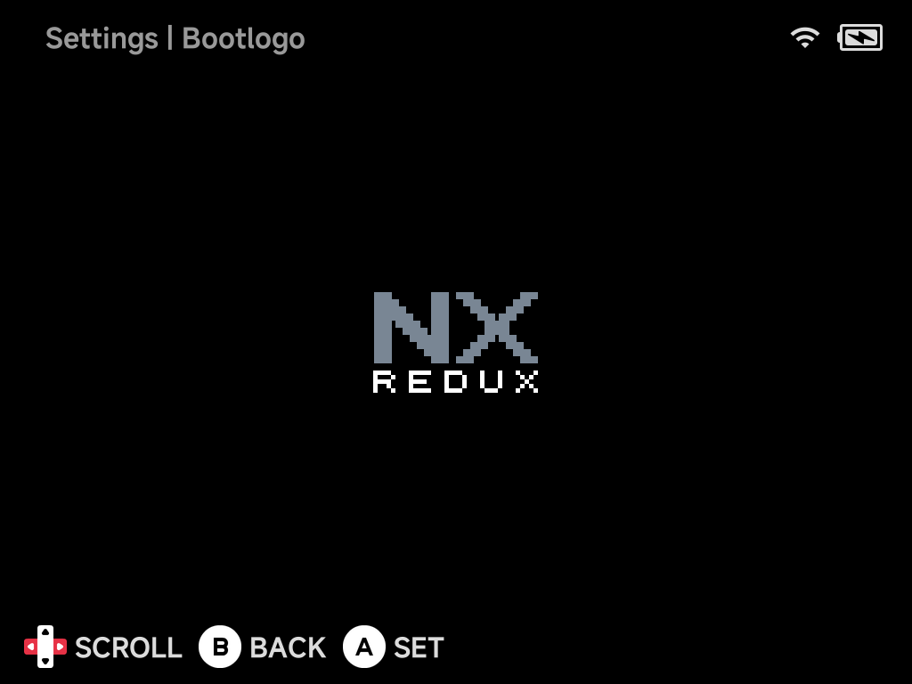

# Appearance

Change how the interface looks: colors, the status pill, button hints,
animations and the boot logo. Menu styles live in [Layouts](layouts.md).

Text and menus are sized for each device's screen, so there is no UI scale
setting.

## Colors

Each color row cycles through a palette with a live swatch beside the value.

| Setting | What it colors |
| --- | --- |
| **Main color** | Main UI elements |
| **Primary accent color** | Highlights, such as the selection |
| **Secondary accent color** | Secondary highlights |
| **Hint info color** | Button hints and info text |
| **List text** | List text |
| **List text selected** | The selected list entry's text |

The main, primary accent and secondary accent colors each have an
**opacity** row below them, `100%` down to `10%` in 10% steps. Below `100%`
those elements turn translucent and show the wallpaper (`bg.png` at the SD
card root) through them.

## Show battery percentage

Show the battery level as a percentage in the status pill. Off by default.

## Show clock

Show the clock in the status pill. Off by default.

## Show 24h time format

Show the clock in 24-hour format. On by default.

## Show search hint

Show or hide the `START` search button hint on the main menu tabs. Hiding it
only removes the hint: pressing `START` on a tab still opens search.

## Show recent hint

Show or hide the `SELECT` recent games button hint on the main menu. Hiding it
only removes the hint: pressing `SELECT` still opens the
[Game Switcher](../guide/game-switcher.md).

## Show netplay hint

Show or hide the `Y` netplay button hint in game lists and search results.
Hiding it only removes the hint: pressing `Y` on a game that supports netplay
still opens the netplay menu.

## Show menu animations

Enable or disable menu animations.

## Show menu transitions

Enable or disable the animated slide transitions between screens.

## Bootlogo

Change the device boot logo.

1. Scroll through the images with left/right.
2. Press `A` to apply one. The device reboots to show it.

The NX Redux mark is the default logo. The previous NextUI logo is still in
the list.

## Reset to defaults

Resets all options on this page to their default values. The
[Layouts](layouts.md) page has its own reset.

??? info "Options that moved or were removed"
    The main menu redesign replaced several older options:

    | Old option | Now |
    | --- | --- |
    | **Show Emulators**, **Show Collections**, **Show Tools** | **Consoles tab**, **Collections tab**, **Tools tab** in [Layouts](layouts.md) |
    | **Show Recents** | Removed. Your last game is Home's Continue card, and the [Game Switcher](../guide/game-switcher.md) lists the rest. |
    | **Game art visible / style / type / width / corner radius**, **Use folder background for ROMs** | Removed. Each [layout](../guide/layouts.md) places the art itself. |
    | **Show folder names at root** | Removed. Names always show. |
    | **Show clock**, **Show 24h time format** (were in [System](system.md)) | Here, under [Show battery percentage](#show-battery-percentage). Your existing choices carry over. |
