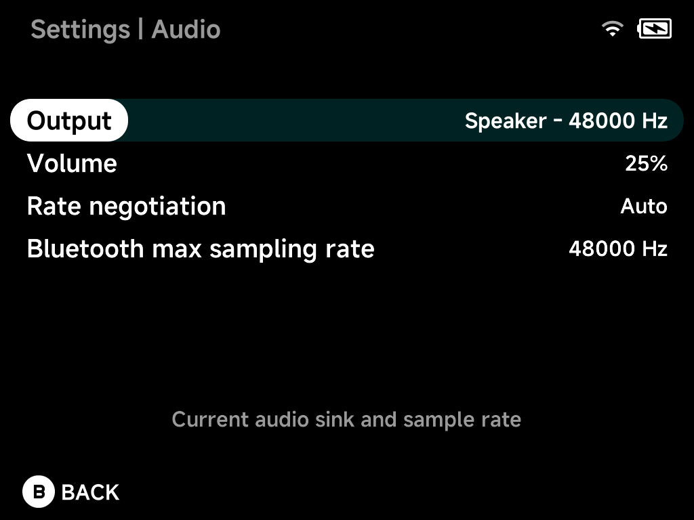

# Audio

Sound output and sample rates. Audio follows whatever output is active: the
speaker, a Bluetooth device or a USB-C DAC. Plugging in a DAC or connecting
Bluetooth mid-playback switches over automatically, and a headphone icon
shows in the status bar while an external output is active.

## Output

The current audio output and its sample rate, live. For example
`Speaker – 48000 Hz`, or your DAC or Bluetooth device when connected.

## Volume

Speaker volume, `Muted` or `5%`–`100%`.

## Rate negotiation

`Auto` (default) matches the active output's preferred sample rate.
`Force 48000 Hz` is the fallback if a device misbehaves.

## Bluetooth max sampling rate

Caps the sample rate used for Bluetooth audio: `44100 Hz` or `48000 Hz`.

??? info "More detail"
    With `Auto`, NX Redux negotiates the rate with the active output: 48 kHz
    on the speaker, the negotiated Bluetooth rate, or a rate the USB DAC
    supports. It resamples in the app at high quality instead of letting the
    system resample silently at low quality.
