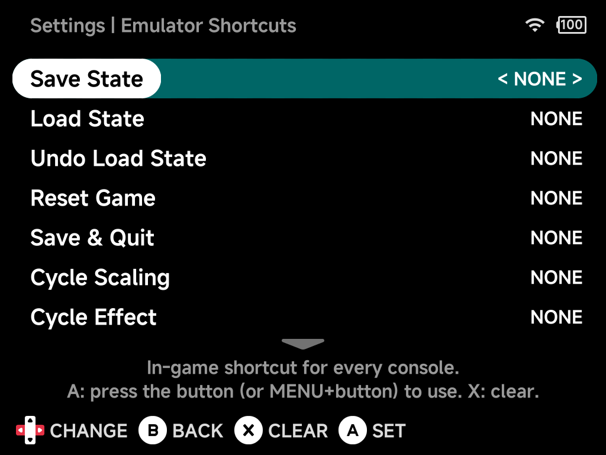
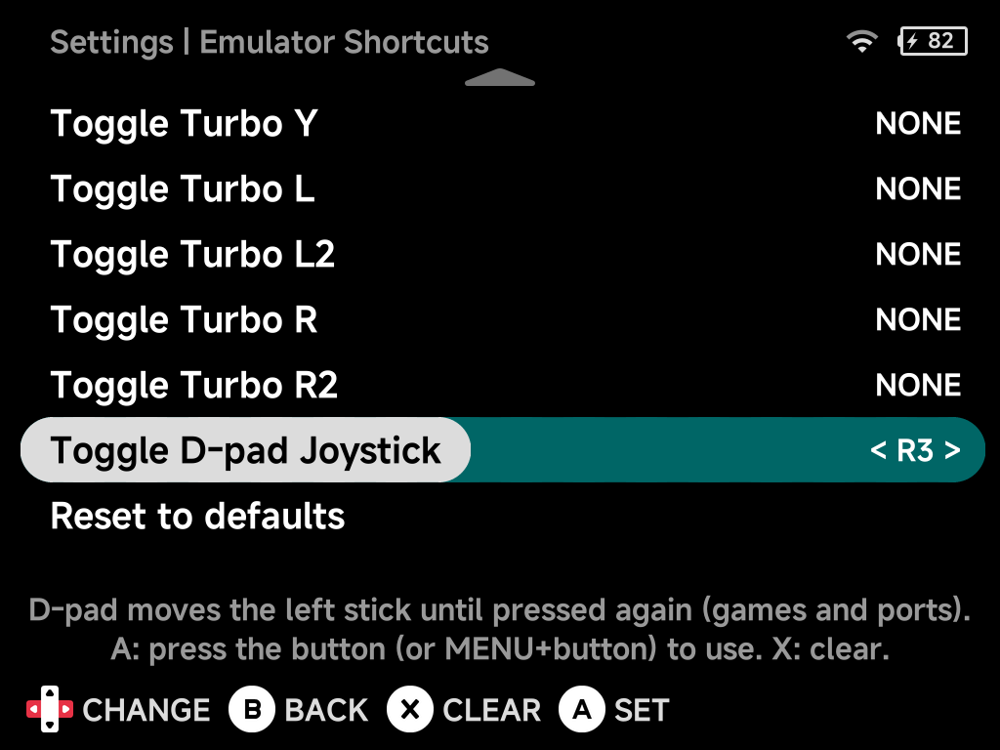

# Emulator Shortcuts

Hotkeys for actions during play: save states, fast-forward, rewind, turbo
and more. All are unbound (`NONE`) by default.

Shortcuts are global. One set applies to every console and every game on the
device, so fast-forward bound once works everywhere. A console or game can
still use a different button for any of them: set it in the game's
[Options → Shortcuts](../guide/in-game-options.md#shortcuts). The page is
hidden in [Simple Mode](simple-mode.md).

!!! warning "Upgrading from an older version?"
    Shortcuts you saved for a console or game in the in-game menu before
    v2.2.0 work again as that console's or game's own shortcuts, unless you
    have saved its options since. Set the ones you want everywhere here.

## Binding a shortcut

- Press `A` on a shortcut, then press the button you want to use, or hold
  `MENU` and press a button for a `MENU` + button combination. You have 5
  seconds; `B` cancels.
- `LEFT` / `RIGHT` steps through the buttons instead.
- Press `X` to clear a shortcut (`NONE`).

Prefer `MENU` + button combinations: a shortcut on a plain button the game
also uses does both, while a `MENU` + button shortcut doesn't press that
button in the game.

??? info "More detail"
    - `MENU` + `SELECT` can't be bound. It always opens the
      [Game Switcher](../guide/game-switcher.md).
    - On the Famicom Disk System, `L1` and `R1` are the
      [disk buttons](../emulators/other-systems.md#flipping-disk-sides), so
      avoid binding them on their own.

## Shortcuts

| Shortcut | Action |
| --- | --- |
| **Save State** / **Load State** | Save to / load from the current save state slot. |
| **Undo Load State** | Go back to where you were before the last Load State. |
| **Reset Game** | Restart the game. |
| **Save & Quit** | Save and exit the game. |
| **Cycle Scaling** | Step through the Screen Scaling modes. |
| **Cycle Effect** | Step through the Screen Effect modes. |
| **Toggle FF** / **Hold FF** | Fast-forward: toggle on/off, or only while held. |
| **Toggle Rewind** / **Hold Rewind** | Rewind: toggle on/off, or only while held. Needs [Rewind](../guide/in-game-options.md#frontend) turned on. |
| **Game Switcher** | Open the [Game Switcher](../guide/game-switcher.md). |
| **Screenshot** | Take a screenshot. |
| **Toggle Turbo A / B / X / Y / L / L2 / R / R2** | Turn turbo (rapid fire) on or off for that button. |
| **Toggle D-pad Joystick** | Make the D-pad drive the left analog stick, until you press it again. |

## Toggle D-pad Joystick

For games that expect an analog stick on a device without one, such as
[Nintendo 64](../emulators/nintendo-64.md) or [PSP](../emulators/psp.md)
games on the Brick. While it's on, the D-pad moves the left stick instead of
pressing the D-pad. A notification shows **D-pad: Joystick** or **D-pad:
D-pad** each time you press it.

It is off every time a game starts.

## Reset to defaults

Clears every shortcut.
