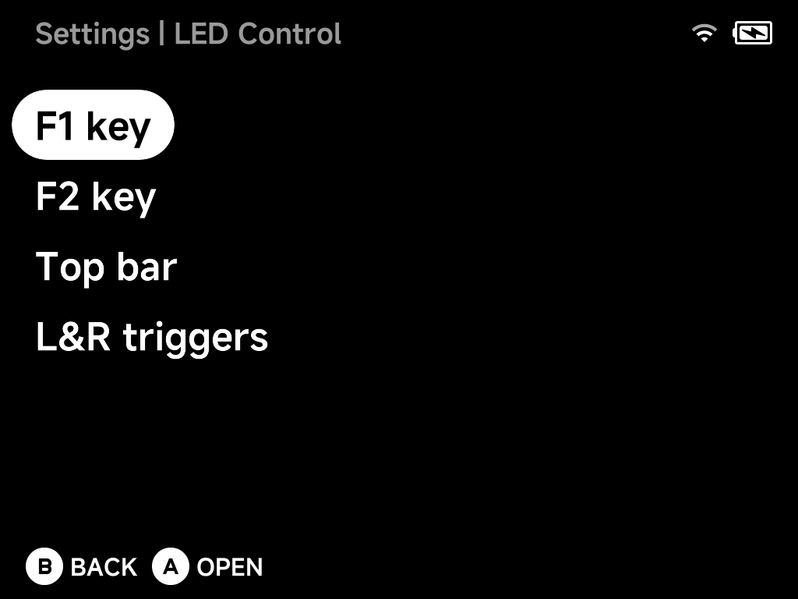
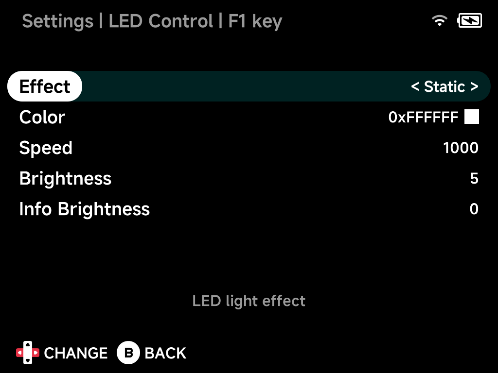

# LED Control

Set the lighting for each LED zone. Pick a zone to configure it; every zone
offers the same options below. Quick LED on/off lives in the
[OSD](../guide/osd.md).

| Device | Zones |
| --- | --- |
| Brick | **F1 key**, **F2 key**, **Top bar**, **L&R triggers** |
| Brick Pro | **F1 key**, **F2 key**, **Top bar**, **Joysticks**, **L&R triggers** |
| Smart Pro S | **Joystick L**, **Joystick R**, **Logo** |

Opening a zone shows its options — here the F1 key:

## Effect

The lighting effect for the zone: Linear, Breathe, Interval Breathe,
Static or Blink 1–3. These are the effects the device's LED hardware
supports.

## Color

The LED color, chosen from the color palette.

## Speed

Animation speed of the chosen effect.

## Brightness

LED brightness level. On the Brick and Brick Pro it is per zone; on other
devices the row reads **Brightness (All LEDs)** and sets every zone.

## Info Brightness

LED brightness used for status lighting — charging and low battery. Like
Brightness, it is per zone on the Brick and Brick Pro only.
