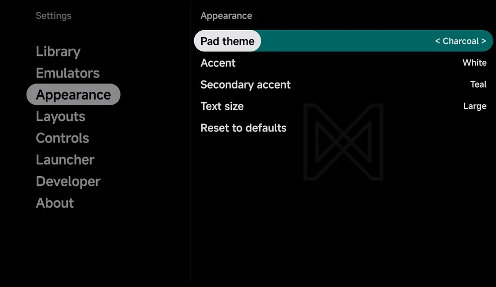
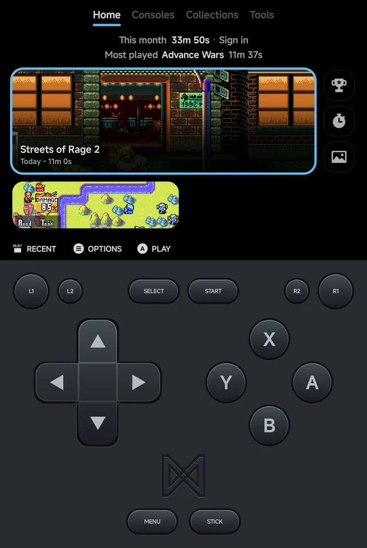

# Appearance

**Tools → Settings → Appearance** sets the look of the app: the on-screen
pad, the text size and the colours. The menu styles have their own category,
[Layouts](layouts.md).

- `Right` and `A` step the highlighted row to its next value, and `Left` to
  the previous one.
- With touch alone, a tap on **Accent** or **Secondary accent** opens a
  dropdown of the colours (see [Settings](settings.md)).

| Setting | What it does | Values | Default |
| --- | --- | --- | --- |
| [**Pad theme**](#pad-theme) | Colours of the portrait pad | Charcoal, Retro | Charcoal |
| [**Accent**](#accent) | The selection colour | White, Red, Orange, Amber, Lime, Teal, Sky, Violet, Pink | White |
| [**Secondary accent**](#secondary-accent) | The bar behind a selected value | Auto, then the same nine colours | Teal |
| [**Text size**](#text-size) | Size of the text across the app | Large, Small | Large |
| [**Reset to defaults**](#reset-to-defaults) | Puts this page back to its defaults | | |

## Pad theme

The colours of the on-screen pad in portrait, in the menus and in games.

- **Charcoal** (default): the dark pad.
- **Retro**: a light grey body with magenta face buttons.

The landscape button clusters always stay Charcoal. See
[Controls](controls.md) for the pad itself.

??? info "More detail"
    The landscape clusters' opacity is set per game or console with **Pad
    Opacity (landscape)** in the in-game [Frontend](in-game-menu.md#frontend)
    options, not here.

## Accent

The selection colour: the highlight on the selected row, tile or card, and
the line under the current tab. It also colours Home's **Pick a game**
picture and the in-game menu.

There are nine colours: **White** (default), **Red**, **Orange**, **Amber**,
**Lime**, **Teal**, **Sky**, **Violet** and **Pink**.

*Home with the Sky accent*

## Secondary accent

The colour of the bar behind a selected setting's value, as in
**< Charcoal >** above. It shows on the Settings pages, a game's
[Game Settings](emulator-settings.md) and the
[in-game menu](in-game-menu.md).

- **Teal** is the default.
- **Auto** uses a darker shade of the Accent. With the White accent, Auto
  gives Teal.
- The nine Accent colours can be picked here too.

## Text size

The size of the text across the app.

- **Large** (default).
- **Small**: three quarters of the size, with more rows per screen.

The text also follows Android's own font size setting.
[First-run setup](getting-started.md) asks for the text size before anything
else.

??? info "More detail"
    - It sizes every list, the Settings pages and the in-game menu included,
      with the page titles, the tab names and the hint bar. It also sizes the
      game names and stats in the game lists' Carousel, Backdrop and Grid,
      Home's cards and stats strip, the RetroAchievements lists and the
      achievements panel, the dropdowns and the dialogs. The on-screen pad's
      labels keep their size.
    - Android's font size is held between 85% and 130%, so a very small or
      very large system font does not crowd the screens. Text on fixed
      shapes, such as the pad's labels, the tab names and the hint bar, keeps
      its size there.

## Reset to defaults

Puts **Pad theme**, **Accent**, **Secondary accent** and **Text size** back to
their defaults. It does not ask first. It leaves the [Layouts](layouts.md)
page alone: that page has its own **Reset to defaults**.
