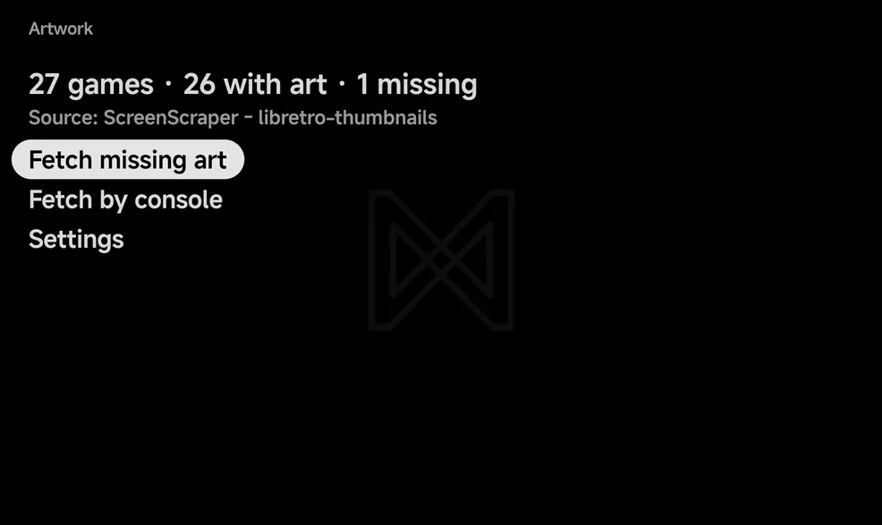
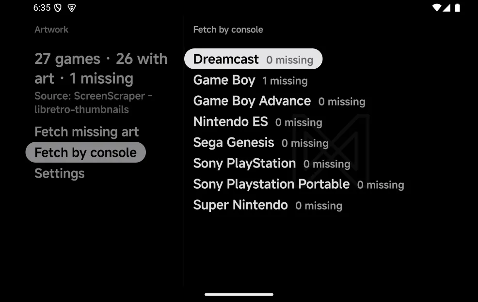
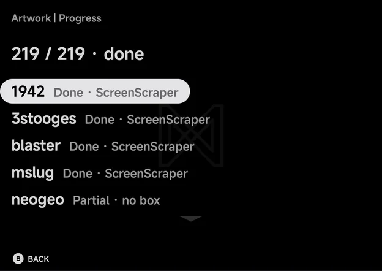
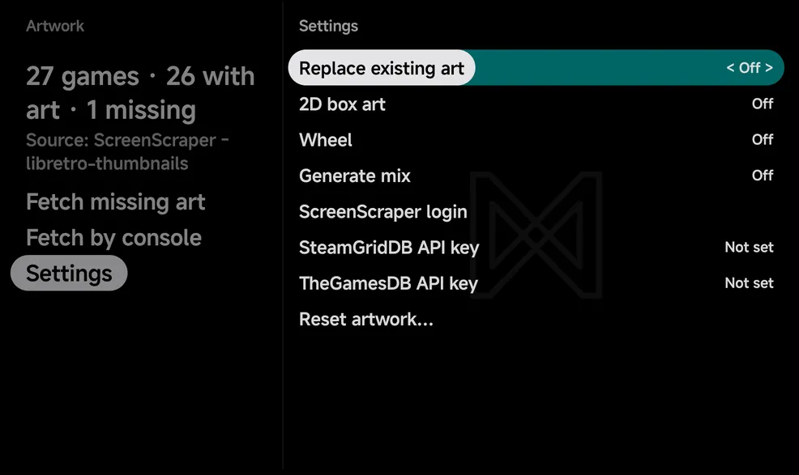

# Artwork

**Tools → Artwork** fetches box art and screenshots for your games. It works
through your whole library in the background, and you can keep playing while
it runs.

{ .nx-wide }

The page opens with your counts, such as **217 games · 148 with art · 69
missing**, and these rows:

| Row | What it does |
| --- | --- |
| **Resume art fetch (d/t)** | Carries on a paused fetch. Only shown while one is paused. |
| **Fetch missing art** | Fetches art for every game that has none. Reads **Fetch all art** when **Replace existing art** is on. |
| **Fetch by console** | Fetches art for one console. |
| **Progress** | Shows the current or last fetch. Only shown once a fetch has run, until you choose **Done** there. |
| **Settings** | What to fetch, your ScreenScraper login, the SteamGridDB and TheGamesDB keys, and **Reset artwork**. See [Settings](#settings). |

??? info "More detail"

    - While a fetch runs or is paused, a line shows how far it is, and a
      source that stopped gets a note. The last line names the sources in
      use, such as **Source: ScreenScraper - libretro-thumbnails**.
    - Unassigned games, and folders whose tag no art source knows, are left
      out of the counts and are never fetched.

## Where the art comes from

The app asks several sources in turn and stops as soon as a game has what it
needs. A game is only asked for what it lacks.

- **libretro-thumbnails** and **ScreenScraper** work with nothing from you.
- A free ScreenScraper account goes much further, and **SteamGridDB** and
  **TheGamesDB** are only used with your own free API key. See
  [Accounts and keys](#accounts-and-keys).

??? info "More detail: the order of sources"

    | Art | Sources, in order |
    | --- | --- |
    | **Box art** | ScreenScraper 3D box, ScreenScraper 2D cover, libretro-thumbnails, TheGamesDB, then a SteamGridDB grid |
    | **Screenshot** | ScreenScraper, libretro-thumbnails, then TheGamesDB |
    | **2D box art** (optional) | ScreenScraper, libretro-thumbnails, then TheGamesDB |
    | **Wheel** (optional) | ScreenScraper, SteamGridDB, then TheGamesDB |

    - A game with box art and a screenshot is skipped, unless **Replace
      existing art** is on.
    - When no source has a screenshot, SteamGridDB stands in: a wide **hero**
      image for landscape backgrounds, and a tall **grid** image for portrait
      ones.
    - 2D box art and the wheel are only fetched when you turn them on in
      [Settings](#settings).
    - When a source runs out of requests or stops answering, the fetch carries
      on with the others. The Artwork page shows a note for the source that
      stopped.

## Fetching art

### The whole library or one console

Choose **Fetch missing art** for everything, or **Fetch by console** to pick
one. Fetch by console lists each console with how many of its games lack
art, such as **Dreamcast 6 missing**. Press `A` **Fetch** on one.

{ .nx-wide }

First-run setup can start the same fetch for you. See
[Getting Started](getting-started.md).

??? info "More detail"

    - If there is nothing to fetch, the app says **Every game has art**, or
      **Every *console* game has art** for one console.
    - In first-run setup, the **Fetch artwork** step's **Fetch now** starts
      **Fetch missing art** in the background, or **Fetch all art** with
      **Replace existing art** on.

### Progress

Starting a fetch opens **Progress**. It shows how far it is and the time
left, such as **1 / 2 · ~1 min left**, and each game's status, such as
**Done**, **Partial** or **Not found**.

{ .nx-wide }

| Button | What it does |
| --- | --- |
| `Y` **Pause** / **Resume** | Pauses the fetch, or carries it on |
| `X` **Cancel** | Asks **Cancel art fetch?** Games already fetched keep their art. **Stop** ends the fetch. |
| `A` **Done** | Once the fetch has ended: clears it, and the **Progress** row with it |
| `B` **Back** | Leaves the page. The fetch keeps running. |

On touch, **Pause**, **Cancel** and **Done** are buttons above the list.

??? info "More detail: what each status means"

    The first line can also read **paused**, **done** or **cancelled**. The
    second line counts what the games came to so far, such as **12 fetched ·
    2 partial · 3 not found**.

    | Status | Meaning |
    | --- | --- |
    | **Waiting** | Queued |
    | **Searching** / **Downloading** | Being fetched now |
    | **Done** | Box art and a screenshot were found, followed by the sources used. It adds **no screenshot** when a SteamGridDB hero stands in for the screenshot |
    | **Partial** | Only part was found, followed by **no box**, **no screenshot** or, with **Generate mix** on, **no mix** |
    | **Not found** | No source had art for it |
    | **Skipped** | It already has art, or no source covers its console |
    | **Error** | Something went wrong, followed by the reason |

    Once a fetch has ended, the list keeps only the games to look at: those
    **Not found** and those with an **Error**. The second line counts the
    rest, and with a cancelled fetch, the games **not fetched**.

### In the background

A fetch keeps running when you leave the page, start a game or switch to
another app, with a **Fetching artwork** notification. Art shows up in the
menus as each game finishes. There is no need to rescan.

A paused fetch is kept, even after the app closes. **Resume art fetch (d/t)**
on the Artwork page carries on from where it stopped.

??? info "More detail"

    - The notification has **Pause** and **Cancel** buttons.
    - Android asks once whether the app may show notifications. If you say no,
      the fetch still runs, just without the notification.
    - A fetch pauses by itself when the connection drops, or when it cannot
      write to your home folder.

### On a wide screen

In landscape on a wide screen, such as an unfolded Fold, the pages below
Artwork open beside it. See
[Foldables & Large Screens](foldables.md#two-pane-screens).

??? info "More detail"

    The Artwork page stays on the left, dimmed, with the row you opened lit.
    Tap a row there to open it instead. **Reset artwork** opens beside
    **Settings** the same way.

### One game

Open a game's context menu with `MENU` in a game list, and choose **Fetch
art**. The app fetches that game straight away. `B` cancels. See
[Context menus](main-menu.md#context-menus) for the rest of the menu.

??? info "More detail"

    - While it works, **Fetching art…** shows. It then says **Art fetched**,
      **No art found**, or **Already has art (Replace existing art is off)**.
    - **Fetch art** is only offered for games in a console an art source
      knows, and only when the game's art is incomplete or **Replace existing
      art** is on.

## Settings

**Artwork → Settings** holds what to fetch, your accounts and keys, and
Reset artwork, on one page, in groups: **Art to fetch**, **Accounts**, then
**Reset artwork**. Its rows work like [Settings](settings.md#buttons): the
On/Off rows are switches, and the ? icon or `X` **Info** shows a row's full
description.

{ .nx-wide }

| Row | Default | What it does |
| --- | --- | --- |
| **Replace existing art** | Off | Fetch art again for games that already have it. **Fetch missing art** then reads **Fetch all art**. |
| **2D box art** | Off | Also fetch the flat 2D cover, beside the 3D box. |
| **Wheel** | Off | Also fetch the game's logo. Locked **On** while **Generate mix** is on. |
| **Generate mix** | Off | Make the handheld's mix picture on the phone. See [Wheel and mix](#wheel-and-mix). |
| **ScreenScraper login** / **ScreenScraper logout** | — | Log in to ScreenScraper, or log out. |
| **SteamGridDB API key** | Not set | `A` asks for the key. |
| **TheGamesDB API key** | Not set | `A` asks for the key. |
| **Reset artwork** | — | Delete art the app fetched. See [Reset artwork](#reset-artwork). |

??? info "More detail"

    - `A`, `LEFT` / `RIGHT` or a tap on the row switch the On/Off rows.
    - While **Generate mix** is on, **Wheel** is dimmed and reads **Needed by
      Generate mix**.
    - Once logged in, the ScreenScraper row shows today's requests under its
      name, such as `312 / 20,000 today`.
    - The key rows read **Set** or **Not set**. **Remove SteamGridDB key** and
      **Remove TheGamesDB key** show once a key is set.
    - Once your TheGamesDB key is set, a **TheGamesDB** row shows the requests
      left under its name, such as `896 left this month`.

### Accounts and keys

| Source | What you need |
| --- | --- |
| **ScreenScraper** | Works without an account, on a shared allowance. A free [ScreenScraper](https://www.screenscraper.fr/) account gives you your own daily allowance, which goes much further. |
| **SteamGridDB** | Only used with your own free key from [SteamGridDB](https://www.steamgriddb.com/). |
| **TheGamesDB** | Only used with your own free key from [TheGamesDB](https://thegamesdb.net/). |

Choose **ScreenScraper login** to sign in, or a key row to enter a key.

??? info "More detail"

    - **ScreenScraper login** opens **Sign in to ScreenScraper**. Once you are
      in, the row reads **ScreenScraper logout** with your requests used
      today. Logout asks first: fetches then use the anonymous allowance
      again.
    - A key is checked before it is saved. If the source turns it down, the
      app says so and does not save it.
    - Login and logout are dimmed while art is downloading.

### Reset artwork

**Reset artwork** opens a list: **All**, then each console. Pick one, and
the app asks **Delete fetched art for *console*? Art you added yourself is
kept.** **Delete** removes it and says how many files went.

Only art the app fetched itself is deleted. Images you put in the folders
yourself stay.

??? info "More detail"

    A fetch running for the same games is paused first.

### Wheel and mix

The NX Redux handheld shows a game's **wheel** (its logo) and a **mix**: one
picture of the screenshot, the box and the wheel. The app can make both, so a
card shared with a handheld has them ready. The app itself doesn't show
either yet.

??? info "More detail"

    - The mix is 384 × 288.
    - **Generate mix** makes the mix on the phone, the way the handheld's
      [Artwork Manager](../handheld/apps/artwork-manager.md) does. It needs
      the wheel, so **Wheel** stays on with it.
    - A game needs a screenshot or a box for its mix. A wheel alone makes
      none.
    - With **Generate mix** on, a game counts as missing art until it has its
      mix. When a later fetch brings a new screenshot, box or wheel, the mix
      is made again.

## Where art is kept

Fetched art goes in the `.media` folder next to the games, one folder per
kind of image, named after the game's file:

```
Roms/Game Boy Advance (GBA)/Golden Sun.gba
Roms/Game Boy Advance (GBA)/.media/boxart/Golden Sun.png
Roms/Game Boy Advance (GBA)/.media/screenshot/Golden Sun.png
```

- **Your own art:** put images in the same folders by hand. The app picks
  them up when you come back to it or open **Artwork**, and notices art you
  delete the same way.
- **Art from the handheld:** the `.media/` folders made by the handheld's
  [Artwork Manager](../handheld/apps/artwork-manager.md) work here too.

??? info "More detail: folders and special cases"

    | Folder | Image |
    | --- | --- |
    | `.media/boxart/` | 3D box art |
    | `.media/boxart2d/` | Flat 2D cover. An older `.media/box2d/` folder is still read. |
    | `.media/screenshot/` | In-game screenshot |
    | `.media/grid/` | SteamGridDB grid (tall cover) |
    | `.media/hero/` | SteamGridDB hero (wide banner) |
    | `.media/wheel/` | The game's logo, with **Wheel** on |
    | `.media/mix/` | The mix, with **Generate mix** on |

    - Each image is named after the game's file without its extension, as a
      `.png` or `.jpg`. The app uses your own images like fetched art.
    - The handheld's old untyped mix image (`.media/<game>.png`) is ignored.
    - **Multi-disc games** kept in their own folder: the art goes in the
      `.media` of the folder above it, named after the game's folder.
    - **Extra ROM folders:** the app writes only inside your home folder. Art
      it fetches for a game in an extra folder goes in
      `Roms/.sources/<id>/<folder>/.media/` in your home folder. A `.media`
      folder you keep next to the games in the extra folder is still read,
      and its images win.

## Where each image shows

Game tiles and list backgrounds show the screenshot. The box in Backdrop, and
the [Game Switcher](game-switcher.md) for a game with no resume screenshot,
show the box art. When an image is missing, the app falls back to another one.

??? info "More detail: every place and its fallbacks"

    | Place | What it shows |
    | --- | --- |
    | **Grid and Carousel tiles**, Home's pinned games | The screenshot. Without one, the SteamGridDB hero on a wide tile or the grid on a tall one. |
    | **Game list backgrounds** (List and Backdrop) | The screenshot. Without one, the hero in landscape or the grid in portrait. |
    | **The box** in Backdrop | The 3D box art. Without it, the 2D cover, then the grid, drawn in a case. Without any, an empty case. |
    | **The [Game Switcher](game-switcher.md)**, when a game has no resume screenshot | The 3D box art, then the 2D cover or the grid in a case. Without any, **No Preview**. |
    | **Home's Continue card** | The game's last frame, then the screenshot, the hero, then the grid |
    | **[RetroAchievements](retroachievements.md)** game list | The screenshot, then the 3D box art, then the 2D cover |
    | **[Game Tracker](game-tracker.md)** | The 3D box art, then the 2D cover, then the screenshot |

### Abstract art

A game with nothing to show gets generated abstract art: a soft gradient
with a few large shapes. It does not count as art, so the game still shows as
missing and is still fetched.

??? info "More detail"

    It is the same for the same game every time, and fills any place above
    that has no real image.

### Android games

Games in the Android console get their art here too, through **Fetch
missing art** or **Fetch by console → Android**. Only a screenshot is
fetched. See [Android games](launcher.md#android-games) for adding them.

??? info "More detail"

    - The screenshot comes from ScreenScraper only.
    - It is kept inside the app's own storage, not in your home folder.
    - Until it has one, an Android game shows abstract art in its icon's
      colours, with the icon in the middle.

## Credits

Art comes from these sources. The Artwork page's last line names the ones in
use, such as **Source: ScreenScraper - libretro-thumbnails - TheGamesDB**.

- [ScreenScraper](https://www.screenscraper.fr/): box art, screenshots and
  wheels
- [libretro-thumbnails](https://github.com/libretro-thumbnails/libretro-thumbnails):
  box art and screenshots, from the libretro project
- [TheGamesDB](https://thegamesdb.net/): box art, screenshots and logos
- [SteamGridDB](https://www.steamgriddb.com/): grid, hero and logo images
