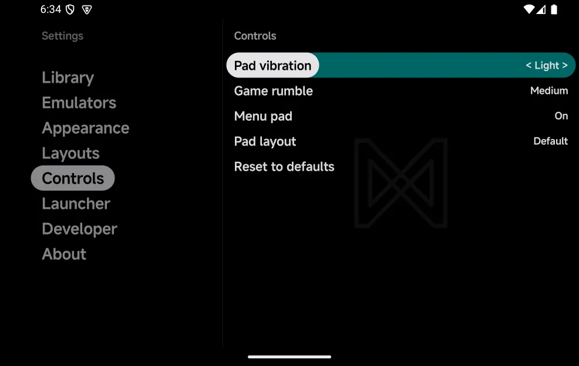
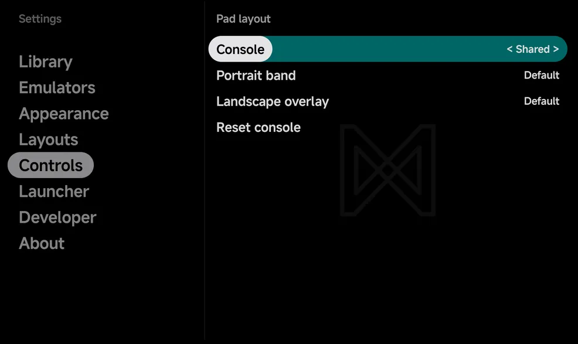

# Controls settings

**Tools → Settings → Controls** sets how strong the vibration is, whether the
main menu has the on-screen pad, and where the pad's buttons sit. The rows
work as on every [Settings](settings.md#buttons) page: `Left` / `Right` step
a value, and `A` or a tap flips a switch or picks a choice.

| Setting | What it does | Values | Default |
| --- | --- | --- | --- |
| [**Pad vibration**](#pad-vibration) | Tick when you press the on-screen pad | Off, Light, Medium, Strong | Light |
| [**Game rumble**](#game-rumble) | Strength of the game's own rumble | Off, Light, Medium, Strong | Medium |
| [**Menu pad**](#menu-pad) | On-screen pad below the main menu | On, Off | On |
| [**Pad layout**](#pad-layout) | Move and resize the pad's buttons | Default, Custom | Default |
| [**Reset to defaults**](#reset-to-defaults) | Puts this page back to its defaults | | |

{ .nx-wide }

## Pad vibration

A short tick when you press the on-screen pad. A controller never makes the
phone tick. It also follows Android's touch feedback setting: with that off,
the pad stays silent whatever you pick here.

When it ticks: see [Controls → Pad vibration](controls.md#pad-vibration).

## Game rumble

The game's own rumble, on the controller you play with when it has a motor,
else on the phone. Changing the level plays a short pulse at that strength,
so you can feel it. **Off** plays none. In a
[multiplayer](multiplayer.md#rumble) game it sets the strength for every
player.

Which consoles rumble, and the Nintendo 64's Rumble Pak: see
[Controls → Game rumble](controls.md#game-rumble).

## Menu pad

The on-screen pad below the main menu in portrait. Set it to **Off** to take
the pad away: the main menu, the game lists and the Game Switcher then run to
the bottom of the screen, and you use them by touch or with a controller.
Games keep their pad, whatever this says.

??? info "More detail"
    - With it on, the pad shows on the main menu, the game lists, the Game
      Switcher and a game's Game Settings, and on the **Appearance** and
      **Controls** pages. The tools never show it.
    - With the pad off and no controller, the screens have no hint bar and
      use touch controls instead. See
      [Controls → In the menus](controls.md#in-the-menus).

## Pad layout

Moves and resizes the on-screen pad's buttons. The row reads **Custom** once
you have changed a layout, and `A` opens its page:

| Row | What it does |
| --- | --- |
| **Console** | Whose layout you edit: **Shared**, or one of the consoles in your library |
| **Portrait band** | Opens the editor for the pad below the screen in portrait, in games and on the main menu |
| **Landscape overlay** | Opens the editor for the button clusters over a landscape game |
| **Reset console** | Puts the chosen console's layouts on this screen back |

{ .nx-wide }

**Shared** is the layout every console uses. A console you give a layout of
its own uses that instead.

In the editor:

- Tap a group of buttons to select it, and drag it to move it.
- Drag the selected group's corner to resize it.
- Press **Save** when you are done. Leaving with changes you haven't saved
  asks **Discard changes?** first.

??? info "More detail"
    - Each layout row reads **Default** (the default pad), **Custom**, or
      **Shared** (a console that follows Shared).
    - The main menu's pad always uses the Shared portrait layout.
    - Each screen size keeps its own layouts: a Fold's cover screen and its
      inner screen, for example, are set up apart. The page edits the screen
      you are on. A screen with no layout yet starts from the other screen's.
    - The editor opens full screen, turned to the layout's orientation, with
      a grey block where the game goes.
    - A group is the d-pad, the face buttons, a pair of shoulders or a pair
      of system buttons. Dropped near its usual spot, a group snaps back
      there.
    - Groups resize from 70% to 150%. Groups that overlap are outlined in
      red.
    - The panel names what you are editing, or the selected group's size,
      over **Reset** (the selected group), **Reset all**, **Cancel** and
      **Save**. Drag the panel aside when it covers a group.

## Reset to defaults

Puts **Pad vibration**, **Game rumble** and **Menu pad** back to their
defaults, and every pad layout back to the default pad. It does not ask
first.
