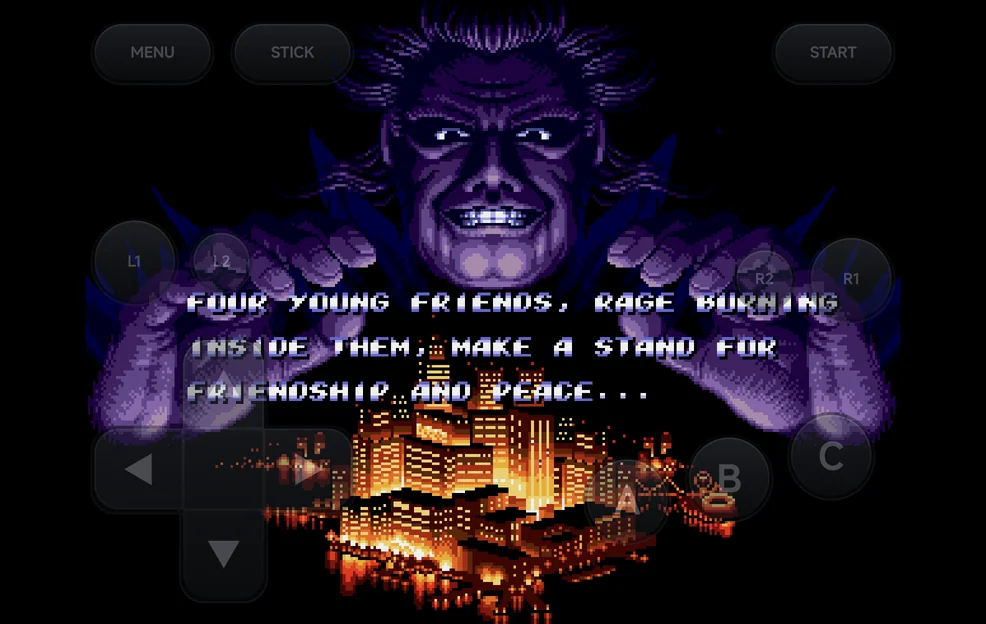
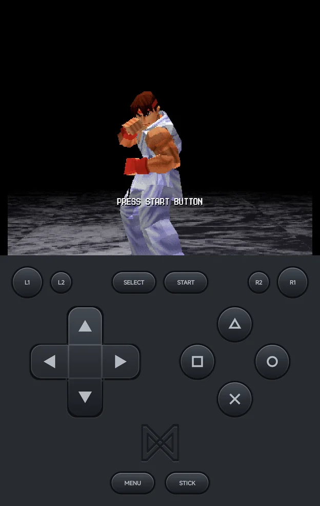
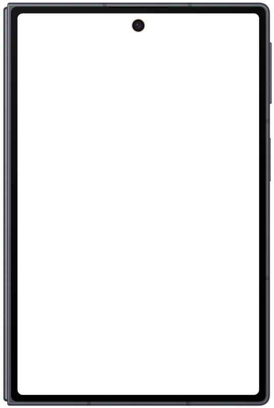
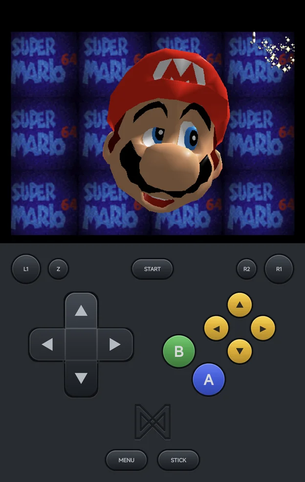
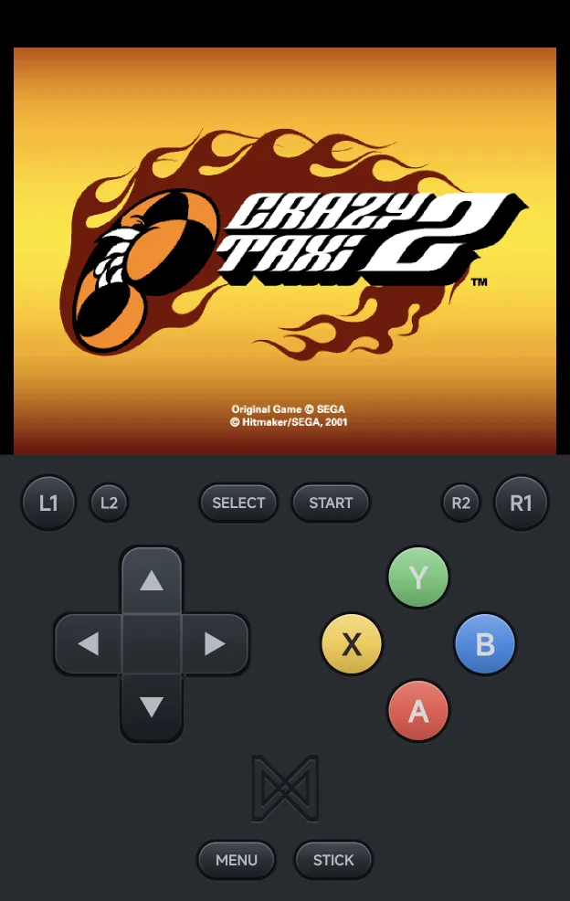
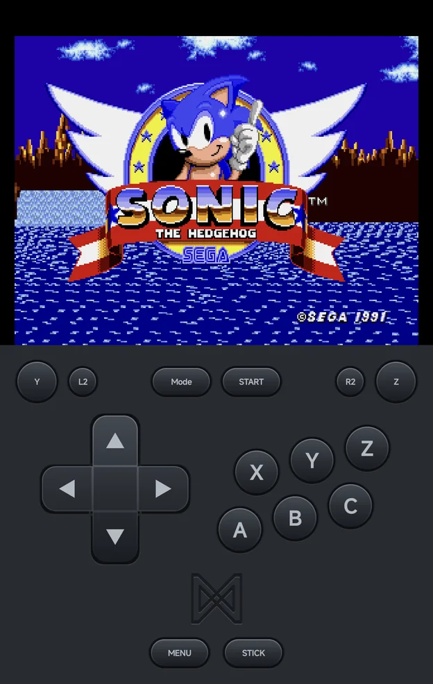
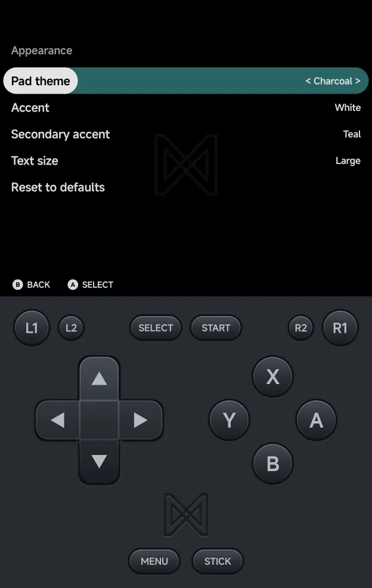
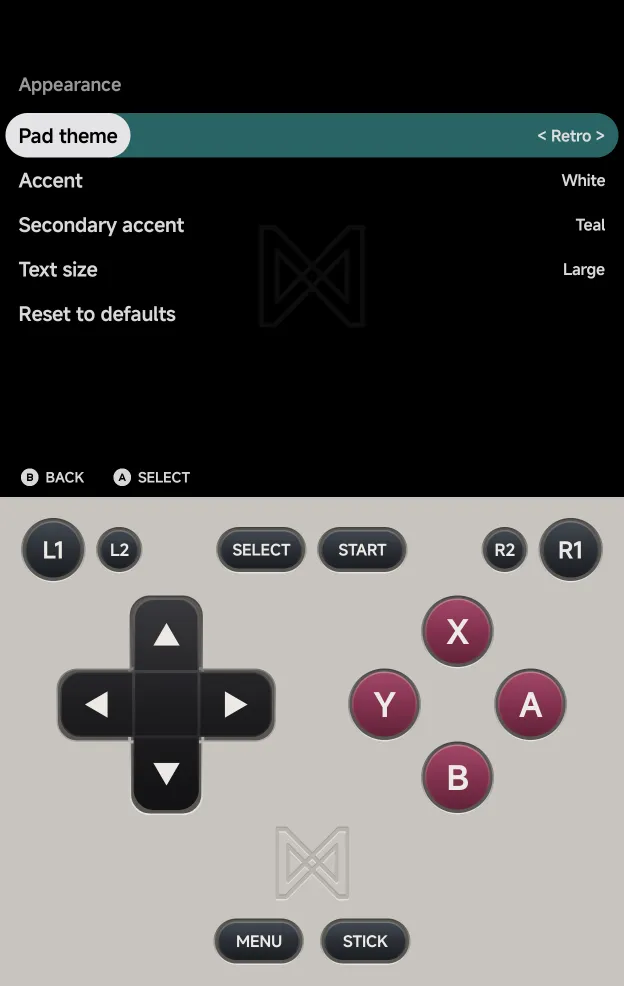

# Controls

## On-screen pad and controllers

Without a controller the app shows an on-screen pad. Connect any Android
controller to play with real buttons instead. With a controller each, two to
four people can play one game; see [Local Multiplayer](multiplayer.md).

- **Portrait:** the pad sits in a band below the screen, in games and on the
  main menu, the game lists and the Game Switcher.
    - In a game, the band goes away while a controller is connected, so the
      game gets the full height.
    - Nintendo DS and 3DS games can hide the band for see-through buttons:
      long-press the arrow in its bottom-right corner. See
      [Nintendo DS](emulators/nintendo-ds.md#portrait-pad).
    - On the main menu the band stays with a controller. Turn it off with
      [**Menu pad**](controls-settings.md#menu-pad).
- **Landscape:** the buttons sit in two clusters over the game. See
  [Landscape](#landscape).
- **`STICK`** switches the on-screen d-pad to an analog stick and back. While
  the stick is on, the button reads **D-PAD**.
- To move or resize the pad's buttons, for every console or for one, use
  [**Pad layout**](controls-settings.md#pad-layout).

??? info "More detail"
    - The tools' pages have no pad.
    - A clip-on controller that sits where the band was, such as the GameSir
      Pocket Taco or the 8BitDo FlipPad, keeps the band in a game.
    - When the band goes away for a controller, the Nintendo DS screens use
      their own controller layout (see [Nintendo DS](emulators/nintendo-ds.md)).

### Landscape

In landscape the pad splits into two clusters over the game:

- The system buttons sit in the top corners: `MENU` and `STICK` on the left,
  `SELECT` and `START` on the right.
- The shoulders, the d-pad and the face buttons sit at the bottom.
- Both clusters keep clear of the camera cutout, on whichever side it is.

**Pad Opacity (landscape)** sets how opaque the clusters are (40% by
default). It is in the in-game menu under **Options →
[Frontend](in-game-menu.md#frontend)**, not in Settings, and is saved per
game or console with Save Changes.

??? info "More detail"
    **Pad Opacity (landscape)** offers 100%, 60%, 40% and 25%.

### Each console's buttons

The pad draws each console's own buttons, and leaves out the ones the console
doesn't have:

| Console | What the pad shows |
| --- | --- |
| Sega Genesis, Sega CD, 32X | The Sega pad: `A` `B` `C` on a 3-button pad, plus `X` `Y` `Z` and `Mode` on a 6-button pad |
| Master System, Game Gear, SG-1000 | `1` and `2` |
| TurboGrafx-16 | `I` to `VI`, `Run` and `Mode` |
| PlayStation, PSP | `○` `×` `△` `□` |
| Nintendo 64 | `A`, `B`, a yellow C-button diamond, and `Z` on `L2` |
| Dreamcast | `A` `B` `X` `Y` in the Dreamcast's colours |
| GameCube | A green `A`, a red `B`, `X`, `Y`, `Z`, `L` and `R` triggers, and a C-stick |
| Wii | The game's Wii controller, with `HOME`, `Shake` and `MOTION`; see [Nintendo Wii & GameCube](emulators/wii-gamecube.md#wii-controls) |

The Sega pad follows the game's [Controller Type](emulators/other-systems.md#controller-type).
On the 6-button pad, `Y` and `Z` are on the shoulder buttons, and `Mode` is
in place of `SELECT`.

<figure class="nx-phone" markdown>
{ .nx-phone__screen }
{ .nx-phone__frame }
</figure>

<figure class="nx-phone" markdown>
{ .nx-phone__screen }
{ .nx-phone__frame }
</figure>

<figure class="nx-phone" markdown>
{ .nx-phone__screen }
{ .nx-phone__frame }
</figure>

<figure class="nx-phone" markdown>
{ .nx-phone__screen }
{ .nx-phone__frame }
</figure>

### Pad themes

**Pad theme** in **Tools → Settings → [Appearance](appearance.md)** colours
the portrait pad:

| Theme | Look |
| --- | --- |
| **Charcoal** (default) | The dark pad |
| **Retro** | A light grey body with magenta face buttons |

The landscape clusters always stay Charcoal.

<figure class="nx-phone" markdown>
{ .nx-phone__screen }
{ .nx-phone__frame }
</figure>

<figure class="nx-phone" markdown>
{ .nx-phone__screen }
{ .nx-phone__frame }
</figure>

## Controller buttons

A controller's face buttons work **as printed**: the button with `A` on it
is the console's `A`, whatever controller you use. So `A` is the Super
Nintendo's `A`, the Nintendo 64's `A` and the Dreamcast's `A`.

The app detects your controller's layout: a **Nintendo-layout** pad has `A`
on the right and `B` at the bottom, and any other pad is read as **Xbox
layout**, with `A` at the bottom and `B` on the right.

**Controller Layout**, in the in-game menu's
**Options → [Console Settings](in-game-menu.md#console-settings)**, names
the letters printed on your controller. Every console has it. Save it for
the console or the game with Save Changes.

| Value | Use it for |
| --- | --- |
| **Auto-detect** (default) | Let the app read your controller |
| **Xbox (A at the bottom)** | A pad with `A` at the bottom |
| **Nintendo (A on the right)** | A pad with `A` on the right |

PlayStation, PSP, the Sega consoles, TurboGrafx-16, PICO-8, Atari,
ColecoVision, Doom and arcade go **by position** instead, like the console's
own pad: the bottom button is the PlayStation's `×` on every controller.

??? info "More detail: by letter and by position"
    - Nintendo's own controllers and pads in Switch mode are recognised as
      Nintendo layout.
    - Pick the layout that isn't your controller's to play with the console's
      original button positions. On an Xbox pad set to **Nintendo**, the
      right button is `A` on Super Nintendo, Nintendo DS and Nintendo 3DS, as
      on the console's own pad.
    - These consoles go by the printed letter: Super Nintendo, NES and
      Famicom Disk System, Game Boy, Game Boy Color, Game Boy Advance,
      Nintendo DS, Nintendo 3DS, Virtual Boy, Atari Lynx, Pokémon mini,
      WonderSwan, Nintendo 64, Nintendo Wii, Nintendo GameCube, Sega
      Dreamcast, NAOMI, Atomiswave and Neo Geo Pocket.
    - The Sega consoles that go by position are Genesis, Sega CD, 32X, Master
      System, Game Gear and SG-1000. These consoles' buttons have no letters,
      or, on the Sega pad, `C` and `Z` would end up on the shoulders by
      letter.
    - On the by-position consoles, Controller Layout only changes which
      button confirms in the in-game menu, so it can't fix a Nintendo-layout
      pad that the app reads as Xbox layout.

The other buttons:

| Controller | NX Redux |
| --- | --- |
| `L1`, `R1`, `L2`, `R2` | `L1`, `R1`, `L2`, `R2` |
| `START`, `SELECT` | `START`, `SELECT` |
| Mode button (Android's `BUTTON_MODE`) | `MENU` |
| D-pad | `UP`, `DOWN`, `LEFT`, `RIGHT` |
| Left and right sticks | The core's analog sticks. On consoles without an analog stick, the left stick also works as the d-pad |
| `L3`, `R3` (pressing the sticks) | `L3`, `R3`, for the consoles that use them, such as the NAOMI and Atomiswave Test and Service buttons |

On a controller without a mode button, hold `SELECT` and `START` together to
open the in-game menu. In a multiplayer game only Player 1's `SELECT` +
`START` does; see [Local Multiplayer](multiplayer.md#the-in-game-menu).

??? info "More detail"
    On Nintendo DS the left stick is the d-pad, or moves the pen in stylus
    mode.

Each console's own mapping, such as the [Nintendo 64](emulators/nintendo-64.md#controls)
or the Sega [Controller Type](emulators/other-systems.md#controller-type)
(3 or 6 buttons), is on its [emulator page](emulators/index.md).

## Vibration

The app vibrates in two ways: a tick under your thumb on the on-screen pad,
and the game's own rumble. Set how strong each one is, or turn it off, in
[**Tools → Settings → Controls**](controls-settings.md).

### Pad vibration

A short tick when you press the on-screen pad. A controller never makes the
phone tick.

Pad vibration follows the phone's own touch feedback setting: with touch
feedback off in Android's settings, the pad stays silent too.

??? info "More detail: when it ticks"
    - When you press a button, not when you let go.
    - When the d-pad moves to a new direction, diagonals included. Holding a
      direction, or letting go back to the centre, does not tick.
    - When your thumb slides onto another button.
    - When the on-screen stick moves to a new direction (up, down, left or
      right), in the main menu only. In games the stick never ticks.
    - On Android 13 and later, Android's touch vibration strength also
      scales it.

### Game rumble

The game's own rumble, for the games and consoles that have it. It goes to
the controller you are playing with when it has a rumble motor, and to the
phone when it doesn't.

Game rumble plays as media vibration, so turning touch feedback off in
Android's settings does not silence it. Set it to **Off** in
[Controls settings](controls-settings.md#game-rumble) instead.

These consoles rumble:

| Console | Which games |
| --- | --- |
| Game Boy, Game Boy Color | Games on a rumble cartridge, such as Pokémon Pinball |
| Game Boy Advance | Games with rumble |
| PlayStation | Games with DualShock rumble |
| Dreamcast | Games that use the Vibration Pack. It is in each controller's second slot out of the box |
| Pokémon mini | Games with rumble |
| Doom (PrBoom) | Rumble is on out of the box |
| Nintendo 64 | Only with the Rumble Pak inserted (see below) |

Other consoles have no rumble.

**Nintendo 64:** out of the box the controller holds the Controller Pak (for
saves). To feel a game's rumble:

1. Open [Emulator Settings](emulator-settings.md) for the console, or **Game
   Settings** for one game.
2. Under **Core settings → Pak/Controller Options**, set **Player 1 Pak** to
   **rumble**. For more players, set **Player 2 Pak** to **Player 4 Pak** the
   same way.
3. Start the game again for the change to take effect.

!!! note
    The Rumble Pak takes the Controller Pak's place, so a game can't save to
    the Controller Pak while it is in.

??? info "More detail"
    - Without a controller motor, rumble goes to the phone (or the
      handheld's motor). Pressing the on-screen pad moves it back to the
      phone.
    - In a [multiplayer](multiplayer.md#rumble) game each player's rumble
      goes to their own controller. Only Player 1 falls back to the phone.
    - Changing the level plays a short pulse at that strength, so you can
      feel it. **Off** plays none.
    - The rumble stops while the [in-game menu](in-game-menu.md) is open and
      picks up again when you close it. It also stops when you leave the app
      or quit the game.
    - The emulators' own rumble options are in **Core settings** too, such
      as **Rumble Effects** for PlayStation and Doom, **Device in Expansion
      Slot A2** for Dreamcast, and **Controller Rumble Strength** for Game
      Boy. Leave them as they are; **Game rumble** sets how strong it feels.

## In the menus

| Button | What it does |
| --- | --- |
| `A` | Open or start the highlighted item. On a game with a save state it resumes the game (**Resume**) |
| `B` | Back. Android's Back gesture does the same. |
| `X` | In a game list, open the [achievements panel](main-menu.md#achievements-panel) for the highlighted game, while you are signed in to [RetroAchievements](retroachievements.md) |
| `Y` | On a game that has [netplay](netplay.md), open the Netplay menu |
| `SELECT` | Open the [Game Switcher](game-switcher.md). The main menu's hint reads **Recent**. |
| `START` | On the main menu, [search](main-menu.md#search) your games. In a game list, [search that list's games](main-menu.md#searching-a-game-list) |
| `MENU`, or a long press | Open the context menu |
| `L1` / `R1` | Switch main menu tabs |

**Which button confirms:**

- On a controller, `A` confirms and `B` goes back, by the letters printed on
  it. In the in-game menu too, with the letters
  [Controller Layout](#controller-buttons) names.
- On the on-screen pad, the button drawn as `A` confirms and the one drawn as
  `B` goes back. On PlayStation and PSP, `×` confirms and `○` goes back.

Menus show key hints you can tap when a controller or the on-screen pad is
present.

??? info "More detail: hint order"
    **Options** (`MENU`) always comes first. The other hints follow the pad
    from left to right: the d-pad and left shoulders, `SELECT`, `START`, then
    `Y` `X` `B` `A`, then the right shoulders.

With touch alone (no controller and no pad below the screen: in landscape,
on the tools' pages in portrait, or with [Menu pad](controls-settings.md#menu-pad)
Off), there is no hint bar:

- Tap an item to select it, tap it again to open it, and long-press for its
  menu. Android's Back gesture goes back.
- **Recent** and **Search** are icons at the right of the tab row, and a
  page's own actions are icons by its title or buttons on the page.
- Dialogs have real buttons.
- A Settings value with three or more choices opens a dropdown of them. See
  [Settings](settings.md).

## Game-list context menu

Press `MENU`, or long-press a game, for its context menu: Pin Item, Hide
Game, Rename Rom, Add to Collection, Game Settings, Netplay, Fetch art and
Emulator. See [Context menus](main-menu.md#context-menus) for what each does
and where it shows.

??? info "More detail: menu order"
    - A game with a save state starts the menu with **Play from start**.
    - While the Netplay hint is hidden, or with touch alone, **Netplay**
      comes next.
    - With the
      [Achievements panel](layouts.md#layout-options-and-achievements-panel)
      row set to Hide, **Achievements** comes last.

## In-game menu

Press `MENU`, hold `SELECT` + `START`, or use Android's Back gesture during a
game. The menu has save states and Options: Console Settings, Frontend,
Shaders, Core Options, Cheats, Achievements and Save Changes. See
[In-game Menu](in-game-menu.md).

## Console shortcuts

`MENU`, `SELECT` + `START` and Back open the in-game menu on every console.
In a multiplayer game, `SELECT` + `START` works on Player 1's controller only.

??? info "More detail"
    `MENU` and the combo never reach the game, but the game does see the
    `SELECT` press before `START`, except on the Nintendo 3DS.

Some consoles have buttons and shortcuts of their own. They are on each
console's page:

| Console | Its own buttons |
| --- | --- |
| [Nintendo 3DS](emulators/nintendo-3ds.md#controls) | `SELECT` + `R1` swaps screens, `SELECT` + `L1` turns stylus mode on, `SELECT` + `LEFT` / `RIGHT` changes the layout, `L2` / `R2` are `ZL` / `ZR`, the right stick is the C-stick |
| [Nintendo DS](emulators/nintendo-ds.md#controls) | `R2` swaps screens, `SELECT` + a direction changes the layout or inset, `L2` turns stylus mode or touch mode on |
| [Sega Dreamcast, NAOMI, Atomiswave](emulators/dreamcast.md#controls) | Analog `L2` / `R2`, and on the arcade boards `SELECT` for a coin, `L3` for Test and `R3` for Service |
| [Arcade (FBNeo)](emulators/arcade.md#controls) | `SELECT` inserts a coin |
| [Nintendo 64](emulators/nintendo-64.md#controls) | Buttons by letter, `Z` on `L2`, the C buttons on the right stick |
| [PlayStation](emulators/playstation.md#controls), [PSP](emulators/psp.md#controls) | `×` `○` `△` `□` by position |
| [Other systems](emulators/other-systems.md) | Sega `Mode`, NES disk and coin buttons, Game Boy turbo, Neo Geo Pocket `Option` and more |
