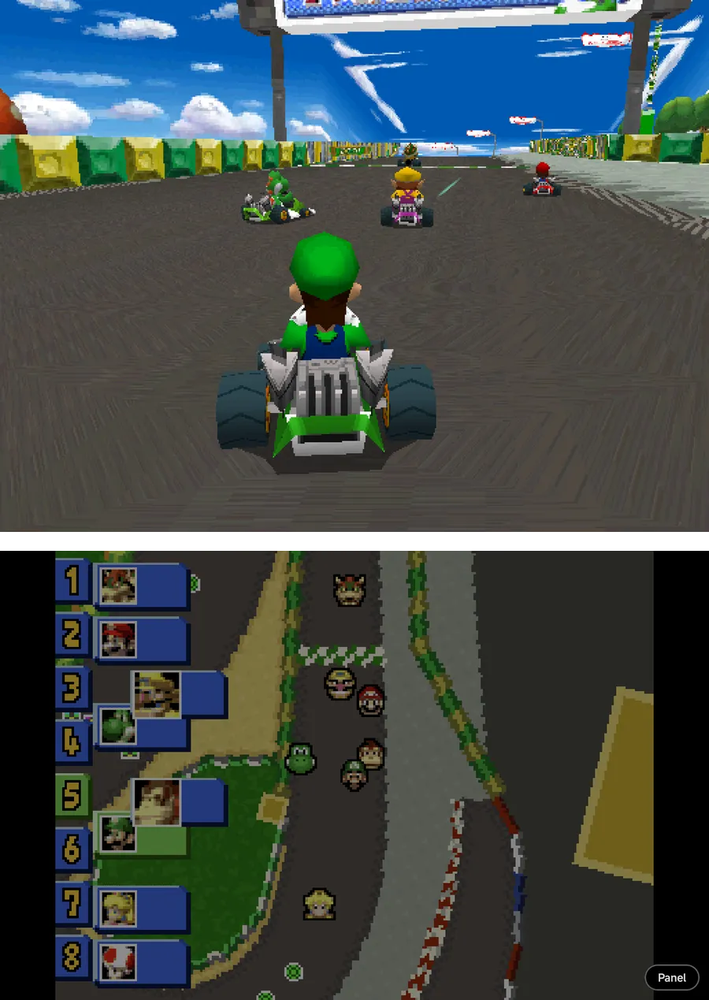
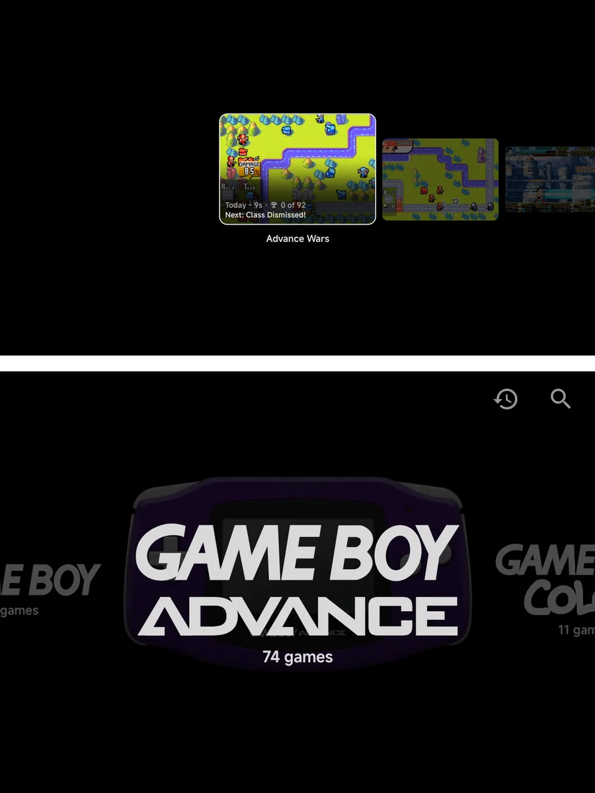
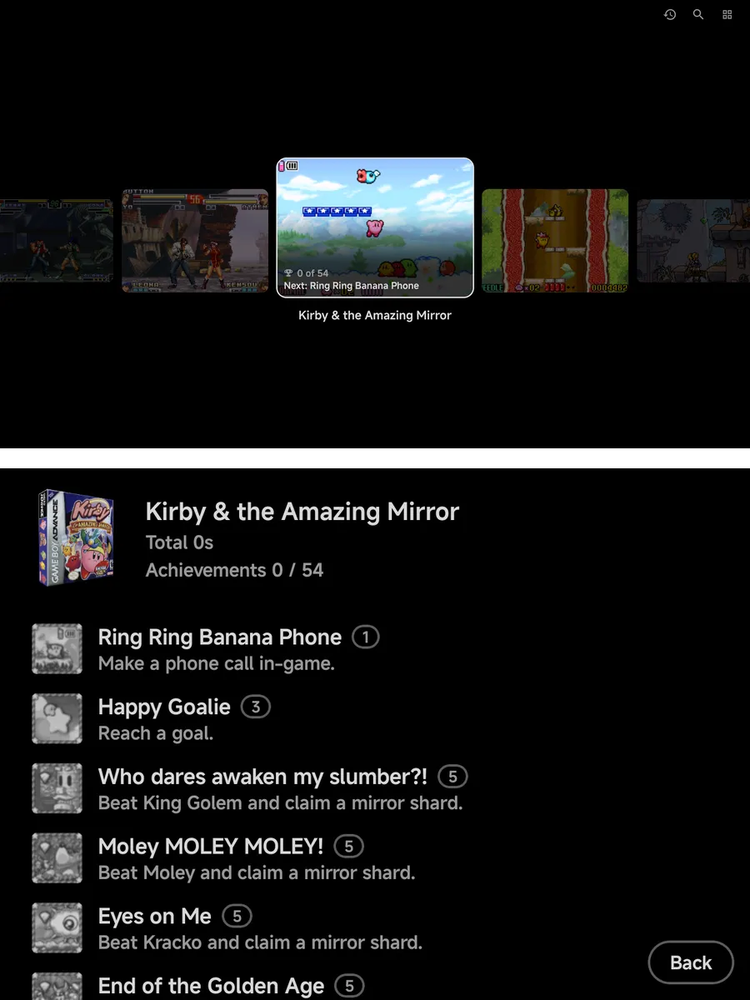
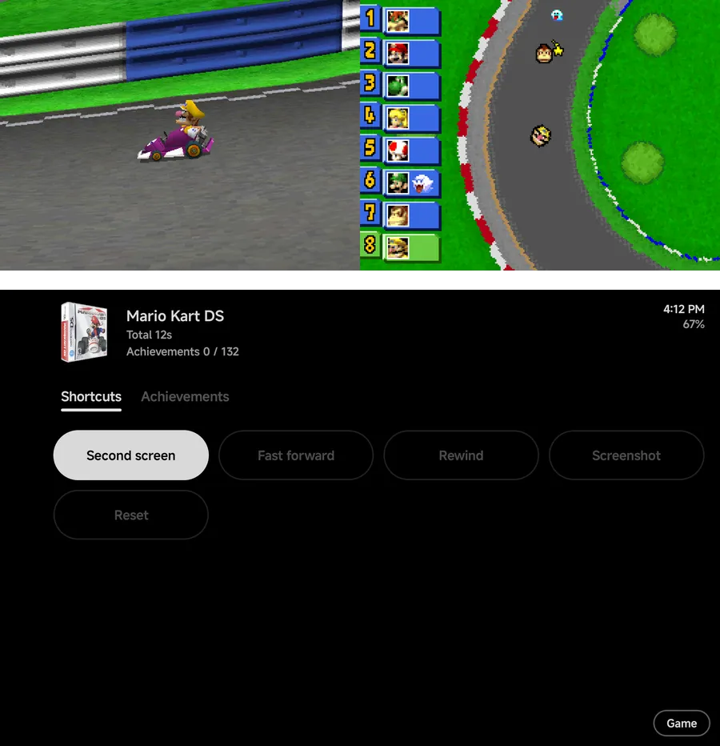
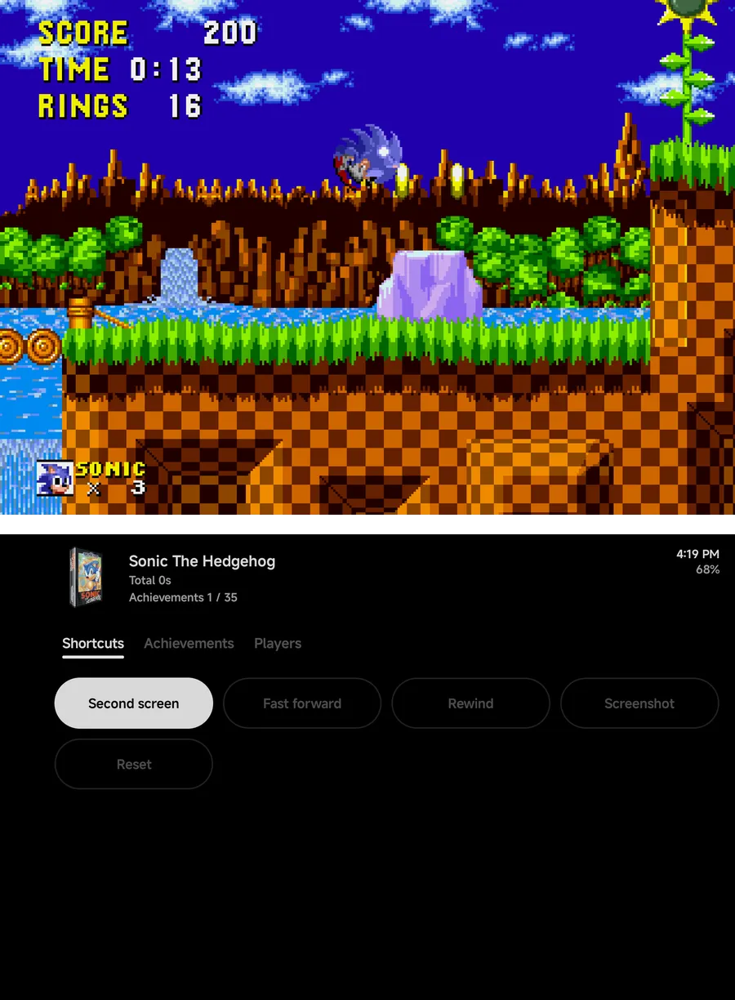
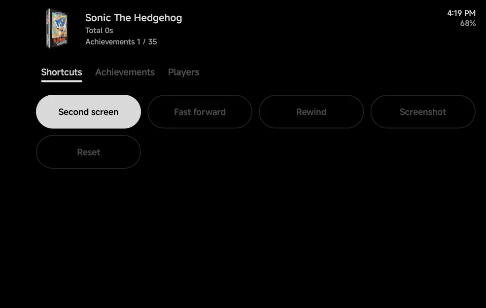
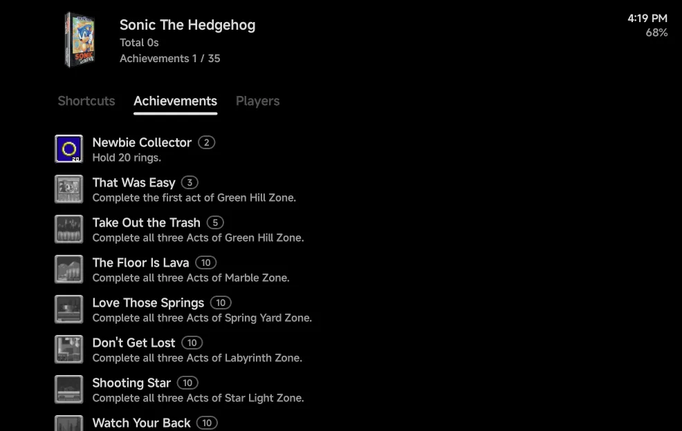

# Dual Screens & External Displays

On a handheld with a second screen, NX Redux uses both. In the
[main menu](#the-main-menu), the games of the console or collection you're on
show on one screen while you browse on the other. Nintendo DS and 3DS games
get one screen each, like the real console. Other games show the game on one
screen and a [game panel](#the-game-panel) on the other, with your play time,
achievements and a few shortcuts.

Two kinds of second screen count:

- **A built-in second screen**, as on dual-screen Android handhelds.
- **A wired display on USB-C**, such as a clip-on screen add-on, a monitor
  or a TV.

Casting and wireless displays, and a foldable's cover screen, are never used.
On a phone with one screen, nothing on this page applies, and the game panel
shows in the [in-game menu](in-game-menu.md#the-game-panel) instead.

??? info "More detail"
    - Plug a display in or unplug it during a game and the game carries on: the
      layout switches straight away.
    - Android doesn't tell an add-on screen from a monitor or a TV, so a
      wired monitor counts as a second screen too.

## Which screen is which

One screen is the **picture screen** and the other the **touch screen**:

- The **picture screen** shows the game, or the DS or 3DS top screen. In the
  main menu it shows a game list.
- The **touch screen** shows the DS or 3DS bottom screen, or the game panel.
  In the main menu it shows the menu.

By default the wider screen is the picture screen. When both have the same
shape, the second screen gets the picture. To choose yourself, set
[**Bottom screen**](#settings) to the screen you want to touch.

While the second screen is in use, the game stays in landscape, either way
up. Unplug the display, or turn the second screen off, and the game gets its
usual orientation back.

??? info "More detail"
    - Games drawn on their side, such as vertical arcade games, always keep
      the picture on the main screen, whatever **Bottom screen** says.
    - While the main screen shows the game panel, the on-screen pad is hidden:
      it would cover the panel. Dual-screen handhelds have their own buttons.

## First-run setup

On a handheld with a built-in second screen, setup asks **Which is the bottom
screen?** right after the text size. Both screens show a **This is the bottom
screen** button: tap the one on the screen below. **Skip** leaves it on
**Auto**.

A wired display never gets this question. Change the answer any time in
[Settings](#settings).

## The main menu

With a second screen in use, the main menu stays on the touch screen and the
picture screen helps you browse.

- On **Consoles** and **Collections**, the picture screen shows the games of
  the highlighted console or collection. It follows as you move.
- Press `A` on a console or collection, or tap it, to move to its game list on
  the picture screen. Move through the games there, and press `A` to play.
- While you're in the game list, the touch screen shows the highlighted
  game's details: its art, name and play time and, with a
  [RetroAchievements](retroachievements.md) set, its achievements.
- `B`, Android's Back gesture or the **Back** button on the details goes
  back to the menu.
- On **Home**, **Tools** and **Settings**, the picture screen shows the
  backdrop with the NX logo.

Your buttons work on the screen you're on, and its button hints show there
only. In the game list they do what they do in any
[game list](main-menu.md#game-lists), such as `MENU` for the game's context menu or
`START` to search. Menus and prompts open on the same screen.

The game list uses your game list style from
[**Settings → Layouts**](layouts.md), not the Consoles or Collections style.

??? info "More detail"
    - You can scroll or swipe either screen at any time without leaving the
      one you're on. Only a tap that picks something moves you: a tap on a
      game highlights it, and a tap on the highlighted game plays it.
    - Back from a game, you return to the game list on the same game.
    - Signed out of RetroAchievements, the details show the game's info only.
    - With [**Enable**](#settings) off, the main menu uses one screen.

### Apps on the picture screen

With a second screen in use, apps you open from NX Redux open on the picture
screen, and the menu stays where it is. This covers apps in **Tools**, tools
pinned to Home, and [Android games](launcher.md).

To have the picture screen back, close the app.

## Settings

**Tools → Settings → Second screen** has the system-wide settings. The
**Second screen** section, between **Controls** and **System**, shows only
while a second screen is connected.

| Row | Values | Default | What it does |
| --- | --- | --- | --- |
| **Enable** | On, Off | On | **Off** leaves the second screen alone, free for another app. |
| **Bottom screen** | Auto, Main screen, Second screen | Auto | Which screen is the touch screen. **Auto** picks by shape. |

With **Enable** off, DS and 3DS games use their usual
[single-screen layouts](emulators/nintendo-ds.md#screen-layouts) and other
games show no panel. The game panel's **Second screen** shortcut changes the
same setting without leaving the game.

### For one console

Each console has its own **Bottom screen** row in its Console Settings:
**System default**, **Main screen** or **Second screen**. **System default**
follows the setting above. Set it in [Emulator Settings](emulator-settings.md),
or during a game in **Options → Console Settings**, where it applies straight
away.

??? info "More detail"
    - The console's **Bottom screen** row shows only while a second screen is
      connected, like the system-wide rows. Values you set are kept while it's
      hidden.
    - Keep an in-game change with
      [Save Changes](in-game-menu.md#save-changes), for the game or the
      console.

## Nintendo DS and 3DS

With a second screen, a DS or 3DS game starts split across both screens: the
top screen on the picture screen and the bottom screen on the touch screen.

- **Touch** goes to the bottom screen, on whichever screen it shows.
  Touching the top screen does nothing.
- **SWAP**, `R2` on the DS or `SELECT` + `R1` on the 3DS swaps the two
  screens over.
- In [stylus mode](emulators/nintendo-ds.md#stylus-mode) the DS stylus dot
  follows the bottom screen to whichever screen shows it.

### The Panel and Game pills

A **Panel** pill sits at the bottom right of the touch screen. Tap it and the
touch screen shows the [game panel](#the-game-panel), while both DS or 3DS
screens move side by side onto the picture screen. Touch reaches the bottom
screen there.

On the panel, the **Game** pill, in the same corner, brings the bottom screen
back to the touch screen.

??? info "More detail"
    - On the DS, **SWAP** while split changes the **Big Screen** setting, the
      same as on one screen, so it carries over when you play without the
      second screen. On the 3DS the swap lasts for this session.
    - The screen layout settings, such as **Layout (landscape)**, aren't used
      while the game is split or the panel is up.

## Other games

Every other game shows its picture on the picture screen and the game panel
on the touch screen while you play. The panel works by touch only: your
buttons keep playing the game.

Opening the [in-game menu](in-game-menu.md) pauses the game and adds the menu
list to the left of the panel. Closing it takes the list away again.

## The game panel

The same panel shows on the touch screen and, on a phone with one screen,
on the right of the [in-game menu](in-game-menu.md#the-game-panel).

{ .nx-wide }

Across the top, the game's header shows:

- its box art, or the console's logo when it has none;
- its name;
- its total play time, such as **Total 4h 12m**;
- with a [RetroAchievements](retroachievements.md) set, your count, such as
  **Achievements 3 / 40**;
- the time and the battery level, since the game hides Android's status bar.

Below it are up to four tabs. A tab shows only when it applies.

| Tab | Shows when | What it holds |
| --- | --- | --- |
| **Shortcuts** | Always | One-tap buttons. See [below](#shortcuts). |
| **Achievements** | The game has a RetroAchievements set | The game's achievements, in your **Achievement sort order**. |
| **Cheats** | The game's emulator takes cheats | The game's cheats, each with a switch. See [below](#cheats). |
| **Players** | The game has more than one player | Which controller is which player. See [Local Multiplayer](multiplayer.md#the-players-page). |

??? info "More detail"
    - The play time is the total before this launch. It doesn't count up while
      you play.
    - The clock follows the phone's 12 or 24-hour setting.

### Shortcuts

| Shortcut | Shows when | What it does |
| --- | --- | --- |
| **Swap disc** | A game with more than one disc | Puts the next disc in, such as **Disc 2 of 3**. The button shows the disc in use, such as `1/2`. |
| **Second screen** | A second screen is connected | Turns the second screen on or off. Filled while on. |
| **Fast forward**, **Rewind**, **Screenshot**, **Reset** | Always | Shown dimmed: not available yet. |

??? info "More detail"
    - **Swap disc** works as the in-game menu's **Disc** row does, while the
      game keeps running.
    - **Second screen** changes **Settings → Second screen → Enable**.
    - In a [netplay](netplay.md) match, **Swap disc** is hidden.

### Achievements

Each row shows the achievement's badge, its name with its points in a small
pill, and its description. The badge says where you are: in colour once
unlocked, greyed while locked. Rows open nothing.

{ .nx-wide }

### Cheats

Each row shows a cheat's name and its switch. Tap a row to turn the cheat
**On** or **Off**; it applies straight away. To keep them for next time,
use [Save Changes → Save for game](in-game-menu.md#save-changes).

With no cheats for the game, the tab says **No cheats for this game.** and
how to add some. See [Cheats](cheats.md).

??? info "More detail"
    - When a game's cheats come from several files, each row names its
      source under the cheat, such as **GameShark**.
    - In a [netplay](netplay.md) match, the tab is hidden.

### Players

The **Player 1** to **Player 4** rows show each player's controller, **Empty**
or the name with **(disconnected)**. Tap a row to step it to the next
controller, or **Empty**. It works as the
[Players page](multiplayer.md#the-players-page).

## Limits

- To type on the second screen, such as in a search or a rename, tap the text
  field first.
- While an app covers the main screen, the menu on the second screen hides
  until you come back.
- The panel can't be driven with buttons on the touch screen. In the in-game
  menu on one screen it can: see [The game panel](in-game-menu.md#the-game-panel).
- Achievements in the panel have no details page for now.
