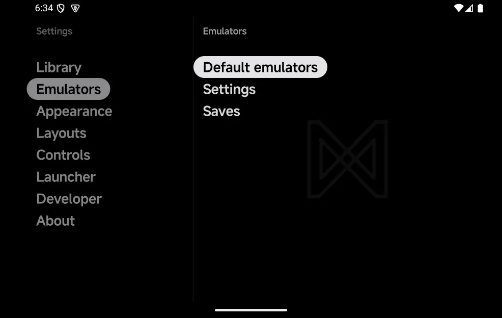
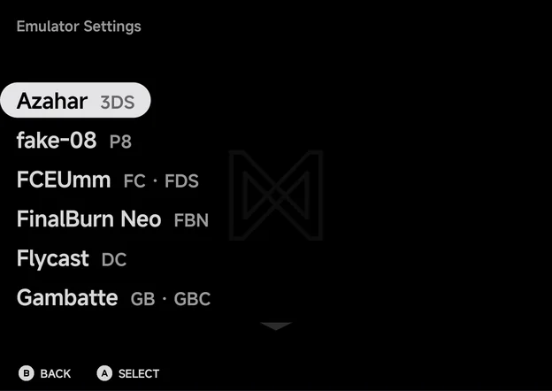
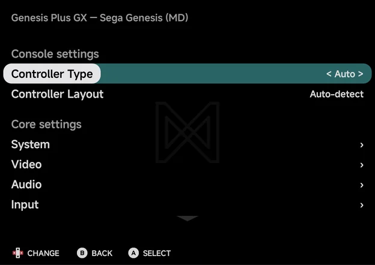
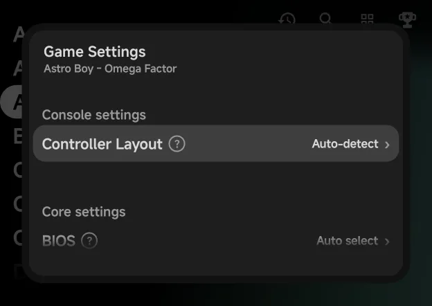
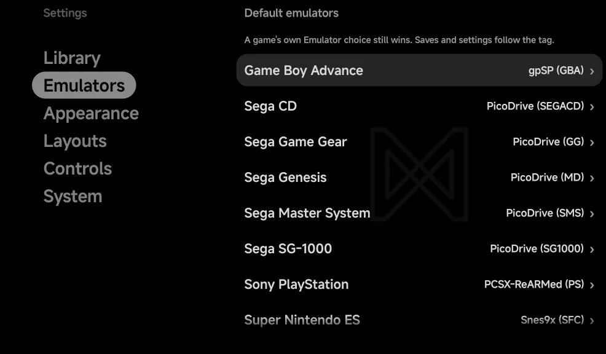

# Emulator Settings

**Tools → Settings → Emulators → Settings** opens **Emulator Settings**. It
sets each emulator's options for a whole console, without starting a game
first.

The **Emulators** section holds two rows: **Default emulators** (see
[below](#default-emulators)) and **Settings**.

{ .nx-wide }

For one game, use **Game Settings** in the game's context menu instead. See
[Game Settings](#game-settings).

## The emulator list

The page lists each emulator that runs one of your consoles, with the tags it
covers, such as **Gambatte GB · GBC**. Press `A` on an emulator. When it
covers more than one tag, the app asks for the console first.

{ .nx-wide }

??? info "More detail"

    Emulators for consoles you have no games for are not listed.

## An emulator's settings

The page is titled with the emulator, the console and the tag, such as
**PicoDrive — Sega Genesis (MD)**. It has two groups:

| Group | What it holds |
| --- | --- |
| **Console settings** | The app's own settings for the console, such as **Controller Layout**. The same rows as the in-game [Console Settings](in-game-menu.md#console-settings) page, plus the ones read only when a game starts, such as **Graphics API**. |
| **Core settings** | The emulator's own options. Rows with `›` open a group of options, such as **Video** or **Audio**. |

{ .nx-wide }

- The rows work as on the [Settings](settings.md#buttons) pages: a switch,
  a row of choices, or a value with `›` that opens the list of its values.
  `LEFT` and `RIGHT` change any value.
- `A` flips a switch, steps a row of choices, and opens the list on a value
  with `›`. By touch, tap the switch, the choice, or the row.
- The **?** icon, or `X` **Info**, shows an option's full description.
- Each change is saved straight away. There is no **Save** row.
- Some options only take effect when a game starts, such as the N64
  resolution. The new value is used the next time you start a game.

What you set here is the console's setting, the same as the in-game menu's
**Save Changes → Save for console**. See the
[in-game menu](in-game-menu.md) for the options themselves.

??? info "More detail"

    - **Console settings** holds **Controller Layout** for every console,
      **Controller Type** for Sega Genesis, Sega CD and Sega 32X, the
      **Layout** and **Big Screen** rows for Nintendo DS, the **Layout** rows and
      **New 3DS Controls** for Nintendo 3DS, **Portrait Pad** for both, and the Wii's rows
      ([Nintendo Wii & GameCube](emulators/wii-gamecube.md#console-settings)).
    - While a second screen is connected, every console also has **Bottom
      screen**: **System default**, **Main screen** or **Second screen**. See
      [Dual Screens & External Displays](dual-screen.md#for-one-console).
      The start-only rows are **Graphics API**
      ([Graphics API](emulators/index.md#graphics-api)), and the Wii's **Wii
      Screen** and **Pointer** rows.
    - The in-game [Core Options](in-game-menu.md#core-options) page leaves out
      the options that only take effect when a game starts.
    - When the app cannot read an emulator's options outside a game, **Core
      settings** shows **This core's options aren't available outside a
      game.** Change them from the in-game menu instead.
    - The console's settings and **Save for console** write the same file.

## Game Settings

Open a game's context menu with `MENU` in a game list, or a long press on
the game, and choose **Game Settings**. The same page opens over the list, for that one game.

- The first change gives the game its own settings, starting from the
  console's.
- To go back to the console's settings, press `A` on **Use emulator
  settings**, the last row.
- `B` goes back to the game list.
- There is no hint bar: the rows work as on the
  [emulator's page](#an-emulators-settings), by buttons or touch.

??? info "More detail"

    - The game's settings are the same file **Save Changes → Save for game**
      writes.
    - **Use emulator settings** shows only while the game has its own
      settings. `A` on it deletes them, so the game follows the console's
      again.
    - `B` returns to the game list on the same game.

## Pause when unfocused

Whether a game pauses while another app takes over is set in **Tools →
Settings → System → Pause when unfocused**. See
[System](about.md#pause-when-unfocused).

The second screen has its own section in Settings: see
[Dual Screens & External Displays](dual-screen.md#settings).

## Default emulators

Some consoles can run on more than one emulator. **Tools → Settings →
Emulators → Default emulators** picks the emulator for a game with
no emulator of its own.

{ .nx-wide }

The consoles with more than one emulator come first, then the consoles you
have games for that have only one, each group A to Z. Each row shows the
console's emulator and tag, such as **gpSP (GBA)**. On a console with more
than one emulator, pick another one as on any Settings row: `LEFT` /
`RIGHT`, `A`, or a tap.

- Saves and BIOS are shared by the console's emulators, so switching emulator
  copies nothing.
- To switch one game to another emulator, use **Emulator** in its context
  menu. See [Emulators](emulators/index.md).

??? info "More detail"

    - The line under the page's title reads **A game's own Emulator choice
      still wins. Saves and settings follow the tag.**

    - The consoles with more than one emulator (listed in
      [Choosing an emulator](emulators/index.md#choosing-an-emulator)) always
      show. The other rows are dimmed and only show the emulator in use.
