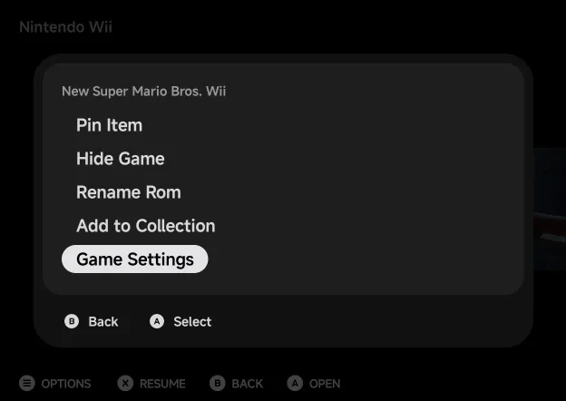
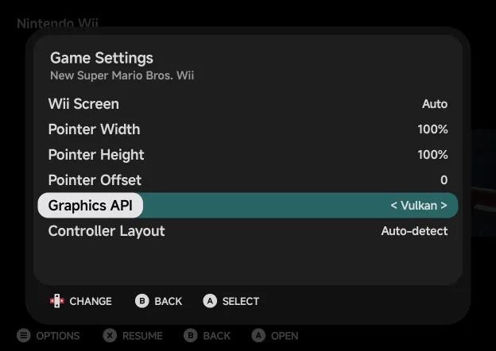

# Bundled Emulators

Every core is bundled in the app. There is nothing to download. Folder and
tag names match NX Redux on the handheld.

The systems with their own controls or settings have a page each:
[Arcade (FBNeo)](arcade.md), [Nintendo 64](nintendo-64.md),
[Sega Dreamcast](dreamcast.md), [PlayStation](playstation.md),
[PlayStation Portable](psp.md), [Nintendo DS](nintendo-ds.md),
[Nintendo 3DS](nintendo-3ds.md) and
[Nintendo Wii & GameCube](wii-gamecube.md). The
smaller differences of the others, such as the Sega `Mode` button or the
Neo Geo Pocket's `Option`, are on [Other Systems](other-systems.md).

| Put this | Here |
| --- | --- |
| Games | Each system's own folder under `Roms/`, such as `Roms/Game Boy Advance (GBA)/` |
| BIOS files (for systems that need them) | `Bios/<TAG>/`, such as `Bios/DC/` |

| System | Tag(s) | Core |
| --- | --- | --- |
| [Nintendo DS](nintendo-ds.md) | `NDS` | melonDS DS |
| [Nintendo 3DS](nintendo-3ds.md) | `3DS` | Azahar |
| [Nintendo Wii](wii-gamecube.md) | `WII` | Dolphin |
| [Nintendo GameCube](wii-gamecube.md) | `GC` | Dolphin |
| [Nintendo 64](nintendo-64.md) | `N64` | Mupen64Plus-Next |
| [PlayStation Portable](psp.md) | `PSP` | PPSSPP |
| Game Boy / Game Boy Color | `GB`, `GBC` | Gambatte |
| Game Boy Advance | `GBA` | gpSP |
| Game Boy Advance, Super Game Boy | `MGBA`, `SGB` | mGBA |
| NES / Famicom Disk System | `FC`, `FDS` | FCEUmm |
| Super Nintendo | `SFC` | Snes9x |
| Super Nintendo | `SUPA` | Supafaust |
| Genesis / Mega Drive, Master System, Game Gear, SG-1000, Sega CD | `MD`, `SMS`, `GG`, `SG1000`, `SEGACD` | PicoDrive |
| Genesis / Mega Drive, Master System, Game Gear, SG-1000, Sega CD | `GPGX` | Genesis Plus GX |
| Sega 32X | `32X` | PicoDrive |
| [Dreamcast, NAOMI, Atomiswave](dreamcast.md) | `DC` | Flycast |
| [PlayStation](playstation.md) | `PS` | PCSX-ReARMed |
| [PlayStation](playstation.md) | `PSX` | SwanStation |
| Neo Geo Pocket / Color | `NGP`, `NGPC` | RACE |
| PC Engine / TurboGrafx-16 | `PCE` | Beetle PCE Fast |
| Virtual Boy | `VB` | Beetle VB |
| Atari Lynx | `LYNX` | Handy |
| Atari 2600 | `A2600` | Stella 2014 |
| Atari 5200 | `A5200` | a5200 |
| Atari 7800 | `A7800` | ProSystem |
| Pokémon Mini | `PKM` | PokeMini |
| WonderSwan Color | `WSC` | Beetle WonderSwan |
| PICO-8 | `P8` | fake-08 |
| Doom | `PRBOOM` | PrBoom |
| ColecoVision | `COLECO` | Gearcoleco |
| [Arcade](arcade.md) | `FBN` | FinalBurn Neo |
| Android | none | The game's own app (see [Launcher Mode & Android Games](../launcher.md)) |

**Android** shows as a console once you add Android games. They are apps
installed on your phone, and the app starts them for you. They have no core
and no folder.

## Choosing an emulator

Eight consoles have a second emulator, each with its own tag:

| Console | Tags |
| --- | --- |
| Game Boy Advance | `GBA` (gpSP), `MGBA` (mGBA) |
| Super Nintendo ES | `SFC` (Snes9x), `SUPA` (Supafaust) |
| Sony PlayStation | `PS` (PCSX-ReARMed), `PSX` (SwanStation) |
| Sega Genesis | `MD` (PicoDrive), `GPGX` (Genesis Plus GX) |
| Sega Master System | `SMS` (PicoDrive), `GPGX` (Genesis Plus GX) |
| Sega Game Gear | `GG` (PicoDrive), `GPGX` (Genesis Plus GX) |
| Sega SG-1000 | `SG1000` (PicoDrive), `GPGX` (Genesis Plus GX) |
| Sega CD | `SEGACD` (PicoDrive), `GPGX` (Genesis Plus GX) |

- The emulator comes from **Tools → Settings → Emulators → Default
  emulators**.
- For one game, press `MENU` on it in a game list, or long-press it, and
  pick **Emulator**. This choice wins over the default.
- PicoDrive is the Sega consoles' default, as on the handheld, so a
  handheld save state resumes on the phone. Genesis Plus GX shows as
  **Genesis Plus GX (GPGX)**, with its states in the handheld's
  `GPGX-genesis_plus_gx` folder.
- A Classic NES Series cart, such as Pac-Man, doesn't run on gpSP. On its
  first launch with gpSP as the console's default, the app sets its
  **Emulator** to mGBA and starts it there. A game you set to gpSP yourself
  stays on gpSP.

Each console has one folder, and its battery saves and BIOS are shared by its
emulators. Save states stay per emulator. To set a core's options outside
a game, for a whole console or for one game, see
[Emulator Settings](../emulator-settings.md).

## Graphics API

Seven consoles can draw with Vulkan instead of OpenGL ES: Nintendo Wii,
GameCube, Nintendo 64, Sega Dreamcast, PlayStation on SwanStation (`PSX`),
PSP and Nintendo 3DS. **Graphics API** picks:

| Value | What it does |
| --- | --- |
| **Auto** (default) | OpenGL ES. |
| **OpenGL ES** | OpenGL ES. |
| **Vulkan** | Vulkan. On Nintendo 64 it also switches to the ParaLLEl-RDP renderer: more accurate, and heavier. |

The game reads it when it starts, so it isn't in the in-game menu. To switch
a game to Vulkan:

1. In the game list, press `MENU` on the game, or long-press it, and choose
   **Game Settings**.

    

2. Move to **Graphics API** and set it to **Vulkan** with `LEFT` / `RIGHT`.
   On a touchscreen with no controller, tap the row and pick **Vulkan** from
   the list.

    

3. Start the game.

For a whole console, set it in [Emulator Settings](../emulator-settings.md)
instead. To put a game back on the console's setting, choose **Use emulator
settings** at the top of its Game Settings.

- A phone without a Vulkan GPU that the app can use stays on OpenGL ES,
  whatever the setting.
- If Vulkan can't start on your phone, the game starts again on OpenGL ES,
  with a notice: **Vulkan couldn't start on this device, so this game is
  using OpenGL ES.** The app remembers it for that emulator, so later
  launches go straight to OpenGL ES, and the **Graphics API** row says
  **Vulkan didn't work on this phone; using OpenGL ES.** An app update tries
  Vulkan again.
- Which is faster depends on the game and the phone. Try Vulkan on a game
  that runs slowly, and go back if it doesn't help.

## BIOS files

Put BIOS files in `Bios/<TAG>/`.

- These systems need their BIOS: Famicom Disk System, Sega CD, PC Engine CD,
  ColecoVision (`Bios/COLECO/colecovision.rom`) and Dreamcast
  ([Sega Dreamcast](dreamcast.md#bios)).
- The app checks for it before launch and names the missing file, such as
  **Sega CD needs a BIOS: put bios_CD_U.bin (or bios_CD_E.bin,
  bios_CD_J.bin) in Bios/SEGACD/**.
- PlayStation on PCSX-ReARMed (`PS`) has a BIOS built in, and uses a real
  one when present. SwanStation (`PSX`) needs a real one; see
  [PlayStation](playstation.md).
- Wii and GameCube need no BIOS: Dolphin's system files are bundled.

??? info "More detail"
    A launch also reads the folders of tags that share its core. So a
    handheld's layout (`Bios/FC/disksys.rom`, `Bios/MD/bios_CD_*.bin`,
    `Bios/PS/psxonpsp660.bin`) works unchanged.

## Zip and 7z files

An archive holding one game plays on every core. An archive with one game
beside extras, such as a readme, plays too.

Archives with several games, a password, or a game the chosen core can't run
are refused with a message.

??? info "More detail"
    The app unpacks the archive on first launch. Saves use the archive's name,
    as on the handheld. The unpacked copies are trimmed automatically; see
    [Unpacked games cache](../library.md#unpacked-games-cache).

    Arcade sets are the exception. For FinalBurn Neo, NAOMI and Atomiswave the
    zip *is* the game, and it is never unpacked.

## Multi-disc games

A multi-file disc (`.cue`, `.gdi`) or a disc list (`.m3u`) loads as one game.

To change disc, open the [in-game menu](../in-game-menu.md#the-first-page). For a
game with more than one disc it shows a **Disc** row under **Continue**, with
the disc in the drive, such as `1/2`. `LEFT` / `RIGHT` change the disc, as
opening the lid and swapping it would. The disc choice is not saved.

## Limits

- **PlayStation `.exe` homebrew** doesn't load.
- **PICO-8** games have no save states, and don't resume where you left off.
