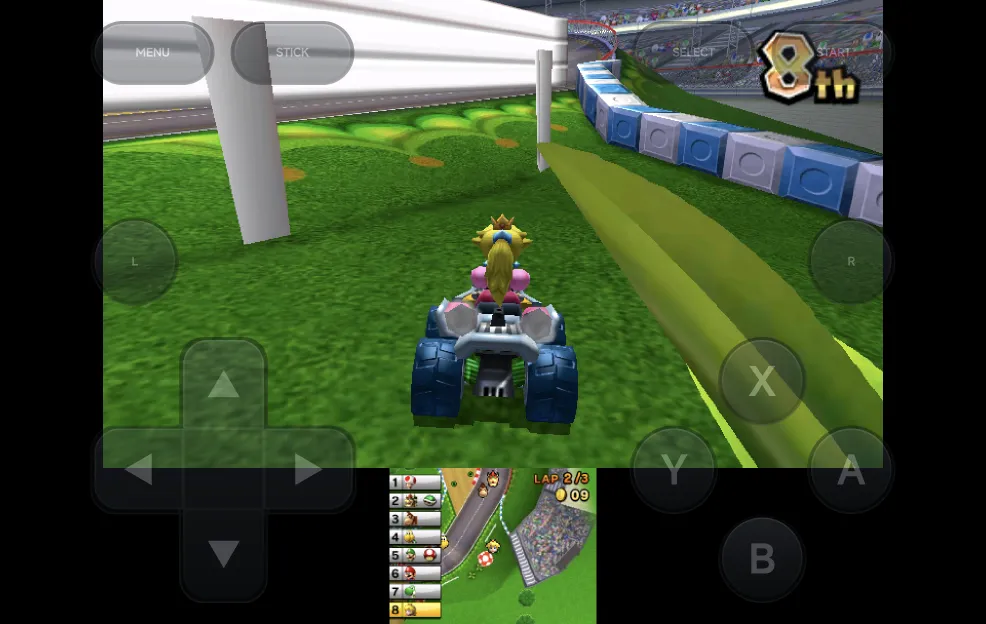
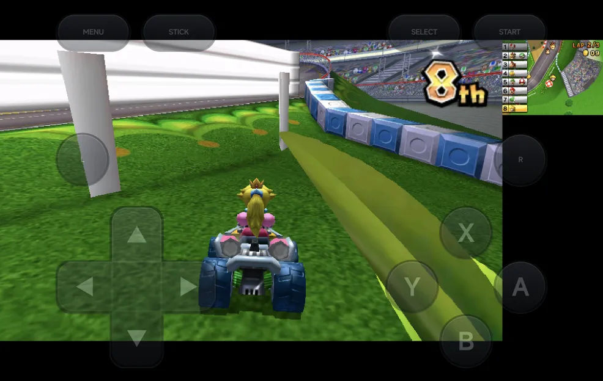
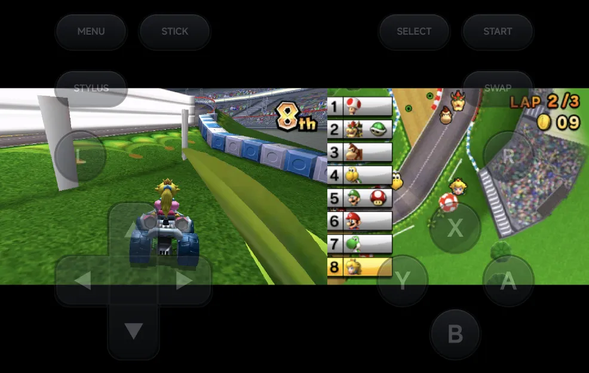
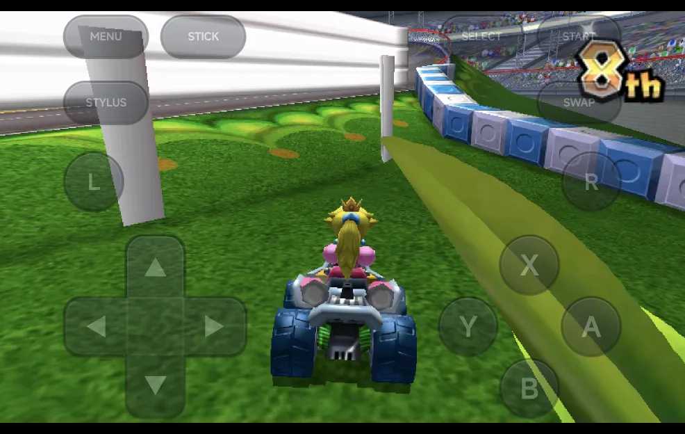
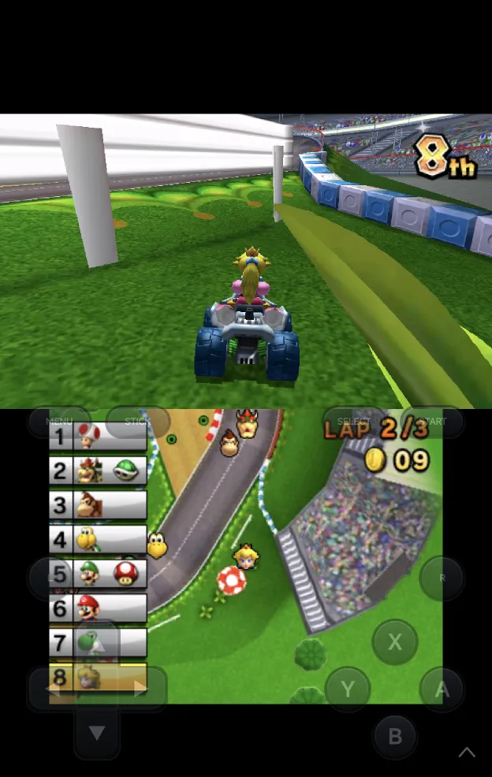

# Nintendo 3DS

Nintendo 3DS games run on the bundled **Azahar** core, which draws both
screens.

| | Azahar |
| --- | --- |
| Folder | `Roms/Nintendo 3DS (3DS)/` |
| BIOS | Not needed |
| [File types](index.md) | Decrypted `3ds` `cci` `cxi` `3dsx`, and their compressed versions `zcci` `zcxi` `z3dsx` |

- **Encrypted games don't load.** Decrypt them first.
- `.cia` install files are not supported.
- 3DS games are not on RetroAchievements in the app, and have no cheats.

## Controls

<figure class="nx-phone" markdown>
{ .nx-phone__screen }
{ .nx-phone__frame }
</figure>

The on-screen pad is laid out like a 3DS. `STICK` / `D-PAD` switches between
the d-pad and the Circle Pad. Games that use the New 3DS buttons also get
`ZL`, `ZR` and the C-stick: see [New 3DS controls](#new-3ds-controls).

The pad also has **STYLUS**, which turns [stylus mode](#stylus-mode) on or
off (pressed in while it's on), and **SWAP**, which swaps the screens. In
portrait they sit either side of `MENU` and `STICK`; over the game
(landscape, or portrait with the [pad hidden](#portrait-pad)) **STYLUS** is
under `MENU` and **SWAP** under `START`.

On a controller the shortcuts are `SELECT` combos, because `L2` and `R2` are
the 3DS's own `ZL` and `ZR`:

| Buttons | What they do |
| --- | --- |
| `SELECT` + `R1`, or **SWAP** | Swap the screens. |
| `SELECT` + `L1`, or **STYLUS** | Turn stylus mode on or off. |
| `SELECT` + `LEFT` / `RIGHT` | Change the layout: **Top over bottom**, **Large screen**, **Side by side**, **Single screen**, and round again. |
| `SELECT` + `START`, or `MENU` | Open the [in-game menu](../in-game-menu.md). |

A controller adds:

| Control | Nintendo 3DS |
| --- | --- |
| `L2`, `R2` | `ZL`, `ZR`, also on controllers whose triggers are analog only |
| Left stick | The Circle Pad |
| Right stick | The C-stick, and the touch cursor |
| `R3` (press the right stick) | Tap at the cursor |
| `L3` (press the left stick) | Swap the screens |

A controller's face buttons work as printed: its `A` is the 3DS's `A`. To
use the 3DS's positions on an Xbox pad (`A` on the right), set
**Controller Layout** to **Nintendo** in **Options → Console Settings**; see
[Controls](../controls.md#controller-buttons).

!!! note "`SELECT` waits"
    The game gets `SELECT` when you let go of it, so a combo doesn't pause
    the game.

??? info "More detail: `SELECT`"
    Many 3DS games pause on Select, so the game never sees `SELECT` while you
    hold it:

    - Tap it and the game gets `SELECT` when you let go.
    - Hold it longer than 1 second without a combo and nothing is sent.
    - After a combo (`SELECT` + `R1`, `L1`, `LEFT`, `RIGHT` or `START`) the
      game gets nothing.

## Motion

Games that use the 3DS's gyroscope and tilt read your phone's: turn or tip
the phone the way you would turn or tip a 3DS. In Mario Kart 7's first-person
view, for example, you steer by turning the phone.

Motion is always on, like on a 3DS. Hold the phone the way the game expects,
as you would a 3DS.

??? info "More detail"
    - There's no setting for motion.
    - It works in portrait and in both landscape directions. The game reads
      the phone's tilt as it is.
    - The sensors only run while you play. They stop while the game is
      paused, in the in-game menu, or in the background.
    - On a phone without a gyroscope, tilting still works, but aiming by
      turning the phone does nothing.

## New 3DS controls

<figure class="nx-phone" markdown>
{ .nx-phone__screen }
{ .nx-phone__frame }
</figure>

**New 3DS Controls** adds `ZL` and `ZR` and the C-stick to the on-screen pad.
Set it for the console in [Emulator Settings](../emulator-settings.md), or
in the in-game menu under **Options → Console Settings**, where
[Save Changes](../in-game-menu.md#save-changes) keeps it for the game or the
console:

| Value | What the pad shows |
| --- | --- |
| **Auto** (default) | The extra controls for games known to use them, such as Majora's Mask 3D (camera). |
| **On** | The extra controls for every game. |
| **Off** | No extra controls. |

A controller's right stick, `L2` and `R2` always reach the game, whatever
the setting. Azahar runs as a New 3DS, so Circle Pad Pro games work without
extra setup.

??? info "More detail"
    - **Auto** covers games that use the C-stick, `ZL` / `ZR` or the Circle
      Pad Pro, such as Majora's Mask 3D, Monster Hunter 4 Ultimate and
      Xenoblade Chronicles 3D.
    - `ZL` and `ZR` sit where `L2` and `R2` are on other consoles. The
      C-stick is centred under `SELECT` and `START` in portrait, and at the
      top left of the face buttons in landscape.
    - A change in the in-game menu updates the pad straight away.

    **Auto** finds the game by the title ID in `.3ds`, `.cci` and `.cxi`
    files. It can't read the compressed `zcci`, `zcxi` and `z3dsx` files or
    `3dsx` files, so for those set **On** yourself.

## Touch

Touch the bottom screen directly. While the on-screen buttons are over the
game (landscape without a controller, or portrait with the
[pad hidden](#portrait-pad)), it takes finger touches only when it is the
main screen: swap it there with **SWAP**, then touch it between the
buttons. Stylus mode's cursor reaches it either way.

## Stylus mode

In stylus mode a dot on the bottom screen is the stylus, the same pen dot
as on the [Nintendo DS](nintendo-ds.md#stylus-mode). It shows once you move
it:

| Control | What it does |
| --- | --- |
| D-pad or left stick | Move the dot. The d-pad speeds up the longer you hold it. |
| `A` | Tap at the dot. |
| **STYLUS**, or `SELECT` + `L1` | Turn stylus mode off again. |

Stylus mode is off each time a game starts, and is not saved.

## Screen layout

| Layout | Portrait | Landscape |
| --- | --- | --- |
| **Top over bottom** (default) The top screen above the bottom screen. In landscape the top screen takes three quarters of the height and the bottom screen is a third of its size. |  |  |
| **Large screen** The top screen big, the bottom screen small at its top right. |  |  |
| **Side by side** The two screens next to each other. |  |  |
| **Single screen** Only the top screen. |  |  |

**SWAP** (or `SELECT` + `R1`) swaps which screen is the big or upper one, in
every layout.
`SELECT` + `LEFT` / `RIGHT` saves the layout for the game straight away,
without Save Changes.

### Portrait pad

In portrait, long-press the arrow in the pad's bottom-right corner to hide
the pad band: the screens get its room and the see-through landscape buttons
sit over the lower half of the game. Long-press the arrow again to bring the
band back. It's **Portrait Pad** in **Options → Console Settings**, and the
long-press saves it for the console.

Touch follows the [touch rule](#touch): swap the bottom screen up with
**SWAP** to touch it, or use [stylus mode](#stylus-mode). With a
controller connected the buttons hide.

??? info "More detail"
    - The layout is Azahar's **Screen Layout** option, so you can also set it
      in **Core Options**, or for the console in
      [Emulator Settings](../emulator-settings.md).
    - **Screen Swap Mode** in **Core Options** sets whether the swap toggles
      (the default) or lasts only while you hold the buttons.
