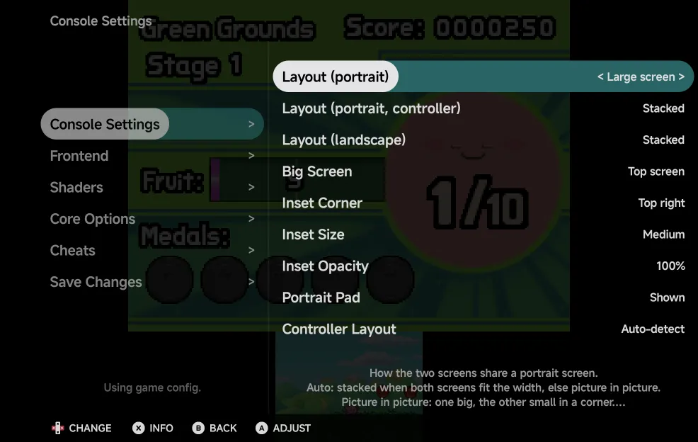
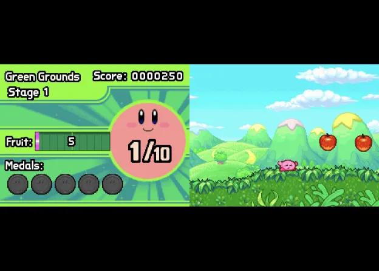
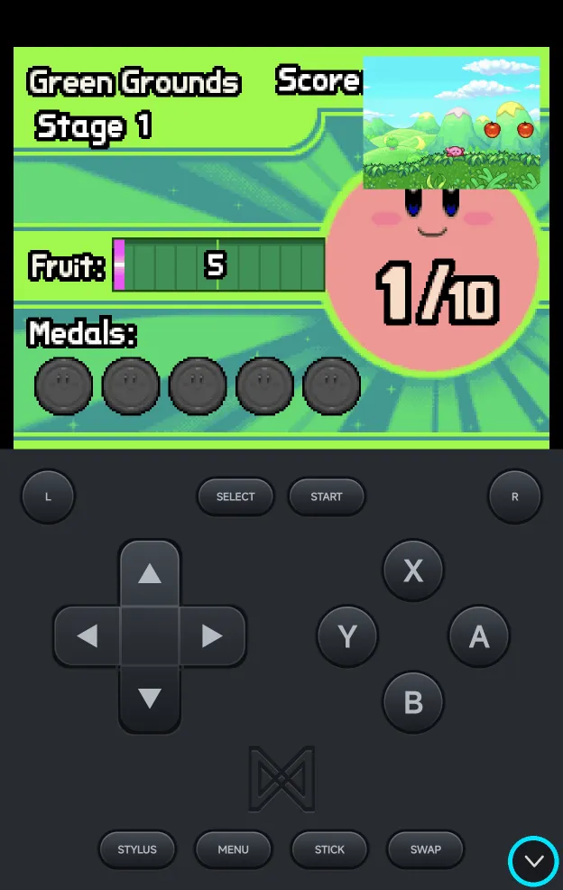
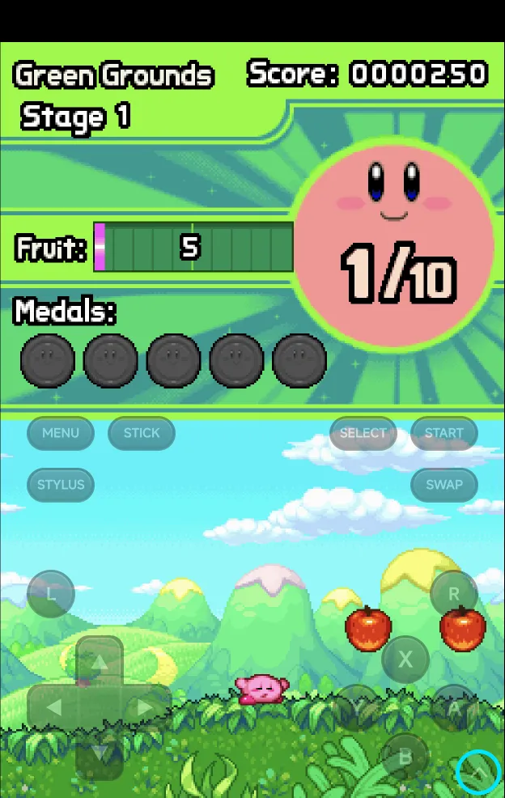

# Nintendo DS

Nintendo DS games run on the bundled **melonDS DS** core. The app lays out
the two screens.

| | melonDS DS |
| --- | --- |
| Folder | `Roms/Nintendo DS (NDS)/` |
| Saves | `Saves/NDS/`. Saves from other DS emulators carry over (see [below](#saves-from-other-ds-emulators)). |
| BIOS | Not needed: free BIOS and firmware are built in. Real ones in `Bios/NDS/` are used when present. |
| [File types](index.md) | `nds` (also inside a zip or 7z) |

## Controls

<figure class="nx-phone" markdown>
{ .nx-phone__screen }
{ .nx-phone__frame }
</figure>

The face buttons, d-pad, `L1`, `R1`, `START` and `SELECT` are the DS's own:
the on-screen pad labels `L1` and `R1` as **L** and **R**. Two more buttons
on the pad are the app's:

- **STYLUS** turns [stylus mode](#stylus-mode) on or off. It stays pressed in
  while stylus mode is on.
- **SWAP** swaps the big screen.

In portrait they sit either side of `MENU` and `STICK`. Over the game
(landscape, or portrait with the [pad hidden](#portrait-pad)) **STYLUS** is
under `MENU` and **SWAP** under `START`.

With a controller or the on-screen pad:

| Buttons | What they do |
| --- | --- |
| `R2` on a controller, or **SWAP** | Swap the big screen. |
| `SELECT` + `LEFT` / `RIGHT` | Change the layout of the orientation you're in. In portrait this steps through Picture in picture, Stacked, Single screen, Large screen and Side by side. |
| `SELECT` + `UP` / `DOWN` | Move the inset to the previous or next corner, clockwise. |
| `L2` on a controller, or **STYLUS** | Turn stylus mode on or off. |
| `MENU`, or `SELECT` + `START` | Open the [in-game menu](../in-game-menu.md). |

The layout hotkeys (swap and `SELECT` + a direction) are saved straight
away, without Save Changes. Stylus mode is not saved.

??? info "More detail"
    - A short label shows the new setting.
    - A controller's `L2` and `R2` never reach the game: the DS has no such
      buttons.
    - `SELECT` on its own still reaches the game. Only `SELECT` + a direction
      is kept by the app.
    - A controller's left stick works as the d-pad, except in stylus mode,
      where it moves the pen.

    Saving a layout hotkey gives the game its own settings, copied from the
    console's if it had none. From then on the game uses only its own
    settings. Later **Save for console** changes don't reach it until you use
    **Restore defaults** in that game.

## Console Settings

The DS's own options are in the in-game menu under **Options → Console
Settings**, and for the console in
[Emulator Settings](../emulator-settings.md). `LEFT` / `RIGHT` change a
value; keep it for the game or the console with
[Save Changes](../in-game-menu.md#save-changes).

{ .nx-wide }

| Row | Values | Default | See |
| --- | --- | --- | --- |
| **Layout (portrait)** | Auto, Picture in picture, Stacked, Single screen, Large screen, Side by side | Auto | [Screen layouts](#screen-layouts) |
| **Layout (portrait, controller)** | The same | Stacked | [Screen layouts](#screen-layouts) |
| **Layout (landscape)** | Side by side, Single screen, Picture in picture, Large screen, Stacked | Stacked | [Screen layouts](#screen-layouts) |
| **Big Screen** | Top screen, Bottom screen | Top screen | [Big screen and inset](#big-screen-and-inset) |
| **Inset Corner** | Top left, Top right, Bottom left, Bottom right | Top right | [Big screen and inset](#big-screen-and-inset) |
| **Inset Size** | Small, Medium, Large | Medium | [Big screen and inset](#big-screen-and-inset) |
| **Inset Opacity** | 100%, 75%, 50% | 100% | [Big screen and inset](#big-screen-and-inset) |
| **Portrait Pad** | Shown, Hidden | Shown | [Portrait pad](#portrait-pad) |
| **Controller Layout** | Auto-detect, Xbox (A at the bottom), Nintendo (A on the right) | Auto-detect | [Controls](../controls.md#controller-buttons) |

Every row takes effect straight away; none needs the game restarted. Only
**Render Mode** in **Core Options** waits for the next start (see
[3D rendering](#3d-rendering)).

## Screen layouts

The DS has two screens, and there's more than one way to fit them on a
phone. Pick a layout for each orientation to suit the game and how you
like to play: both screens the same size, one big with the other small, or
just one. The pictures are in portrait; landscape draws the same layouts
across the wider screen. Portrait and landscape keep their own layout, so turning the
phone switches between them, and `SELECT` + `LEFT` / `RIGHT` changes the
one you're in without opening the menu.

| Layout | Picture |
| --- | --- |
| **Stacked** One screen above the other. In landscape the first takes three quarters of the height and the other is a third of its size. |  |
| **Picture in picture** One screen big, the other small in a corner over it. `SELECT` + `UP` / `DOWN` moves the small screen to another [corner](#controls). |  |
| **Large screen** One screen big, the other small next to it: above or below it in portrait, beside it in landscape. `SELECT` + `UP` / `DOWN` moves the small screen to another [corner](#controls). |  |
| **Single screen** Only the big screen. |  |
| **Side by side** Each screen takes half the width. |  |
| **Auto** **Stacked** when both screens fit the width, else **Picture in picture**. Portrait only. |  |

**Layout (portrait)** and **Layout (landscape)** in
[Console Settings](#console-settings) pick the layout for each orientation:
**Auto** in portrait and **Stacked** in landscape by default.

With a controller connected, the on-screen pad goes away in portrait and the
screens get the full height. **Layout (portrait, controller)** is used then:
same choices, **Stacked** by default.

Without a controller, the on-screen buttons sit over the game in landscape.
**Pad Opacity (landscape)** in **Options → Frontend** sets how opaque
they are: 100%, 60%, 40% or 25% (40% by default).

??? info "More detail"
    - A clip-on controller that holds the phone keeps the pad band and the
      normal portrait layout. The GameSir Pocket Taco is recognised as one.
      The 8BitDo FlipPad is expected to be recognised too.
    - Screen Scaling and the screen offsets don't apply to the DS screens.

### Big screen and inset

These apply in both orientations, straight away: no restart needed.

| Option | Values | Default | What it does |
| --- | --- | --- | --- |
| **Big Screen** | Top screen, Bottom screen | Top screen | The screen shown big in picture in picture, large screen and single screen, and first in stacked and side by side. |
| **Inset Corner** | Top left, Top right, Bottom left, Bottom right | Top right | Where the small screen sits in picture in picture and large screen. |
| **Inset Size** | Small, Medium, Large | Medium | The small screen's width in picture in picture and large screen: 25%, 33% or 40% of the big screen's width. |
| **Inset Opacity** | 100%, 75%, 50% | 100% | How opaque the small screen is. Below 100%, the big screen shows through it. |

??? info "More detail"
    - Overlays are off while the DS screens are drawn apart. The **Overlay**
      row shows **Unavailable**.
    - Shader presets apply to the big screen, and to both screens in portrait
      stacked and side by side. The small screen of picture in picture, large
      screen and landscape stacked is drawn without them.

## Stylus mode

In stylus mode a dot on the bottom screen is the pen, for touching it without
your finger.

| Control | What it does |
| --- | --- |
| D-pad or left stick | Move the dot. The d-pad speeds up the longer you hold it. |
| `A` | Touch at the dot. |
| **STYLUS**, or `L2` on a controller | Turn stylus mode on or off. |

Stylus mode is off each time a game starts, and is not saved.

## Touch

Touch the bottom screen wherever it is drawn, as long as the on-screen
buttons aren't over the game: in portrait with the pad band, or with a
controller.

While the on-screen buttons are over the game (landscape without a
controller, or portrait with the [pad hidden](#portrait-pad)), only the main
screen takes touches: the big one, or the first (top or left) when both are
the same size.

**For games that need buttons and touch together**, press **SWAP** to make
the bottom screen the main one. Then touch it anywhere between the buttons
while you play with them. A layout with one big screen gives it the most
room.

??? info "More detail"
    - The see-through buttons still take the touches that land on them. To
      reach something under a button, such as a menu item in a corner of the
      bottom screen, use [stylus mode](#stylus-mode), whose pen reaches the
      bottom screen either way, or turn the phone to portrait.

## Portrait pad

In portrait, long-press the arrow in the pad's bottom-right corner to hide
the pad band. The two screens get its room, and the see-through landscape
buttons sit over the lower half of the game instead. The arrow stays in the
corner: long-press it again to bring the band back. A plain tap does
nothing.

<figure class="nx-phone" markdown>
{ .nx-phone__screen }
{ .nx-phone__frame }
</figure>

Pad shown

<figure class="nx-phone" markdown>
{ .nx-phone__screen }
{ .nx-phone__frame }
</figure>

Pad hidden

The choice is **Portrait Pad** (Shown or Hidden) in **Options → Console
Settings**, and the long-press saves it for the console.

??? info "More detail"
    - Touch follows the [touch rule](#touch): swap the bottom screen up with
      **SWAP** to touch it, or use [stylus mode](#stylus-mode).
    - With a controller connected the see-through buttons hide too, as in
      landscape.
    - Landscape is not affected.

## Second screen

On a handheld with a second screen, or with a display on USB-C, the game
starts split: the top screen on one screen and the bottom screen on the
other, which takes the touches. **SWAP** (or `R2`) swaps them over, and the
stylus dot in [stylus mode](#stylus-mode) follows the bottom screen. The
**Panel** pill at the bottom right shows the game panel instead, with both
DS screens side by side on the other screen. See
[Dual Screens & External Displays](../dual-screen.md#nintendo-ds-and-3ds).

??? info "More detail"
    - While split, **SWAP** changes **Big Screen**, so the screen on the
      picture screen is the one **Big Screen** names.
    - The **Layout** rows aren't used while split or with the panel up.

## 3D rendering

**Internal Resolution** in **Core Options → Video** upscales 3D: 1× to 8×, 2×
by default. Some games slow down at 4× or higher.

??? info "More detail"
    - 3D renders on the GPU on devices with OpenGL ES 3.2, else in software.
    - Internal Resolution works with the GPU renderer only. The 2D layers stay
      at native resolution.
    - A **Render Mode** change in Core Options applies the next time the game
      starts, once you keep it with Save Changes.
    - If the GPU renderer can't start, the game runs in software and the app
      shows **GPU renderer unavailable — using software** once. The next
      launch tries the GPU again.

## Cheats and achievements

- [Cheats](../cheats.md): the cheat download has codes for Nintendo DS
  games, or add your own `.cht` files.
- [RetroAchievements](../retroachievements.md) works for Nintendo DS games.

## Saves from other DS emulators

Battery saves from the older melonDS core and from DraStic carry over. Save
states from the older melonDS core don't load.

??? info "More detail"
    Battery saves from the older melonDS core (`.sav`) and from DraStic
    (`.dsv`) are converted to `.srm` on a game's first launch.
