# Nintendo DS

Nintendo DS games run on the bundled **melonDS DS** core. The app lays out
the two screens.

| | melonDS DS |
| --- | --- |
| Folder | `Roms/Nintendo DS (NDS)/` |
| BIOS | Not needed: free BIOS and firmware are built in. Real ones in `Bios/NDS/` are used when present. |
| [File types](index.md) | `nds` (also inside a zip or 7z) |

## Screen layouts

The layout options are in the in-game menu under **Options → Console
Settings**. Keep them for the game or console with
[Save Changes](../in-game-menu.md#save-changes).

### Portrait layouts

**Layout (portrait)** sets how the two screens share a portrait screen:

| Layout | Picture |
| --- | --- |
| **Auto** (default) **Stacked** when both screens fit the width, else **Picture in picture**. |  |
| **Picture in picture** One screen big, the other small in a corner. | [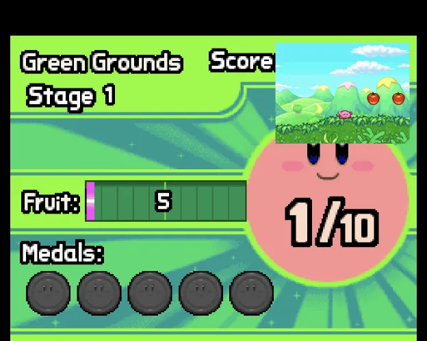](../../assets/screenshots/mobile/ds-portrait-pip.webp) |
| **Stacked** One screen above the other. | [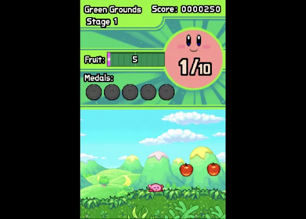](../../assets/screenshots/mobile/ds-portrait-stacked.webp) |
| **Single screen** Only the big screen. | [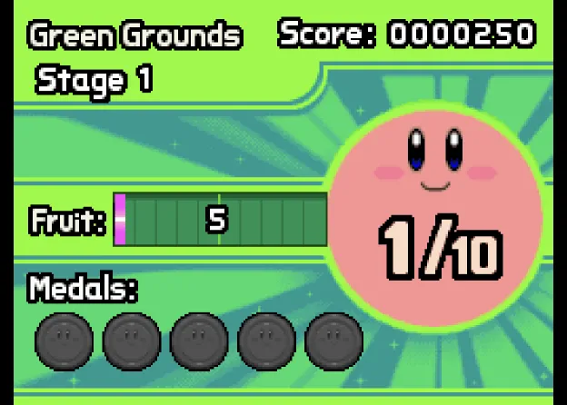](../../assets/screenshots/mobile/ds-portrait-single.webp) |
| **Large screen** One screen big, the other small above or below it, at the inset corner's side. | [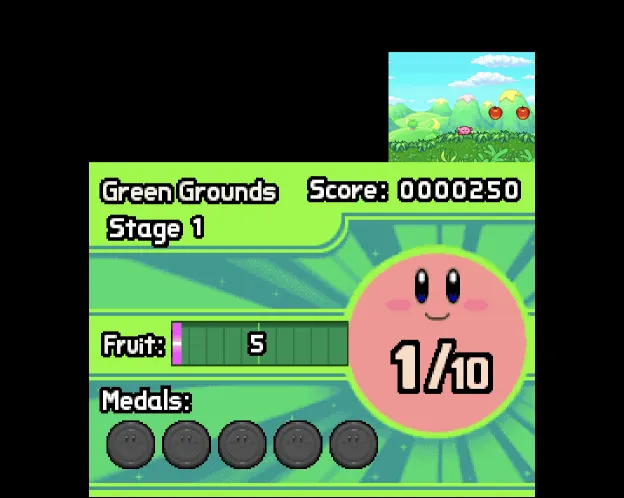](../../assets/screenshots/mobile/ds-portrait-large.webp) |

With a controller connected, the on-screen pad goes away and the screens get
the full height. **Layout (portrait, controller)** is used then: same
choices, **Stacked** by default.

??? info "More detail"
    - A clip-on controller that holds the phone keeps the pad band and the
      normal portrait layout. The GameSir Pocket Taco is recognised as one.
      The 8BitDo FlipPad is expected to be recognised too.
    - Screen Scaling and the screen offsets don't apply to the DS screens.

### Landscape layouts

**Layout (landscape)** sets how the two screens share a landscape screen:

| Layout | Picture |
| --- | --- |
| **Side by side** (default) Each screen takes half the width. | [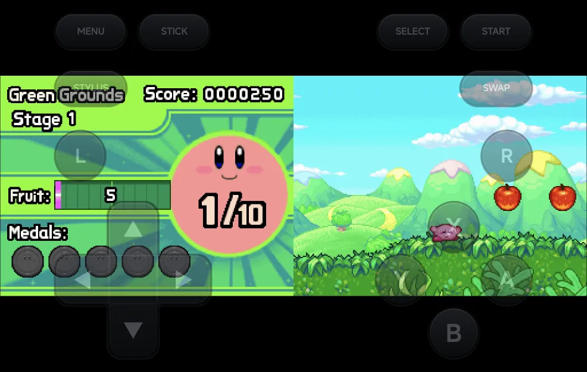](../../assets/screenshots/mobile/ds-landscape-side-by-side.webp) |
| **Single screen** The big screen only, centred. | [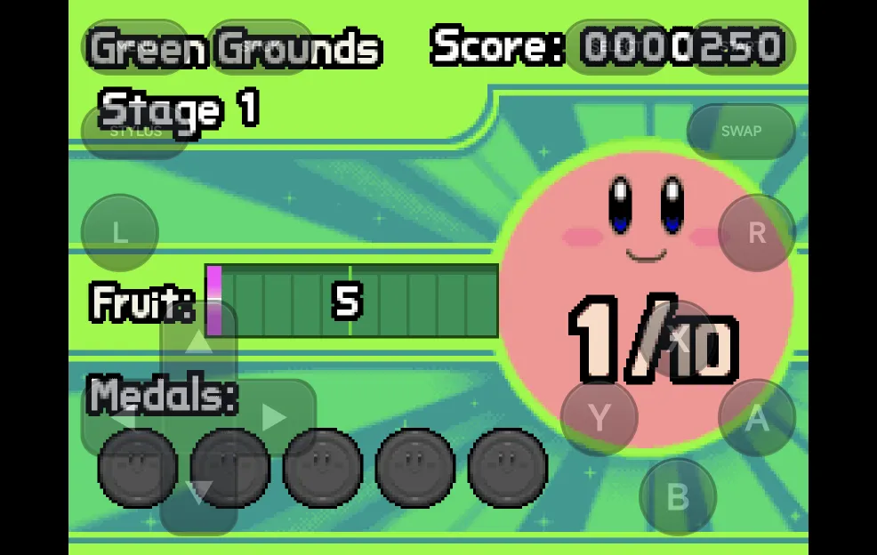](../../assets/screenshots/mobile/ds-landscape-single.webp) |
| **Picture in picture** The big screen centred, the other small in a corner. | [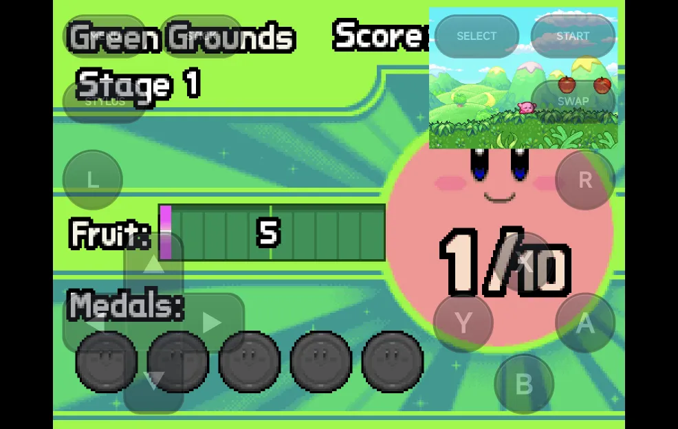](../../assets/screenshots/mobile/ds-landscape-pip.webp) |
| **Large screen** The big screen, the other small beside it, level with its top or bottom edge. | [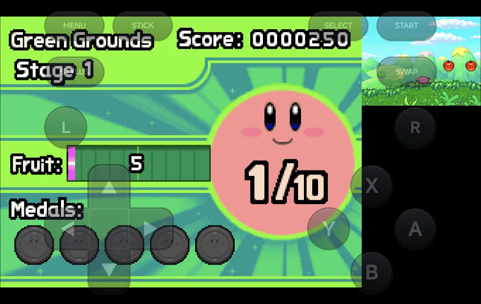](../../assets/screenshots/mobile/ds-landscape-large.webp) |
| **Stacked** The big screen above, taking three quarters of the height; the other below it, a third of its size. | [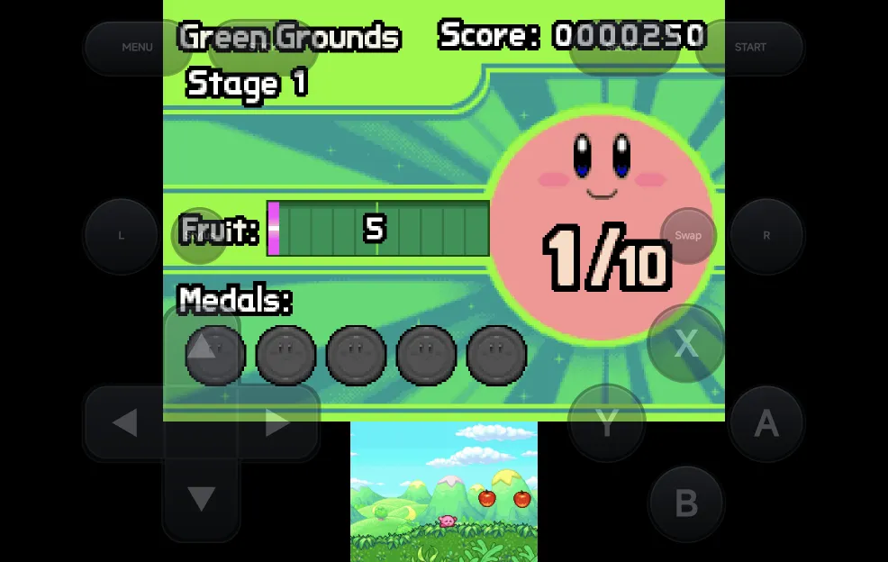](../../assets/screenshots/mobile/ds-landscape-stacked.webp) |

Without a controller, the on-screen buttons sit over the game in landscape.
**Pad Opacity (landscape)** in **Options → Frontend** sets how opaque
they are: 100%, 60%, 40% or 25% (40% by default).

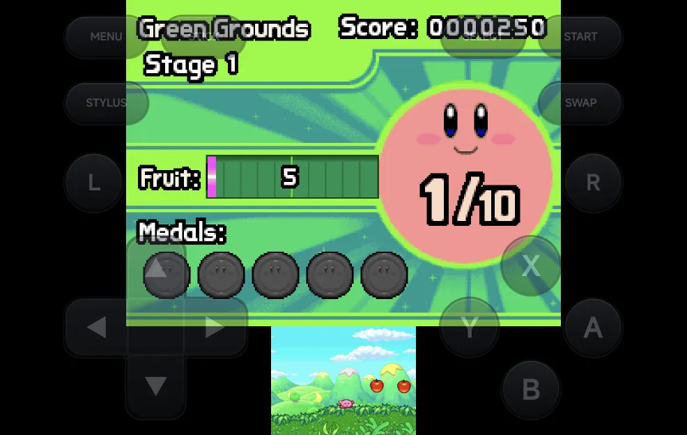

### Big screen and inset

These apply in both orientations:

| Option | Values | Default | What it does |
| --- | --- | --- | --- |
| **Big Screen** | Top screen, Bottom screen | Top screen | The screen shown big in picture in picture, large screen and single screen, and first in stacked and side by side. |
| **Inset Corner** | Top left, Top right, Bottom left, Bottom right | Top right | Where the small screen sits in picture in picture and large screen. |
| **Inset Size** | Small, Medium, Large | Medium | The small screen's width in picture in picture and large screen: 25%, 33% or 40% of the big screen's width. |
| **Inset Opacity** | 100%, 75%, 50% | 100% | How opaque the small screen is. Below 100%, the big screen shows through it. |

??? info "More detail"
    - Overlays are off while the DS screens are drawn apart. The **Overlay**
      row shows **Unavailable**.
    - Shader presets apply to the big screen, and to both screens in portrait
      stacked and side by side. The small screen of picture in picture, large
      screen and landscape stacked is drawn without them.

## Controls

<figure class="nx-phone" markdown>
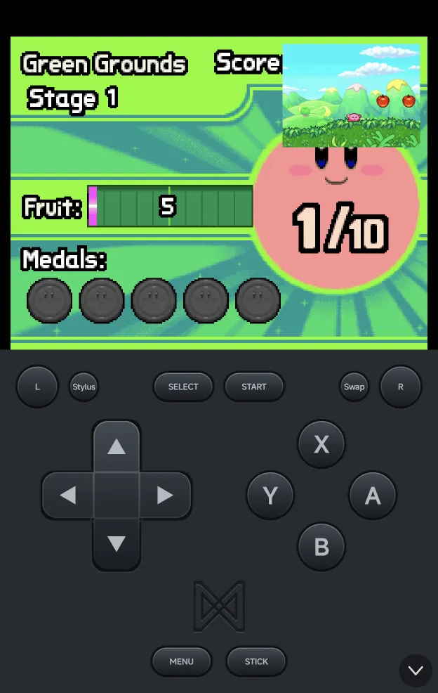{ .nx-phone__screen }
{ .nx-phone__frame }
</figure>

The face buttons, d-pad, `L1`, `R1`, `START` and `SELECT` are the DS's own:
the on-screen pad labels `L1` and `R1` as **L** and **R**. The DS has no
`L2` or `R2`, so the pad labels them by what they do here: **Stylus** and
**Swap**. With a controller or the on-screen pad:

| Buttons | What they do |
| --- | --- |
| `R2` | Swap the big screen. |
| `SELECT` + `LEFT` / `RIGHT` | Change the layout of the orientation you're in. In portrait this steps through Picture in picture, Stacked, Single screen and Large screen. |
| `SELECT` + `UP` / `DOWN` | Move the inset to the previous or next corner, clockwise. |
| `L2` | Turn stylus mode on or off. |
| `MENU`, or `SELECT` + `START` | Open the [in-game menu](../in-game-menu.md). |

The layout hotkeys (`R2` and `SELECT` + a direction) are saved straight
away, without Save Changes. Stylus mode is not saved.

??? info "More detail"
    - A short label shows the new setting.
    - `L2` and `R2` never reach the game: the DS has no such buttons.
    - `SELECT` on its own still reaches the game. Only `SELECT` + a direction
      is kept by the app.
    - A controller's left stick works as the d-pad, except in stylus mode,
      where it moves the pen.

    Saving a layout hotkey gives the game its own settings, copied from the
    console's if it had none. From then on the game uses only its own
    settings. Later **Save for console** changes don't reach it until you use
    **Restore defaults** in that game.

## Stylus mode

In stylus mode, the d-pad or left stick moves a pen on the bottom screen,
faster the longer you hold it, and `A` touches at the pen. Stylus mode is off
each time a game starts.

## Touch

Touch the bottom screen wherever it is drawn, as long as the on-screen
buttons aren't over the game: in portrait with the pad band, or with a
controller.

While the on-screen buttons are over the game (landscape without a
controller, or portrait with the [pad hidden](#portrait-pad)), only the big
screen takes touches: in picture in picture, large screen and single screen
the big one, in stacked and side by side the first one.

**For games that need buttons and touch together**, press `R2` to make the
bottom screen the big one. Then touch it anywhere between the buttons while
you play with them. Single screen, large screen or picture in picture give
the bottom screen the most room.

??? info "More detail"
    - The see-through buttons still take the touches that land on them. To
      reach something under a button, such as a menu item in a corner of the
      bottom screen, use [stylus mode](#stylus-mode) or turn the phone to
      portrait.

## Portrait pad

In portrait, long-press the arrow in the pad's bottom-right corner to hide
the pad band. The two screens get its room, and the see-through landscape
buttons sit over the lower half of the game instead. The arrow stays in the
corner: long-press it again to bring the band back. A plain tap does
nothing.

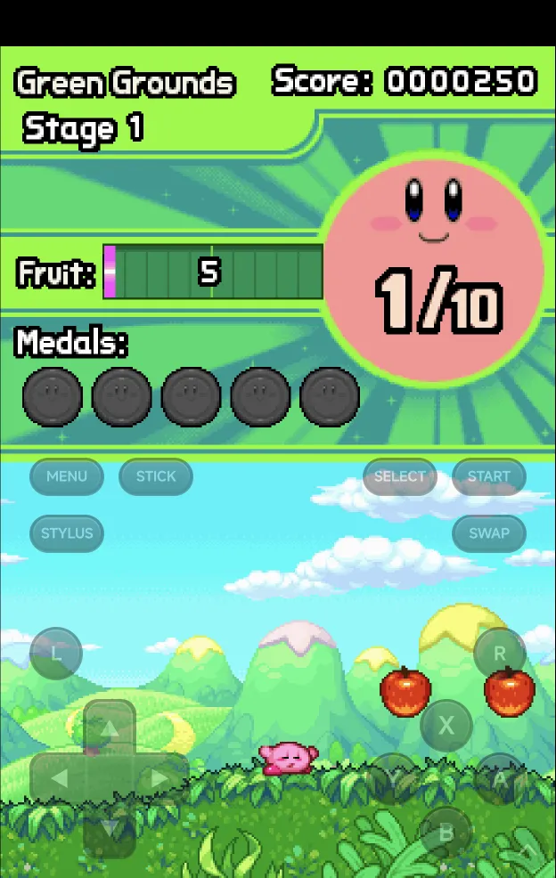

The choice is **Portrait Pad** (Shown or Hidden) in **Options → Console
Settings**, and the long-press saves it for the console.

??? info "More detail"
    - Only the screen above the buttons takes touches. Swap the bottom screen
      up with `R2`, or use [stylus mode](#stylus-mode).
    - With a controller connected the see-through buttons hide too, as in
      landscape.
    - Landscape is not affected.

## 3D rendering

**Internal Resolution** in **Core Options → Video** upscales 3D: 1× to 8×, 2×
by default. Some games slow down at 4× or higher.

??? info "More detail"
    - 3D renders on the GPU on devices with OpenGL ES 3.2, else in software.
    - Internal Resolution works with the GPU renderer only. The 2D layers stay
      at native resolution.
    - A **Render Mode** change in Core Options applies the next time the game
      starts, once you keep it with Save Changes.
    - If the GPU renderer can't start, the game runs in software and the app
      shows **GPU renderer unavailable — using software** once. The next
      launch tries the GPU again.

## Saves from other DS emulators

Battery saves from the older melonDS core and from DraStic carry over. Save
states from the older melonDS core don't load.

??? info "More detail"
    Battery saves from the older melonDS core (`.sav`) and from DraStic
    (`.dsv`) are converted to `.srm` on a game's first launch.
