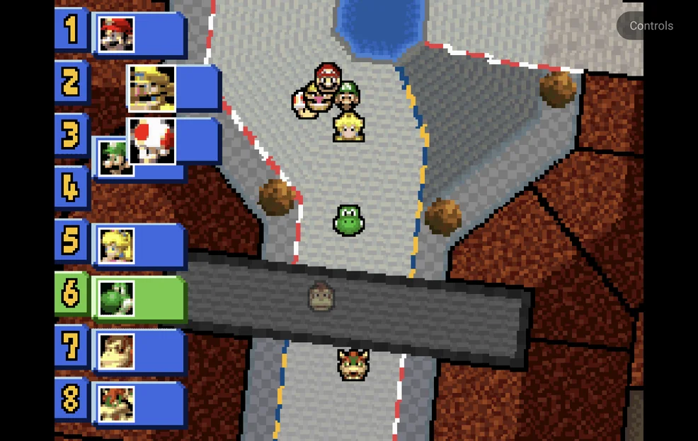

# Nintendo DS

Nintendo DS games run on the bundled **melonDS DS** core. The app lays out
the two screens.

| | melonDS DS |
| --- | --- |
| Folder | `Roms/Nintendo DS (NDS)/` |
| BIOS | Not needed: free BIOS and firmware are built in. Real ones in `Bios/NDS/` are used when present. |
| [File types](index.md) | `nds` (also inside a zip or 7z) |

## Screen layouts

The layout options are in the in-game menu under **Options → Console
Settings**. Keep them for the game or console with
[Save Changes](../in-game-menu.md#save-changes).

### Portrait layouts

**Layout (portrait)** sets how the two screens share a portrait screen:

| Layout | What you see |
| --- | --- |
| **Auto** (default) | **Stacked** when both screens fit the width, else **Picture in picture**. |
| **Picture in picture** | One screen big, the other small in a corner. |
| **Stacked** | One screen above the other. |
| **Single screen** | Only the big screen. |

With a controller connected, the on-screen pad goes away and the screens get
the full height. **Layout (portrait, controller)** is used then: same
choices, **Stacked** by default.

??? info "More detail"
    - A clip-on controller that holds the phone keeps the pad band and the
      normal portrait layout. The GameSir Pocket Taco is recognised as one.
      The 8BitDo FlipPad is expected to be recognised too.
    - Screen Scaling and the screen offsets don't apply to the DS screens.

### Landscape layouts

**Layout (landscape)** sets how the two screens share a landscape screen:

| Layout | What you see |
| --- | --- |
| **Side by side** (default) | Each screen takes half the width. |
| **Single screen** | The big screen only, centred. |
| **Picture in picture** | The big screen centred, the other small in a corner. |

Without a controller, the on-screen buttons sit over the game in landscape.
**Pad Opacity (landscape)** in **Options → Frontend** sets how opaque
they are: 100%, 60%, 40% or 25% (40% by default).

### Big screen and inset

These apply in both orientations:

| Option | Values | Default | What it does |
| --- | --- | --- | --- |
| **Big Screen** | Top screen, Bottom screen | Top screen | The screen shown big in picture in picture and single screen, and first in stacked and side by side. |
| **Inset Corner** | Top left, Top right, Bottom left, Bottom right | Bottom right | Where the small screen sits in picture in picture. |
| **Inset Size** | Small, Medium, Large | Medium | The small screen's width: 25%, 33% or 40% of the big screen's width. |
| **Inset Opacity** | 100%, 75%, 50% | 100% | How opaque the small screen is. Below 100%, the big screen shows through it. |

??? info "More detail"
    - The small screen in picture in picture never takes touches.
    - Overlays are off while the DS screens are drawn apart. The **Overlay**
      row shows **Unavailable**.
    - Shader presets apply to the big screen, and to both screens in stacked
      and side by side.

## Controls

The face buttons, d-pad, `L1`, `R1`, `START` and `SELECT` are the DS's own.
On top of that, with a controller or the on-screen pad:

| Buttons | What they do |
| --- | --- |
| `R2` | Swap the big screen. |
| `SELECT` + `LEFT` / `RIGHT` | Change the layout of the orientation you're in. In portrait this steps through Picture in picture, Stacked and Single screen. |
| `SELECT` + `UP` / `DOWN` | Move the inset to the previous or next corner, clockwise. |
| `L2` | Turn stylus mode on or off, or start touch mode (see below). |
| `MENU`, or `SELECT` + `START` | Open the [in-game menu](../in-game-menu.md). |

The layout hotkeys (`R2` and `SELECT` + a direction) are saved straight
away, without Save Changes. Stylus mode and touch mode are not saved.

??? info "More detail"
    - A short label shows the new setting.
    - `L2` and `R2` never reach the game: the DS has no such buttons.
    - `SELECT` on its own still reaches the game. Only `SELECT` + a direction
      is kept by the app.
    - A controller's left stick works as the d-pad, except in stylus mode,
      where it moves the pen.

    Saving a layout hotkey gives the game its own settings, copied from the
    console's if it had none. From then on the game uses only its own
    settings. Later **Save for console** changes don't reach it until you use
    **Restore defaults** in that game.

## Stylus mode

In stylus mode, the d-pad or left stick moves a pen on the bottom screen,
faster the longer you hold it, and `A` touches at the pen. Stylus mode is off
each time a game starts.

## Touch

Touch the bottom screen when it is drawn full size (not as the small inset).

- In portrait, touch always works.
- In landscape, it works with a controller. Without one, the on-screen
  buttons cover the game, so use touch mode.

**Touch mode:** in landscape, `L2` hides the on-screen buttons and shows the
bottom screen big, so you can touch it. The **Controls** button in a free
corner brings the buttons back.

??? info "More detail"
    - Touch mode starts with the on-screen buttons shown and stylus mode off.
      With stylus mode on, `L2` turns stylus mode off first.
    - In single screen and picture in picture, the bottom screen becomes the
      big one. Side by side already shows it full size.
    - Rotating the phone, or connecting or disconnecting a controller, also
      ends touch mode.
    - `R2` does nothing in touch mode, and touch mode is not saved.

## 3D rendering

**Internal Resolution** in **Core Options → Video** upscales 3D: 1× to 8×, 2×
by default. Some games slow down at 4× or higher.

??? info "More detail"
    - 3D renders on the GPU on devices with OpenGL ES 3.2, else in software.
    - Internal Resolution works with the GPU renderer only. The 2D layers stay
      at native resolution.
    - A **Render Mode** change in Core Options applies the next time the game
      starts, once you keep it with Save Changes.
    - If the GPU renderer can't start, the game runs in software and the app
      shows **GPU renderer unavailable — using software** once. The next
      launch tries the GPU again.

## Saves from other DS emulators

Battery saves from the older melonDS core and from DraStic carry over. Save
states from the older melonDS core don't load.

??? info "More detail"
    Battery saves from the older melonDS core (`.sav`) and from DraStic
    (`.dsv`) are converted to `.srm` on a game's first launch.
