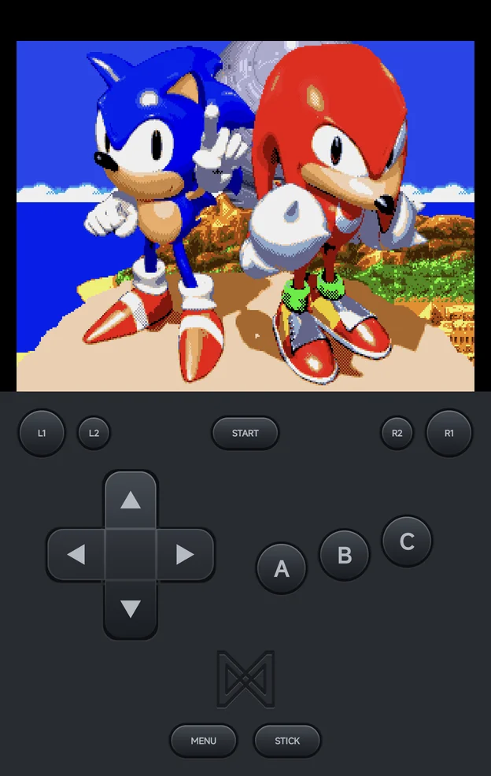
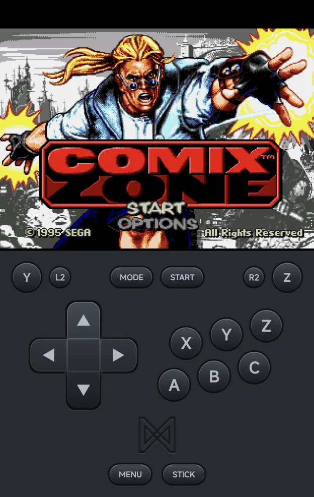

# Sega Consoles

Sega Genesis, Sega CD, 32X, Master System, Game Gear and SG-1000 games run on
the bundled **PicoDrive** core by default. All but the 32X can run on
**Genesis Plus GX** instead; see
[Choosing an emulator](index.md#choosing-an-emulator).

| | Folder | BIOS | [File types](index.md) |
| --- | --- | --- | --- |
| Sega Genesis | `Roms/Sega Genesis (MD)/` | Not needed | `md` `gen` `smd` `bin` `68k` |
| Sega CD | `Roms/Sega CD (SEGACD)/` | `bios_CD_U.bin` (USA), `bios_CD_E.bin` (Europe) or `bios_CD_J.bin` (Japan) in `Bios/SEGACD/` | `chd` `cue` `iso` `m3u` |
| Sega 32X | `Roms/Sega 32X (32X)/` | Not needed | `32x` |
| Master System | `Roms/Sega Master System (SMS)/` | Not needed | `sms` |
| Game Gear | `Roms/Sega Game Gear (GG)/` | Not needed | `gg` |
| SG-1000 | `Roms/Sega SG-1000 (SG1000)/` | Not needed | `sg` |

Saves go in `Saves/<tag>/`, such as `Saves/MD/`.

??? info "More detail"
    - Battery saves are shared by PicoDrive and Genesis Plus GX, so a game
      switched to the other emulator keeps its progress. Save states stay
      per emulator.
    - A handheld `Sega Genesis (GPGX)` or `Sega Master System (GPGX)` folder
      is just that console's folder. Its tag names the console, not the
      emulator.

## Controls

<figure class="nx-phone" markdown>
{ .nx-phone__screen }
{ .nx-phone__frame }
</figure>

3-button pad

<figure class="nx-phone" markdown>
{ .nx-phone__screen }
{ .nx-phone__frame }
</figure>

6-button pad

The on-screen pad draws the Sega pad the game gets: the 3-button pad, or the
6-button pad for games made for it (see [Controller Type](#controller-type)).
A controller plays the Genesis, Sega CD and 32X **by position**:

| Controller | 6-button pad | 3-button pad |
| --- | --- | --- |
| Left, top and right face buttons | `A`, `B`, `C` | `A`, `B`, `C` |
| Bottom face button | `X` | Not used |
| `L1`, `R1` | `Y`, `Z` | Not used |
| `SELECT` | `Mode` | Not used |

On the Master System, Game Gear and SG-1000, the bottom and right face
buttons are `1` and `2`.

## Console Settings

Genesis, Sega CD and 32X games have two rows in the in-game menu's
**Options → Console Settings**, also set for the console in
[Emulator Settings](../emulator-settings.md). Both take effect straight
away; keep them for the game or the console with
[Save Changes](../in-game-menu.md#save-changes).

| Row | Values | Default | See |
| --- | --- | --- | --- |
| **Controller Type** | Auto, 3 buttons, 6 buttons | Auto | [Controller Type](#controller-type) |
| **Controller Layout** | Auto-detect, Xbox (A at the bottom), Nintendo (A on the right) | Auto-detect | [Controls](../controls.md#controller-buttons) |

### Controller Type

| Value | What the game sees |
| --- | --- |
| **Auto** (default) | A 6-button pad only for games made for one, else a 3-button pad |
| **3 buttons** | A 3-button pad |
| **6 buttons** | A 6-button pad |

Some older games misbehave with a 6-button pad. The on-screen pad changes to
match, and Player 2 gets the same pad.

## Multiplayer

- Two players can play on the Genesis, Sega CD, 32X, Master System and
  SG-1000, each on their own controller; see
  [Local Multiplayer](../multiplayer.md). The Game Gear is one player.
- Every Sega console here also plays over [Netplay](../netplay.md).

## Cheats and achievements

- [Cheats](../cheats.md): the cheat download has codes for every Sega console
  here, or add your own `.cht` files.
- [RetroAchievements](../retroachievements.md) works for all of them.
