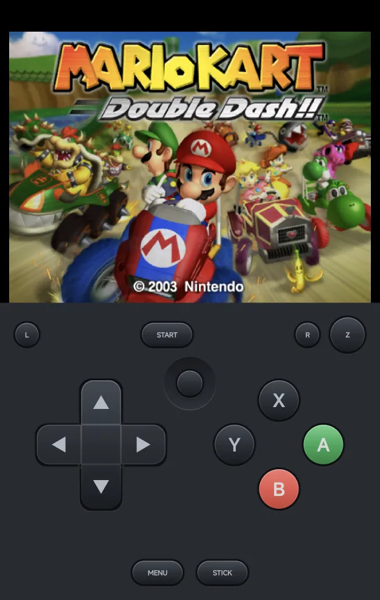
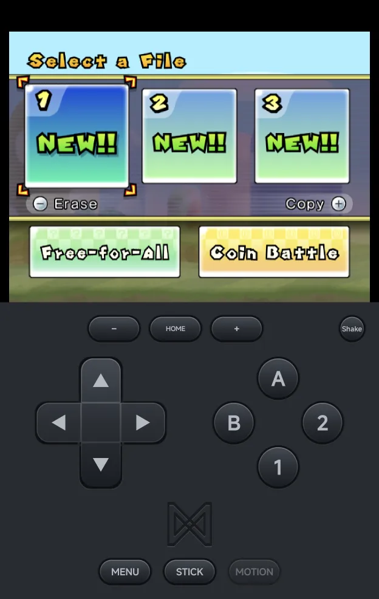
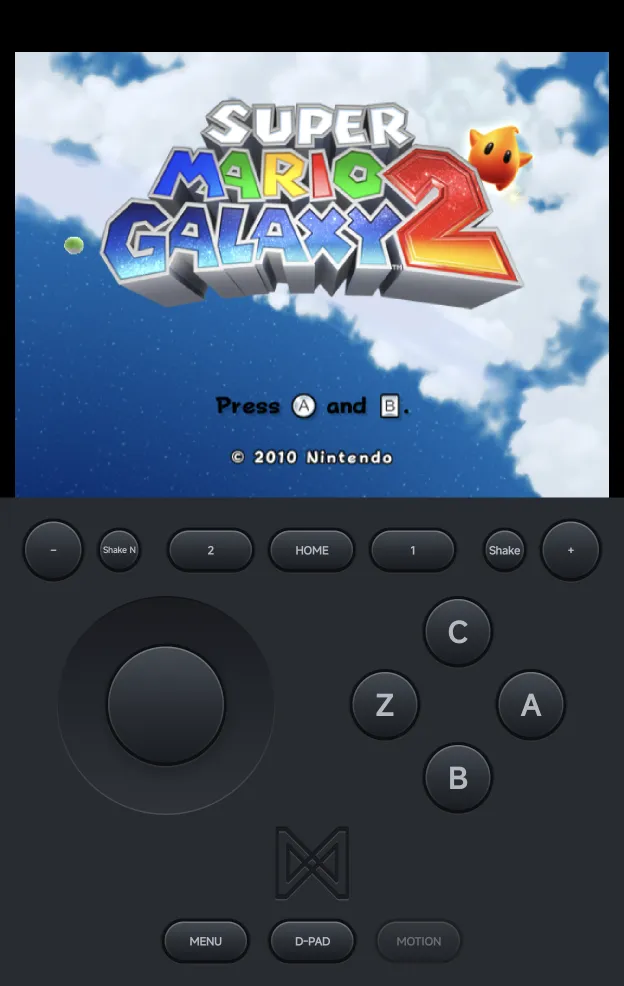
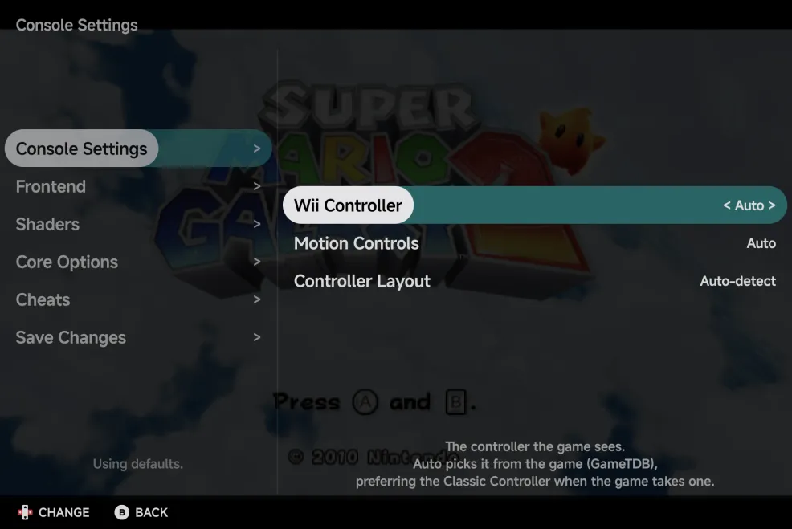

# Nintendo Wii & GameCube

Wii and GameCube games run on the bundled **Dolphin** core.

| | Wii | GameCube |
| --- | --- | --- |
| Folder | `Roms/Nintendo Wii (WII)/` | `Roms/Nintendo GameCube (GC)/` |
| BIOS | Not needed | Not needed |
| [File types](index.md) | `wbfs` `wia` `rvz`, and `iso` `ciso` `gcz` `wad` `elf` `dol` `m3u` in the Wii folder | `gcm` `gcz` `tgc` `ciso`, and `iso` `elf` `dol` `m3u` in the GameCube folder |

- A GameCube disc in the Wii folder plays as GameCube.
- **Graphics API** can switch a game to Vulkan. See
  [Graphics API](index.md#graphics-api).

??? info "More detail"
    The first launch copies Dolphin's system files, which takes a second or
    two.

## GameCube controls

<figure class="nx-phone" markdown>
{ .nx-phone__screen }
{ .nx-phone__frame }
</figure>

The on-screen pad is the GameCube's. `STICK` switches the d-pad to the
control stick.

`L` and `R` are analog triggers on a GameCube:

- **Tap** `L` or `R` to squeeze it half-way. It stays squeezed (the button
  lit) until you tap it again.
- **Hold** it for a full press, for as long as your finger stays down.

??? info "More detail"
    - The pad has the d-pad or control stick, the C-stick, a green `A` and a
      red `B`, `X`, `Y`, `Z`, `L`, `R` and `START`.
    - A full press is the click at the end of the trigger. It needs a hold
      of about a third of a second or more.

A controller adds:

| Control | GameCube |
| --- | --- |
| `A` `B` `X` `Y` | `A` `B` `X` `Y`, by the letters printed on your controller |
| `R1` | `Z` |
| `L2`, `R2` | `L`, `R`. Analog triggers press them as far as you pull. |
| Left stick | The control stick |
| Right stick | The C-stick |

## Wii controls

A Wii game needs a Wiimote, held one way or another, or another Wii
controller. **Wii Controller** picks it:

| Value | What the game gets |
| --- | --- |
| **Auto** (default) | The controller the game expects, from its disc. A game that takes the Classic Controller gets it. Games that require the Wii MotionPlus get it attached. |
| **Sideways Wiimote** | A Wiimote held sideways, like an NES pad |
| **Wiimote** | A Wiimote held upright and pointed at the screen |
| **Wiimote + Nunchuk** | A Wiimote with the Nunchuk |
| **Classic Controller** | The Classic Controller Pro |

Change it in the in-game menu under **Options → Console Settings**. It
applies straight away, and [Save Changes](../in-game-menu.md#save-changes)
keeps it for the game or the console.

<figure class="nx-phone" markdown>
{ .nx-phone__screen }
{ .nx-phone__frame }
</figure>

<figure class="nx-phone" markdown>
{ .nx-phone__screen }
{ .nx-phone__frame }
</figure>

The on-screen pad follows the controller you picked. Its extra buttons:

- **`HOME`** (every Wii pad), between `−` and `+`: opens the game's HOME
  menu.
- **`Shake`** (Wiimote pads): shakes the Wiimote, for a spin jump or a
  swing. The Nunchuk pad adds **`Shake N`** for the Nunchuk.
- **`MOTION`** (Wiimote pads): turns [motion controls](#motion-controls) on
  or off.

On a controller, **`R3`** (press the right stick) is `HOME` and **`L3`**
recentres motion. With a Wiimote, the right stick moves the pointer.

??? info "More detail: the pads and controller buttons"
    - The pads show the sideways Wiimote's `1` and `2`, the Nunchuk's
      stick, `C` and `Z`, or the Classic Controller's two sticks and
      shoulder buttons. The Classic Controller pad has no `Shake` or
      `MOTION`.
    - `HOME` saves a resume point first, so the game pauses for about a
      second.

    A controller adds:

    | Controller | Sideways Wiimote | Wiimote | Wiimote + Nunchuk | Classic Controller |
    | --- | --- | --- | --- | --- |
    | `A` | `2` | `A` | `A` | `a` |
    | `B` | `1` | `B` | `B` | `b` |
    | `X` | `A` | `1` | `C` | `x` |
    | `Y` | `B` | `2` | `Z` | `y` |
    | `SELECT`, `START` | `−`, `+` | `−`, `+` | `2`, `1` | `−`, `+` |
    | `L1`, `R1` | | | `−`, `+` | `L`, `R` |
    | `L2`, `R2` | `R2`: Shake | `R2`: Shake | Shake Nunchuk, Shake | `ZL`, `ZR` |
    | Left stick | | | The Nunchuk's stick | The left stick |
    | Right stick | The pointer | The pointer | The pointer | The right stick |

    The sideways Wiimote works like the NES pad: printed `A` is `2` and
    printed `B` is `1`.

### Pointing

With a Wiimote, touch the picture to aim. The cursor jumps to your finger
and stays where you lift it. A controller's right stick moves it too.

If a tap lands off your finger in a game, adjust the **Pointer** rows for
that game in [Game Settings](../emulator-settings.md#game-settings).

??? info "More detail: the Pointer rows"
    The new values apply the next time the game starts.

    | Row | Values | What it does |
    | --- | --- | --- |
    | **Pointer Width** | 50% to 150% | Lower it if the cursor lands further out sideways than your finger, raise it if it falls short. |
    | **Pointer Height** | 50% to 150% | The same, up and down. |
    | **Pointer Offset** | −20 to +20 | Moves the cursor up (+) or down (−) against your finger. |

### Motion controls

Tilt and turn the phone to move the Wiimote. **Motion Controls** sets when
the phone's motion is used:

| Value | What it does |
| --- | --- |
| **Auto** (default) | On for games that require the Wii MotionPlus, such as Wii Sports Resort. |
| **On** | On for every game. |
| **Off** | Off. The left stick tilts the Wiimote instead. |

- Tap **`MOTION`** on the pad to turn it on or off while you play.
- Hold **`MOTION`**, or press **`L3`** on a controller, to recentre: the way
  you hold the phone now becomes straight ahead.
- Motion needs a phone with a gyroscope.

??? info "More detail"
    - The sensors only run while you play.
    - The Classic Controller has no motion, whatever the setting.

### Wii Screen

**Wii Screen** is the shape the Wii draws: **Auto** (default), **4:3** or
**16:9**. **Auto** picks 4:3 when the game starts in portrait and 16:9 in
landscape. Set it in [Game Settings](../emulator-settings.md#game-settings).

The shape is read when the game starts, so rotating the phone changes it
only at the next launch.

### The Wii Menu

**Wii Menu** in a game's HOME menu closes the game and goes back to the game
list. Resuming later starts from the point saved when you pressed `HOME`.

## Console Settings

The in-game **Options → Console Settings** page has the rows that apply
while you play: **Wii Controller**, **Motion Controls** and **Controller
Layout**.

**Wii Screen**, the **Pointer** rows and **Graphics API** are read when the
game starts. They are set in
[Game Settings](../emulator-settings.md#game-settings) for one game, or in
[Emulator Settings](../emulator-settings.md) for the console.

## Saves

- Wii game saves are in `Saves/WII/`, and GameCube memory cards in
  `Saves/GC/`, with your other [saves inside the app](../library.md#saves).
- Save states work as on other consoles. They are large, about 100 MB each.

## Multiplayer

Up to four players can play, each on their own controller; see
[Local Multiplayer](../multiplayer.md).

- Every player gets the same controller as Player 1.
- Each player shakes their own Wiimote with `R2`.
- Only Player 1 can point at the screen or use the phone's motion.

??? info "More detail"
    - Players 2 to 4 are plugged in only when a controller joins. Until
      then, the game sees one player, so a Wii game shows no extra cursors.
    - "The same controller" is the GameCube pad, or the Wii controller the
      game uses.

## Cheats and achievements

- [Cheats](../cheats.md): Dolphin's own codes for the game are listed after
  the game's first start. The cheat download has no Wii or GameCube codes.
- [RetroAchievements](../retroachievements.md) works for Wii and GameCube
  in every file type above.

??? info "More detail"
    A game is identified once, then remembered. Compressed discs listed in
    an `.m3u`, and split WBFS files, aren't identified. They still play.
