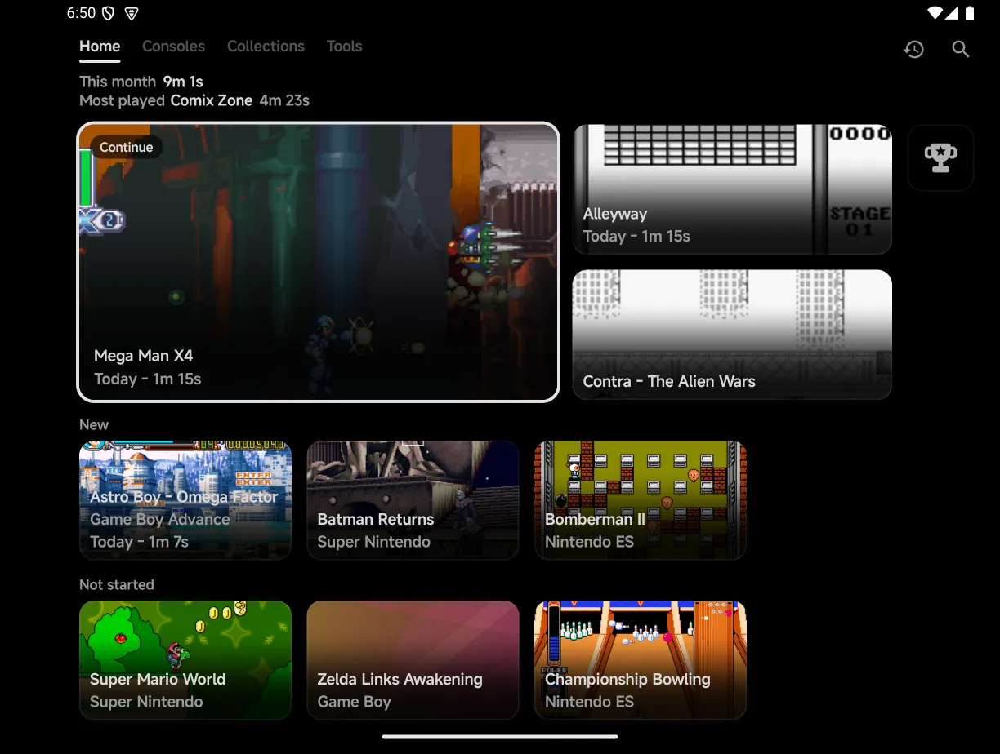
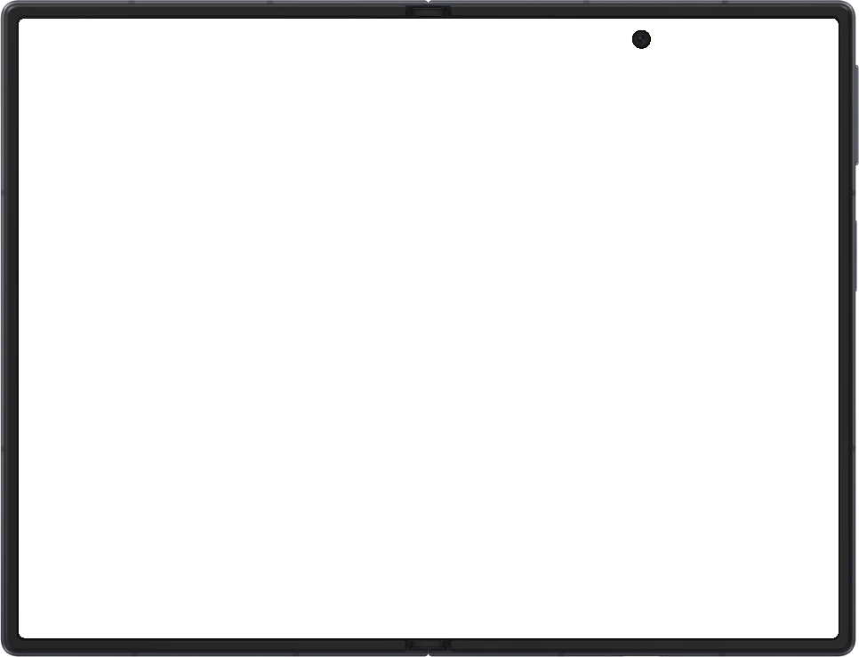
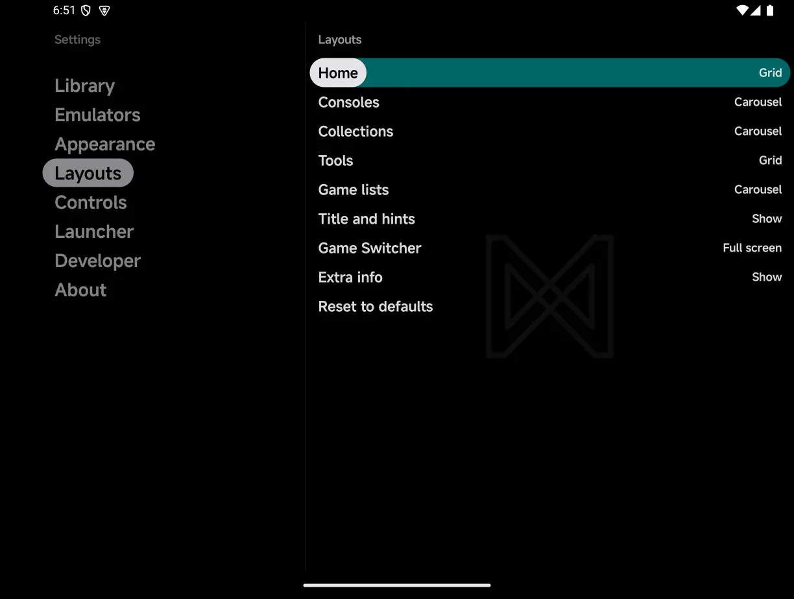
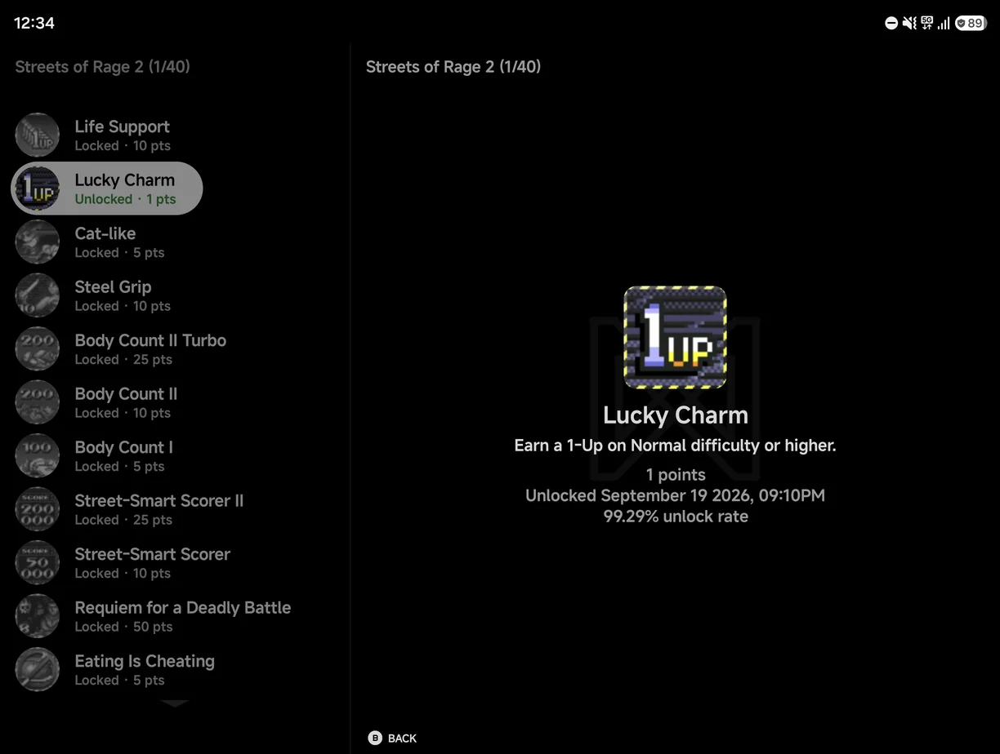
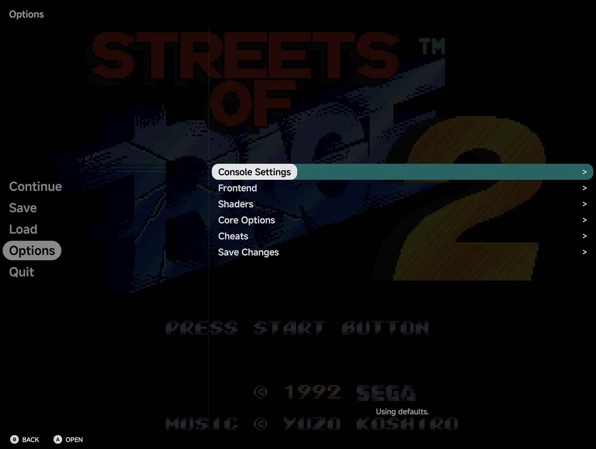

# Foldables & Large Screens

NX Redux fits itself to the screen it's on. A half-folded foldable
gets Flex mode, a wide or large screen gets a fuller Home, and Settings and
the in-game menu split into two panes when there is room.

## Flex mode

Fold a foldable partway, like a small laptop, with the hinge running across
the screen. The app splits at the hinge:

- **Above the hinge:** the game, or the menu.
- **Below the hinge:**
    - in portrait, the portrait pad;
    - in landscape, the two pad clusters, drawn solid instead of over the
      game;
    - with a controller connected, nothing. The lower half stays empty.

There is no setting. Flex mode starts when you fold the phone and stops when
you open it flat. It works in games and in the main menu alike.

??? info "More detail"
    - The hinge must run across the screen, and each half must be at least a
      quarter of the screen. A book-style fold, with the hinge from top to
      bottom, keeps the usual layout.
    - On a phone that doesn't report its half-folded state, such as the
      Galaxy Z Fold, the app reads the hinge angle: between 30° and 150°
      counts as folded.
    - Nintendo DS games keep their usual layout.

## Home on wide and large screens

Home lays itself out for the screen's shape. In portrait and on most
screens it looks as in [Main Menu](main-menu.md#home). On a wide or large
landscape screen, such as a Galaxy Z Flip sideways or an unfolded Galaxy Z
Fold, the tool squares, and one or two pinned games, sit beside the
Continue card.

??? info "More detail"
    **Wide face:** a phone in landscape with a 20:9 or wider screen, such as
    a Galaxy Z Flip.

    - One or two pinned games sit beside the Continue card, in the top
      section. With three or more, they go in rows below it instead.
    - The pinned tools are smaller squares, up to six. With more, the last
      square is **+N**, which opens Tools.

    **Large face:** a landscape screen at least 840 × 480 dp, such as an
    unfolded Galaxy Z Fold or a tablet.

    - The top section is as on the wide face: Continue, one or two pinned
      games and the tool squares.
    - With three or more pinned games, they fill the rows below, four to a
      row.
    - Under them come the [shelves](#shelves), four to a row at the pinned
      games' size.

<figure class="nx-phone nx-phone--open" markdown>
{ .nx-phone__screen }
{ .nx-phone__frame }
</figure>

### Shelves

Home shows up to three shelves of games from your library, to help you
pick something to play. They show on every screen size and in every Home
layout.

| Shelf | What it holds |
| --- | --- |
| **New** | Games the app first found in the last 30 days, newest first. |
| **Not started** | Games you have never played. Picked again each day. |
| **Pick up again** | Games you last played more than 14 days ago, most played first. |

[Layouts](layouts.md) can hide the **New** and **Not started** shelves, each
with its own row in **Layouts → Home**. **Pick up again** always shows when
it has games.

??? info "More detail"
    - Shelves show in portrait and landscape alike. Each shelf shows only
      when it has games, holds at most 3, and a game is never on two shelves.
    - Each shelf has its name as a label above it; on Carousel and List Home
      each game wears it as a badge or tag instead.
    - The game on the Continue card, your pinned games, Unassigned games and
      Android games are left off the shelves.
    - A hidden shelf's games don't move to another shelf.

## Two-pane screens

On a wide screen, such as most phones in landscape or an unfolded Fold held
sideways, some pages show two panes side by side. Portrait screens keep one
page at a time.

??? info "More detail"
    A window counts as wide when it is at least 600 dp wide and at least 1.3
    times as wide as it is tall.

### Settings

**Tools → Settings** shows its sections on the left and the selected
section's page on the right. Moving through the sections previews each page.

<figure class="nx-phone nx-phone--open" markdown>
{ .nx-phone__screen }
{ .nx-phone__frame }
</figure>

### RetroAchievements

Below the [RetroAchievements](retroachievements.md) page, each level opens
beside the one it came from, such as an achievement's details beside the
game's achievements list. The page you came from stays on the left, dimmed.
The [Game Tracker](game-tracker.md) shows a game's sessions the same way.

??? info "More detail"
    The dimmed page keeps the row that opened the right pane highlighted. A
    game's achievements open beside the games list.

<figure class="nx-phone nx-phone--open" markdown>
{ .nx-phone__screen }
{ .nx-phone__frame }
</figure>

### Artwork

[Artwork](artwork.md) works the same way: its pages open beside the
Artwork page. Tap a row in the dimmed left pane to open it instead.

??? info "More detail"
    **Fetch by console**, **Progress** and **Settings** open beside the
    Artwork page, and **Reset artwork** beside Settings. The page you came
    from keeps its row lit.

### In-game menu

The [in-game menu](in-game-menu.md) splits too:

- On the first page, the right pane previews the highlighted row: the save
  slot on **Save** and **Load**, or the page a row opens.
- Deeper in, the open page is on the right and the page it came from on the
  left, dimmed.
- `RIGHT` on a row that opens a page opens it, as `A` does. Value rows still
  change with `LEFT` / `RIGHT`.
- Tap a row in the dimmed pane to go back to it.

<figure class="nx-phone nx-phone--open" markdown>
{ .nx-phone__screen }
{ .nx-phone__frame }
</figure>
