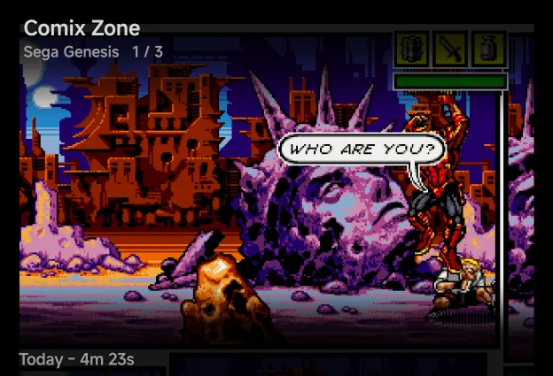
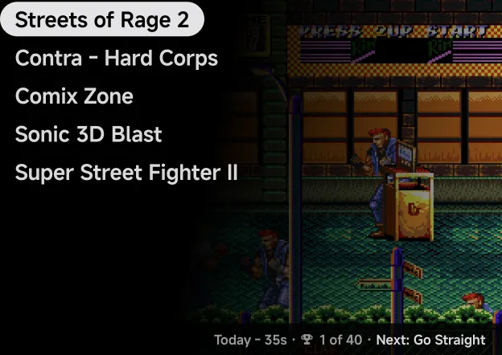

# Game Switcher

The Game Switcher shows your recent games, ready to resume any of them where
you left off. Open it with `SELECT` (**Recent**) on the main menu or in a game
list, or tap the **Recent** icon at the top right.

It has two layouts, picked in
[**Tools → Settings → Layouts → Game Switcher → Game Switcher layout**](layouts.md#game-switcher-layout):
**Full screen** (the default) and **List**.

??? info "More detail"

    The **Recent** icon shows in a game list on any touchscreen, and on the
    main menu whenever the hint bar doesn't show **Recent**.

## Full screen

Each game fills the screen with its picture, with its name, console and place
in the list, such as **1 / 23**. The info line above the hints shows when you
last played it and for how long, and its achievements.

- `LEFT` / `RIGHT`, or a swipe, move between games.
- `A` **Resume**, or a tap on the picture, continues the game.
- `Y` **Remove** takes the game out of your recent games, after asking.
- `B` **Back**, or `SELECT` again, returns to where you were.

??? info "More detail"

    - The info line also names the next achievement to unlock.
    - **Remove** asks **Remove "‹name›" from recents?**; choose **Remove** to
      confirm.
    - On a touchscreen with no controller there is no hint bar: **Remove** is
      a trash icon at the top right, level with the game's name.
    - `LEFT` and `RIGHT` stop at the first and last game; they do not wrap.

## List

Your recent games as a list titled **Recent**, drawn like a
[List](main-menu.md#list-style) game list, with the selected game's picture behind the
rows.

- `UP` / `DOWN` move through the games.
- A tap on a row highlights it, and a second tap resumes it.
- `A` **Resume**, `Y` **Remove** and `B` **Back** work as in Full screen.

??? info "More detail"

    - `UP` on the first game wraps to the last and `DOWN` on the last to the
      first, on a fresh press only: holding the button stops at the end.
      `LEFT` and `RIGHT` do nothing.
    - The line at the bottom gives the selected game's info, as in a List game
      list.
    - Two games with the same name from different consoles show the
      console's tag, such as **Tetris (GB)**, or their whole file names when
      those differ only by extension, such as **Tetris.nes (FC)**. A copy of a
      game kept in an extra folder shows that folder's name after the title,
      dimmed.
    - The background is the first of these that loads:

        1. the screenshot of the game's resume point, with any black bars
           trimmed off,
        2. its screenshot,
        3. its hero image, then its grid image,
        4. its generated abstract picture.

    - With no recent games, the List shows the same **No Recents** screen as
      Full screen.

## The picture

In Full screen the picture is the game's resume point screenshot, or else its
box art. See [Artwork](artwork.md) for where box art comes from.

??? info "More detail"

    The switcher shows the first of these it has for the game:

    1. the screenshot of its resume point,
    2. its 3D box art,
    3. its 2D cover, or else its SteamGridDB grid image, shown in a case,
    4. **No Preview**.

## Play time and achievements

The info line follows [**Extra info**](layouts.md#extra-info) and
[**Button hints**](layouts.md#page-title-and-button-hints) in
**Tools → Settings → Layouts**, in both layouts.

??? info "More detail"

    - With **Extra info** hidden, the info line is left out.
    - With **Button hints** hidden, the hint bar's row stays, without hints,
      and the info line moves into it. In Full screen the row keeps its dark
      shade so the line reads over a light picture.

## Always resumable

Every game you have played can be resumed, with no manual save state needed:

- **Save & Quit** in the [in-game menu](in-game-menu.md#quitting) saves your
  place, and so does leaving the app while a game is open.
- **Quit** leaves the last resume point as it was.

PICO-8 is the exception for now (see [Emulators](emulators/index.md#limits)).

??? info "More detail"

    The resume point is a hidden resume state. This works with nearly every
    core.

## Only resumable games are listed

The switcher lists only recent games that can be resumed. With none, it shows
**No Recents** and **Play a game to see it here**. Android games are never
listed.

In a game list, `A` **Resume** resumes the highlighted game when it can. To
start it fresh instead, choose **Play from start** in its `MENU` menu.

??? info "More detail"

    Unlike the handheld, there is no setting to list every recent game
    instead.
