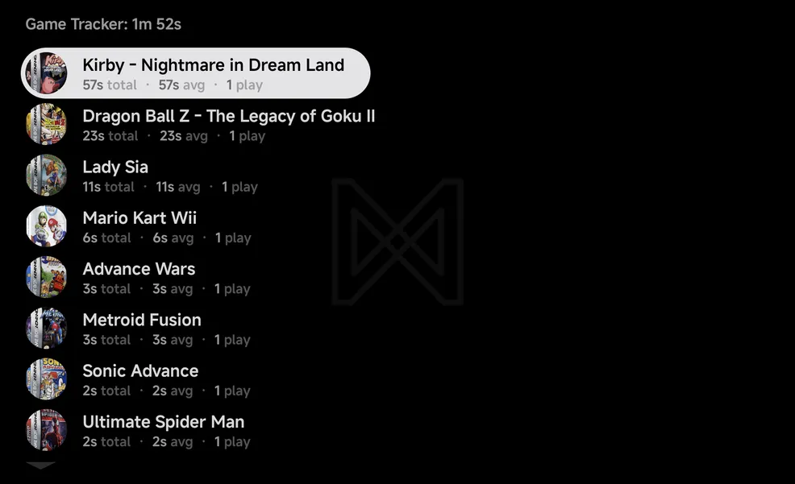
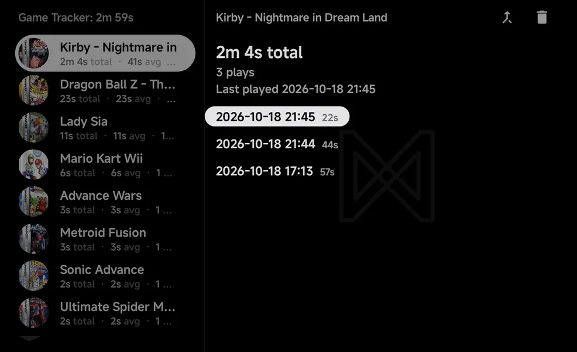

# Game Tracker

**Tools → Game Tracker** shows how long you have played each game. The app
records every play session on its own, with nothing to set up.

- The title shows your total play time, such as **Game Tracker: 41m 10s**.
- Games are listed by play time, most played first.
- Each game shows its total time, average session and play count, such as
  **11m 47s total · 41s avg · 17 plays**.

| Button | What it does |
| --- | --- |
| `A` **Plays** | Opens the game's sessions. A tap on a game does the same. |
| `MENU` **Options** | Merge, unmerge or delete the game's play time. A long press does the same. |
| `B` **Back** | Go back |

??? info "More detail"

    - Each game shows its box art.
    - Before you have played anything, the page shows **No play activity**
      and **Play a game and its time shows up here.**

## Sessions

`A` on a game opens its sessions, titled **Game Tracker | *game*** (just the
game's name when they open beside the list on a wide screen): the
game's total time, play count and when you last played it, then every session
with its date, time and length, newest first.

`B` goes back to the list. The page also has the game's play-time actions,
the same as [Options](#options):

| Button | What it does |
| --- | --- |
| `X` **Merge** | Merge this game into another. |
| `SELECT` **Unmerge** | Split a merged game back out. |
| `Y` **Delete** | Delete the game's play time |

??? info "More detail"

    - When a game has sessions from more than one device, each row also names
      the device it was played on.
    - `B` returns to the list on the same game.
    - **Merge** shows when the tracker has two games or more. **Unmerge**
      shows only on a game with others merged into it.
    - On touch the actions are icons at the right of the title row. **Cancel**
      in any of them returns to the sessions. After a merge, unmerge or delete
      you land on the list.

## Options

`MENU` on a game opens its options.

| Option | What it does |
| --- | --- |
| **Merge into…** | Adds this game's play time to another game. Useful for one game kept as two files, such as two regions or a renamed ROM. |
| **Unmerge…** | Splits a merged game back out. |
| **Delete** | Deletes the game's play time. The record starts fresh the next time you play. |

!!! warning "Deleting a merged game deletes the games merged into it"
    **Delete** asks **Delete play time?** first. On a merged game, it also
    says how many games are merged into it, and they are deleted with it.

??? info "More detail"

    - **Merge into…** lists every other game with its time, and shows when the
      tracker has two games or more. When the two names differ, the app asks
      for the **Name to keep**.
    - **Unmerge…** lists the games merged into this one, and shows only on a
      game with others merged into it.
    - The delete prompt reads **Delete play time for *game*?**

## What is recorded

Every game you play in the app is tracked, except Android games: they start
as their own app, so nothing is recorded for them.

Home's stats strip shows this month's play time and your most played game,
from the same records. See [Home](main-menu.md#home).

??? info "More detail"

    Sessions shorter than 1 second or longer than 24 hours are dropped.
