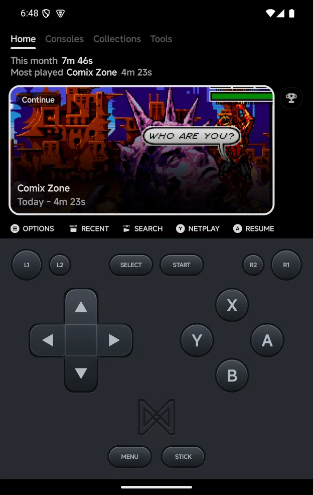
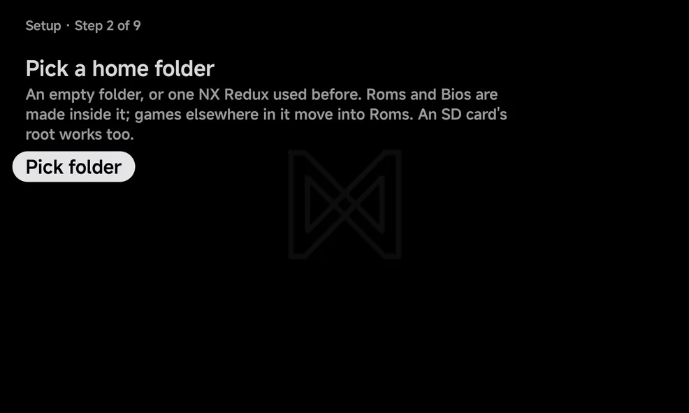
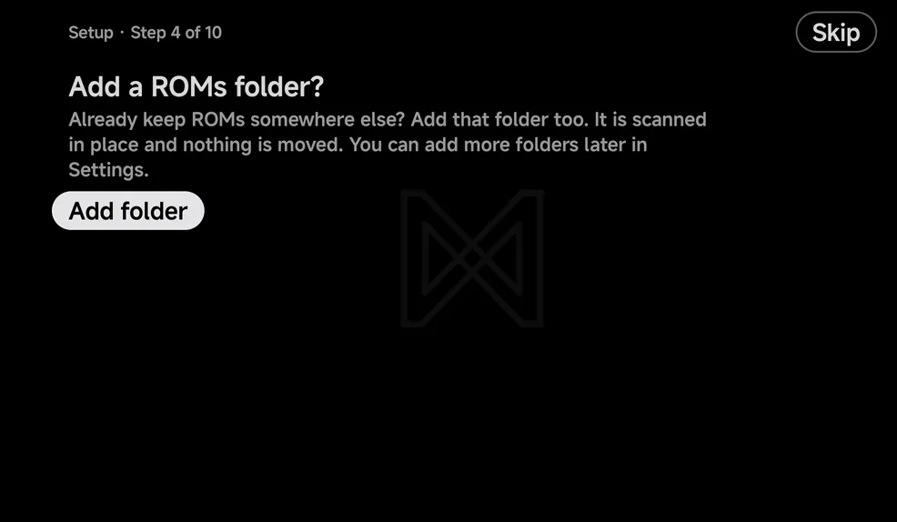
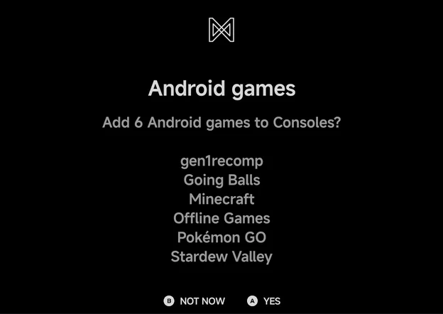

# Getting Started

!!! info "Coming soon"
    NX Redux for Android is not released yet. These pages describe the app as it
    is today.

NX Redux for Android brings the NX Redux look, folder layout and in-game
features to Android phones, tablets, foldables and Android handhelds. It runs retro
systems through emulators bundled in the app, with nothing extra to download.

<figure class="nx-phone" markdown>
{ .nx-phone__screen }
{ .nx-phone__frame }
</figure>

New to NX Redux? See [About NX Redux](../about.md) first.

## What's different from the handheld

- **Emulators:** Sega Dreamcast, NAOMI, Atomiswave and Nintendo 3DS are
  included. Nintendo DS runs melonDS DS (DraStic is not available). See
  [Emulators](emulators/index.md) and [Sega Dreamcast](emulators/dreamcast.md).
- **Library:** besides the home folder, the app can scan extra folders in
  place. See [Library & ROM folders](library.md).
- **Controls:** an on-screen pad, or any Android controller. See
  [Controls](controls.md).
- **Artwork:** the app downloads box art and screenshots for your games. See
  [Artwork](artwork.md).
- **Home screen:** the app can be your phone's home screen, and list your
  Android games and apps. See [Launcher Mode & Android Games](launcher.md).
- **Foldables:** on a half-folded phone, Flex mode puts the game above the
  hinge and the pad below it. See [Foldables & Large Screens](foldables.md).
- **Local multiplayer:** two to four players on one phone, each on their
  own controller. See [Local Multiplayer](multiplayer.md).
- **Netplay:** play with another phone or an NX Redux handheld, over Wi-Fi
  or a USB-C cable, Game Boy and GBA link trades included. See
  [Netplay](netplay.md).
- **Device Sync:** carry games, saves and save states between the phone and
  an NX Redux handheld, over Wi-Fi or a USB-C cable. See
  [Device Sync](device-sync.md).
- **In a later release:** more systems, such as home computers (Amiga, C64
  and so on).
- **Not available:** RetroAchievements hardcore mode, the same as on the
  handheld.
- **Left to Android:** Wi-Fi and Bluetooth management, the on-screen display,
  the music player, PortMaster and firmware updates are not part of the app.

## Install

When it's released, the APK is listed on the
[Download](../reference/download.md) page.

## First-run setup

The first time you open the app, a short setup walks you through it. From
the folders on, the page title counts **Setup · Step n of m**, and
**Continue** or **Skip** sit at the top right. `B` goes back a page.

1. **Welcome.** Press **Get started**.
2. **Text size.** **Large** or **Small**. Every page after it, setup's own
   included, reads at the size you pick. See [Text size](appearance.md#text-size).
3. **Permissions.** **All files access** and **Notifications**, where your
   phone has them. See [Allow All files access](#allow-all-files-access).
4. **Your folders.** The home folder, an extra ROMs folder, and the Android
   games on your phone. See [Choose a home folder](#choose-a-home-folder).
5. **Your handheld.** If you also play on an NX Redux handheld, setup matches
   its save formats and offers a [Device Sync](device-sync.md).
6. **Artwork.** Fetch box art and screenshots in the background. See
   [Artwork](artwork.md).
7. **RetroAchievements.** Sign in, then download the achievement data in the
   background. See [RetroAchievements](retroachievements.md).
8. **Customise the layout?** Pick the menu's look page by page, each with a
   picture, or keep the defaults. See [Menu Layouts](layouts.md).
9. **Accents.** Pick your **Accent** and **Secondary accent**.
10. **Ready, player one.** Press **Press Start** to open the main menu.

Everything setup asks can be changed later in **Tools → Settings**.

## Allow All files access

On Android 11 and later, setup's **Permissions** page lists **All files
access**. The app uses it to read your library faster, to show its own
folder picker, and to sync ROMs with a handheld. Select the row to open
Android's page for the app, turn the switch on, then come back. Choose
**Continue** to go on with or without it; without it the app uses Android's
folder picker.

You can turn it on or off later in **Tools → Settings → Library → ROM
folders → All files access**.

## Choose a home folder

Next the app asks you to **Pick a home folder**: an empty folder, or one
NX Redux used before. Press `A` **Pick folder**. With All files access the
app's own [folder picker](library.md#the-folder-picker) opens; without it,
Android's folder picker does.

The app creates the NX Redux layout inside the folder you pick:

| Folder | What goes there |
| --- | --- |
| `Roms/<Display Name (TAG)>/` | Games, one folder per system |
| `Bios/<TAG>/` | BIOS files for systems that need them |
| `Collections/` | Your game collections, once you make one |

The folders are visible to file managers, so you can copy games in from a
computer. The home folder can sit on an SD card.

If your games already follow the NX Redux layout from a handheld, the same
folder names and `Bios/<TAG>/` files work unchanged. When the folder already
holds games, setup says **Found N games in** the folder, a line per console.
Games outside `Roms/`, and a console split over two folders, are tidied into
`Roms/` while **Move them into …/Roms** is on (the default).

Saves and save states are kept inside the app, not in the home folder. See
[Saves](library.md#saves).

!!! note "Pick a folder, not a root"
    Android's picker can't use the storage root, the SD card root or the
    Download folder. Pick or create a folder inside one of them, such as
    `NXRedux`. With All files access, the app's own picker can use an SD
    card's root, but not the phone's storage root, and can make a folder for
    you with `X` **New folder**.

## Add a ROMs folder

Right after the home folder, the app asks **Add a ROMs folder?**

- If you already keep games somewhere else on the phone, press `A`
  **Add folder** and pick that folder. It is scanned in place and nothing is
  moved, and setup says what it found.
- Choose **Skip** to go on without one.

You can add more folders later in **Tools → Settings → Library → ROM folders
→ Add ROM folder**. See [Library & ROM folders](library.md).

## Android games

When the app finds games installed on your phone, the last folder step asks
**Add N Android games to Consoles?** and lists them.

- Choose **Yes** to add them. They show up as an **Android** console on
  the Consoles tab.
- Choose **Not now** to leave them out.

The question is asked once. On an install that already has a library, it can
show once as a dialog over the main menu instead. Change the list any time in
**Tools → Settings → Launcher → Android games**. See
[Launcher Mode & Android Games](launcher.md).

## Next steps

- [Main Menu & Home](main-menu.md): the tabs, Home and the game lists.
- [Controls](controls.md): the on-screen pad, controllers and the buttons in
  the menus.
- [In-game Menu](in-game-menu.md): save states, options and Save Changes.
- [Game Switcher](game-switcher.md): resume recent games.
