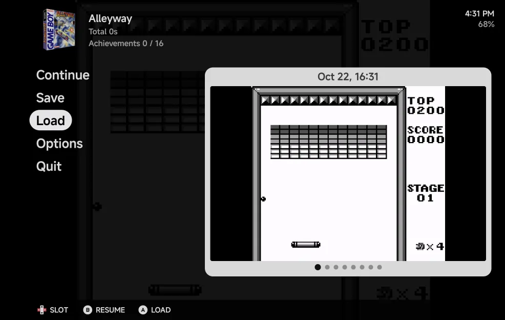
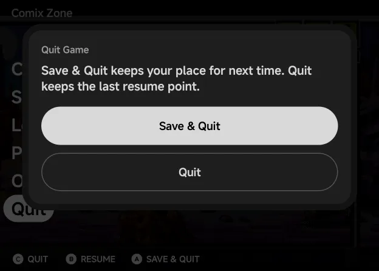
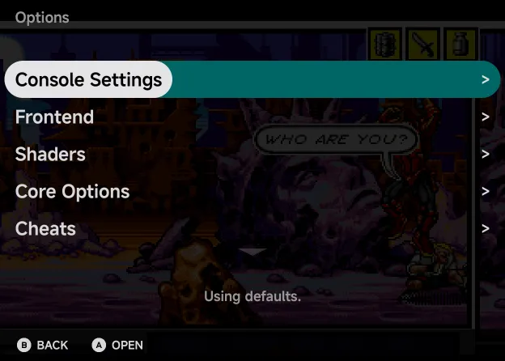
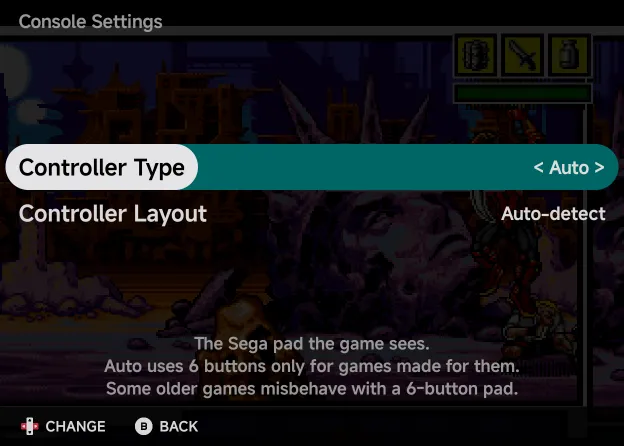
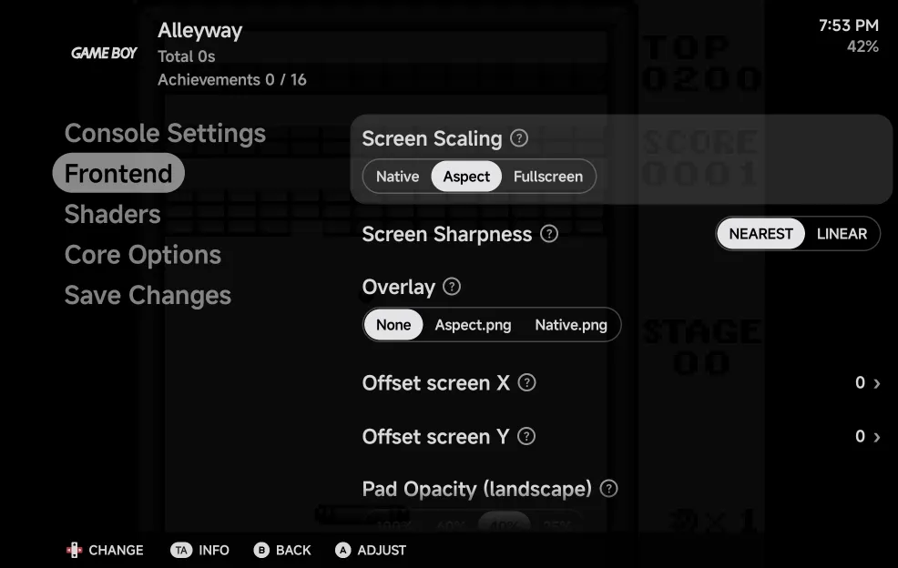
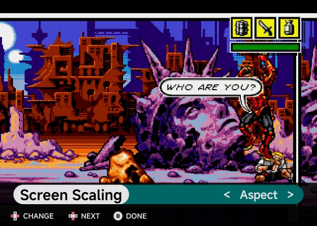
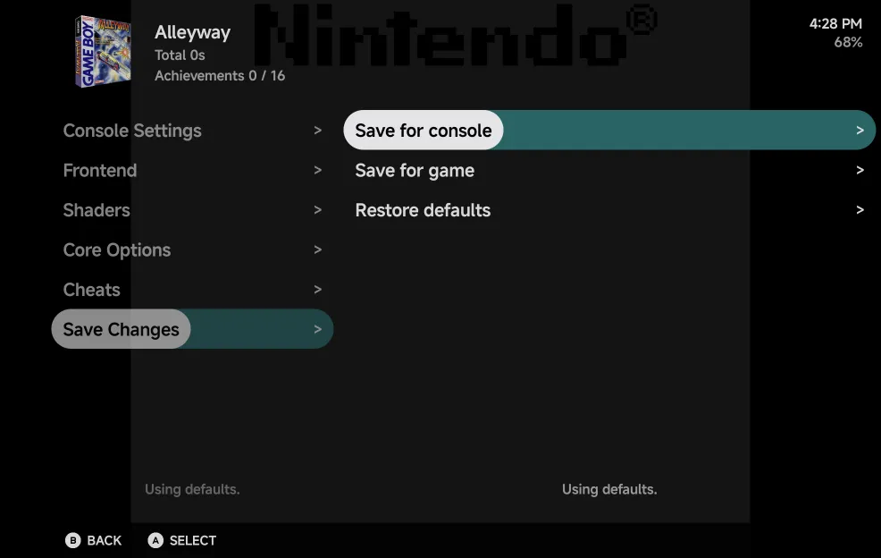

# In-game Menu

While a game is running, open the in-game menu in any of these ways:

- press `MENU` on the on-screen pad or a controller,
- hold `SELECT` and `START` together (in a multiplayer game, on Player 1's
  controller only),
- use Android's Back gesture or button.

The game pauses while the menu is open.

- `B` goes back one page.
- `B` on the first page, or `MENU` on any page, returns to the game.

During a [netplay](netplay.md) match the menu shows only **Leave netplay?**.
See [Netplay → During a match](netplay.md#during-a-match).

??? info "More detail"

    - Some consoles have shortcuts of their own; see their pages under
      [Emulators](emulators/index.md).
    - On a controller, `A` and `B` are the letters printed on it, as
      [Controller Layout](#console-settings) names them, on every console.
    - The menu uses your **Accent** and **Secondary accent** from
      [Appearance](appearance.md): the highlighted row sits on the accent, and
      the value bar on the secondary accent. Its rows, the save slot's text and
      its dialogs follow [**Text size**](appearance.md#text-size) there too.
    - During a netplay match the menu has **Continue** and **Leave**. Once the
      match has ended and you play on alone, it shows **Continue** and
      **Quit**.
    - On a wide landscape screen, such as an unfolded foldable held sideways
      or a phone in landscape, the menu shows two pages side by side. See
      [Foldables & Large Screens](foldables.md#two-pane-screens).

## The first page

| Row | What it does |
| --- | --- |
| **Continue** | Return to the game. |
| **Disc** | Games with more than one disc only. `LEFT` / `RIGHT` change the disc, such as `1/2`. |
| **Save** | Save a state to the chosen slot. |
| **Load** | Load the state in the chosen slot. |
| **Players** | Games with more than one player only. See [Players](#players). |
| **Options** | Open the options pages below. |
| **Quit** | Leave the game. See [Quitting](#quitting). |

There are 8 save state slots. On **Save** and **Load**, `LEFT` / `RIGHT` (or
a sideways swipe) choose the slot, and `A` saves or loads. The preview shows
the slot's screenshot and date, or **Empty Slot**.

??? info "More detail: Disc"

    Changing the disc works as opening the lid and swapping it would.

## Quitting

On **Quit**:

- `A` **Save & Quit** saves your place, then leaves. The
  [Game Switcher](game-switcher.md) can then resume the game where you left
  it.
- `X` **Quit** leaves without it, so the game's last resume point stays as it
  was.

Both keep the game's battery save. Leaving the app with the game open also
saves your place.

??? info "More detail"

    - **Save & Quit** saves a hidden resume state.
    - A tap on **Quit** opens the **Quit Game** dialog with the same two
      choices, **Save & Quit** and **Quit**, and the line **Save & Quit keeps
      your place for next time. Quit keeps the last resume point.** Tap
      outside it, or press `B`, to stay in the menu.

## Touch

You can use the whole menu by touch:

- Tap a row to act on it, as `A` does. **Save** and **Load** take two taps:
  one to highlight the row, then another to save or load.
- Tap the highlighted row's value to step it forward, as `RIGHT` does.
- Each hint along the bottom is a button.

??? info "More detail"

    - The second tap on **Save** or **Load** can be on the row or on the slot
      preview.
    - Off the first page, a tap on the hint bar's empty space goes back.
    - Tap a description page, or an achievement's details, to close it.

## Players

In a game with more than one player, the **Players** page shows which
controller is which player. To add a player, close the menu and press a
button on the new controller. See [Local Multiplayer](multiplayer.md).

??? info "More detail"

    - **Player 1** to **Player 4** show the controller's name, **Empty**, or
      the name with **(disconnected)**. `LEFT` / `RIGHT` give the player
      another controller, or **Empty**. Picking a controller another player
      has swaps the two.
    - Each connected controller has a row set to **Playing** or **Not
      playing**. A controller that is **Not playing** is ignored in
      multiplayer games until it plays again.

## Options

| Row | What it's for |
| --- | --- |
| [Console Settings](#console-settings) | Controller rows, and some console-specific rows. |
| [Frontend](#frontend) | Scaling, sharpness, overlay, screen offset, pad opacity and the debug HUD. |
| [Shaders](#shaders) | Shader presets and their parameters. |
| [Core Options](#core-options) | The emulator core's own settings. |
| [Cheats](#cheats) | Turn the game's cheats on and off. |
| [Achievements](#achievements) | The game's achievements. |
| [Save Changes](#save-changes) | Keep your changes for this console or this game, or restore defaults. |

!!! important "Changes aren't saved until you use Save Changes"
    Changes in Options apply straight away but last only for this session.
    To keep them, use [Save Changes](#save-changes) before you quit. To undo
    a change, quit without saving.

To set these before a game starts, for a whole emulator or one game, use
[Emulator Settings](emulator-settings.md).

??? info "More detail"

    - **Cheats** shows only when the core takes cheats. **Achievements** shows
      only when the game's RetroAchievements session has started; with it
      highlighted, the description lines show your progress, such as
      `12 / 40 unlocked`, or **Not recognised**.
    - **Console Settings** holds the controller rows, the Nintendo DS screen
      layouts, the Nintendo 3DS New 3DS Controls and Portrait Pad for both.
    - The line under the list says which settings the game uses right now:
      **Using defaults.**, **Using console config.** or **Using game config.**
    - Two things are saved straight away instead: the Nintendo DS layout
      hotkeys (see [Nintendo DS](emulators/nintendo-ds.md#controls)) and
      achievement mutes (`X` on the Achievements page).

## Console Settings

The console's own rows. `LEFT` / `RIGHT` change a value.

| Row | Consoles | Values | Default |
| --- | --- | --- | --- |
| **Controller Type** | Sega Genesis, Sega CD, 32X | Auto, 3 buttons, 6 buttons | Auto |
| **Controller Layout** | Every console | Auto-detect, Xbox (A at the bottom), Nintendo (A on the right) | Auto-detect |
| **Layout (portrait)** and the other screen rows | Nintendo DS | See [Nintendo DS](emulators/nintendo-ds.md) | |
| **New 3DS Controls** | Nintendo 3DS | Auto, On, Off | Auto |
| **Portrait Pad** | Nintendo DS, Nintendo 3DS | Shown, Hidden | Shown |
| **Wii Controller**, **Motion Controls** | Nintendo Wii | See [Nintendo Wii & GameCube](emulators/wii-gamecube.md#wii-controls) | Auto |

- **Controller Type** is the Sega pad the game sees.
- **Controller Layout** names the letters printed on your controller. See
  [Controls](controls.md#controller-buttons).
- **Portrait Pad** hides the portrait pad band for the see-through buttons.
  See [Nintendo DS](emulators/nintendo-ds.md#portrait-pad).

Settings the game reads only when it starts, such as **Graphics API**, aren't
here. Set them in [Game Settings](emulator-settings.md#game-settings) or
[Emulator Settings](emulator-settings.md).

??? info "More detail"

    - **Controller Type** **Auto** uses 6 buttons only for games made for
      them.
    - With **Controller Layout** set to your controller, its `A` is the
      console's `A`; the other layout gives the console's original button
      positions.
    - The start-only settings are **Graphics API**
      ([Graphics API](emulators/index.md#graphics-api)), and the Wii's **Wii
      Screen** and **Pointer** rows. Changing them here would do nothing until
      the next launch. Set them for one game in Game Settings, or for the
      console in Emulator Settings.

## Frontend

Settings handled by NX Redux rather than the core, the same for every
console. `LEFT` / `RIGHT` change a value.

| Option | Values | Default | What it does |
| --- | --- | --- | --- |
| **Screen Scaling** | Native, Aspect, Fullscreen | Aspect | **Native**: integer scaling. **Aspect**: the core's aspect ratio. **Fullscreen**: fills the screen. |
| **Screen Sharpness** | NEAREST, LINEAR | NEAREST | **LINEAR** smooths lines. |
| **Overlay** | None, or an overlay bundled for this console | None | A frame image drawn around the game. |
| **Offset screen X** / **Offset screen Y** | −64 to 64 | 0 | Move the game image by this many pixels. |
| **Pad Opacity (landscape)** | 100%, 60%, 40%, 25% | 40% | How opaque the on-screen buttons are in landscape. |
| **Debug HUD** | Off, On | Off | Show frames per second, the core, the resolution and scaler information. |

??? info "More detail"

    - **Fullscreen** uses non-square pixels.
    - **LINEAR** works best when the final image is high resolution: a core
      that outputs a high resolution, or upscaling with shaders.
    - **Pad Opacity** is for landscape, where the buttons sit over the game.
      The portrait pad has its own band and is not affected.
    - While the Nintendo DS screens are drawn apart, **Overlay** reads
      **Unavailable**: overlays are off in those layouts.
    - Overlays are bundled for Game Boy, Game Boy Color, Game Boy Advance
      (`GBA` and `MGBA`), NES, Super Nintendo (`SFC` and `SUPA`), Mega Drive
      (`MD`), Game Gear, Atari Lynx and Neo Geo Pocket Color. None is shown
      until you pick one.

## Shaders

| Row | What it does |
| --- | --- |
| **Shader** | The shader preset to run, or None (the default). |
| **Shader Parameters** | The settings the active shader exposes. |
| **Reset Parameters** | Restore the shader's default parameter values. |

Shaders come bundled with the app. Unlike the handheld, you can't add your
own.

??? info "More detail"

    - **Screen Sharpness** is used where the preset leaves the filter unset.
    - **Shader Parameters** shows **No settings for this shader.** when it has
      none.
    - The bundled presets include `crt/crt-geom`, `crt/zfast-crt`,
      `crt/crt-pi`, `crt/crt-easymode`, `handheld/dot`, `handheld/lcd3x`,
      `handheld/gameboy`, `interpolation/sharp-bilinear`,
      `xbrz/xbrz-freescale`, `nx/line` and `nx/grid`, plus the single shaders
      in `glsl/` (such as `lcd-perfect`, `crt-perfect` and `pixel-perfect`).

## Adjust mode

On a row that changes the picture, press `A` to see each change on the game
as you make it.

??? info "More detail"

    In adjust mode the menu shrinks to a strip over the paused game.

    - `LEFT` / `RIGHT` change the value.
    - `UP` / `DOWN` move to the previous or next picture setting on the same
      page.
    - `B` returns to the page, and `MENU` returns to the game.

    These rows open adjust mode: **Screen Scaling**, **Screen Sharpness**,
    **Overlay**, **Offset screen X** and **Y**, **Shader**, each shader
    parameter, and the Nintendo DS screen rows in **Console Settings**.

## Descriptions

The three lines under the list describe the highlighted row. When a
description is cut off, `X` opens it in full.

??? info "More detail"

    - `UP` / `DOWN` scroll a long description.
    - On a row that doesn't change the picture, `A` also opens its
      description.

## Core Options

The running core's own settings, grouped into the core's categories.
`LEFT` / `RIGHT` change a value. Only options that can change while the game
runs are listed.

??? info "More detail"

    - The Nintendo DS **Render Mode** is listed too; see
      [Nintendo DS](emulators/nintendo-ds.md#3d-rendering).
    - If there are none, the menu says **This core has no options that can be
      changed while running.**

## Cheats

Lists the cheats found for the game. `LEFT` or `RIGHT` turns the highlighted
cheat **On** or **Off**, and it applies straight away. `A` shows a cheat's full
description.

To keep the cheats you turned on, use **Save Changes → Save for game**. See
[Cheats](cheats.md) for where the cheat files come from.

??? info "More detail"

    - With no cheats for the game, the page says **No cheats for this game.**
      and names the file it looked for.
    - The row is hidden for consoles whose cores don't take cheats, such as
      Arcade (`FBN`) and Dreamcast. See
      [Cheats → Where the files go](cheats.md#where-the-files-go) for the
      list.

## Achievements

Shows the game's [RetroAchievements](retroachievements.md), each marked
**Unlocked**, **Pending sync** or **Locked · N pts**. `A` opens an
achievement's details.

??? info "More detail"

    - The row shows once the game's session has started: RetroAchievements is
      on, you are signed in, and the game is on a system RetroAchievements
      covers. If the game isn't recognised or has no achievements, a message
      says so.
    - The order follows **Achievement sort order**.
    - In an achievement's details, `LEFT` / `RIGHT` step to the previous or
      next one.
    - `Y` switches between all achievements and only the locked ones. With
      every achievement unlocked, the locked list reads **Everything
      unlocked.**
    - `X` mutes or unmutes the achievement's notifications. A muted
      achievement shows `[M]` before its name.

## Save Changes

Keeps what you changed in Console Settings, Frontend, Shaders and Core
Options.

| Choice | What it does |
| --- | --- |
| **Save for console** | Save for every game on this console. |
| **Save for game** | Save for this game only, including the cheats you turned on. |
| **Restore defaults** | Delete the saved settings the game uses now and go back one level: from game to console, or from console to the defaults. |

A game with its own settings uses only those; the console's settings apply
to the other games.

!!! warning "Save for console removes this game's own settings"
    If this game had its own settings, **Save for console** removes them, so
    it follows the console again. That also removes the cheats kept with
    **Save for game** and any DS layout hotkey changes.

## Notifications

In-game notifications, such as achievement unlocks, show in the top-left and
bottom-left corners of the game.

??? info "More detail"

    While the landscape pad is over the game, notifications move to the top
    centre, between the pad's system buttons, so they don't cover the
    controls.
