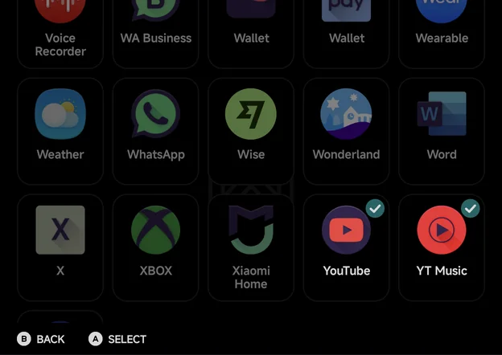
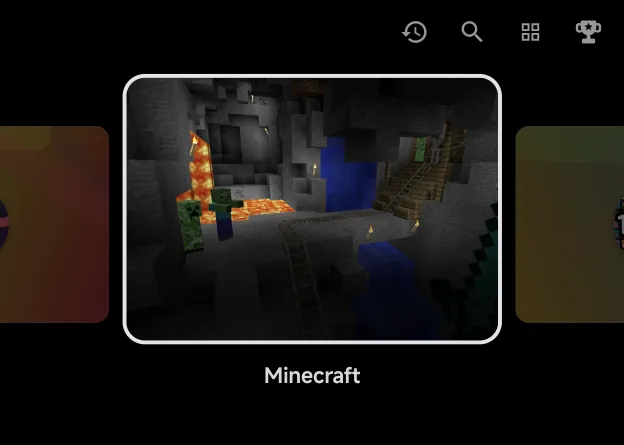

# Launcher Mode & Android Games

NX Redux can be your phone's home screen, show your Android apps in
Tools, and list your Android games as a console:

| Where | What it does |
| --- | --- |
| **Tools → Settings → System → Use as home screen** | Make the app your Android home screen. See [Use as home screen](#use-as-home-screen). |
| **Tools → Apps** | Every app on the phone. Open one, or add it to Tools. See [Android apps](#android-apps). |
| **Tools → Settings → Library → Android games** | Pick the apps in the Android console. See [Android games](#android-games). |

{ .nx-wide }

## Use as home screen

Turn **Use as home screen** On, in the **Launcher** group of
[System](about.md), and Android asks whether to make NX Redux your
home app. Say yes, and the phone opens to the main menu.

While the app is the home screen, **Home** (the button or the gesture)
brings you back to the main menu's Home tab.

To stop using it, turn the row Off. Android's home settings open, so you can
pick your old launcher again.

??? info "More detail"
    - **Back** on the main menu stays where it is, since there is nothing
      under a home screen.
    - The screen sleeps as usual on the main menu.
    - If you turn Android's question down, the row stays Off and a notice
      says where to set it by hand: **Set NX Redux as the home app in Android
      settings → Default apps**.

## Android apps

**Tools → Apps** opens a grid of your installed apps. Press `A`, or tap the
selected app, to open it.

Press `MENU`, or long-press an app, for its menu:

- **Add to Tools** puts the app in the Tools tab, after the built-in tools.
  **Remove from Tools** takes it out again; it stays in **Apps**.
- **Pin to Home** pins it to Home, as with the other tools. **Unpin from
  Home** takes it off.

An app in Tools opens like any other tool, and its own `MENU` offers **Pin**
or **Unpin** and **Remove from Tools**.

??? info "More detail"
    - Apps you put in the Android console aren't listed here.
    - Apps that are in Tools carry a mark in the grid.

## Android games

**Tools → Settings → Library → Android games** opens the same kind of grid. Apps Android marks as games
come first, then every other app, so you can add any of them.

Ticked apps leave Tools and join the **Android** console on the Consoles tab.

First-run setup also offers to add the games it finds (**Add N Android games
to Consoles?**). It asks only once.

??? info "More detail"
    - If an app was pinned to Home as a tool, its pin moves with it.
    - In setup, choose **Yes** to add them all, or **Not now**. On an install
      that was set up before, the question may show once over the main menu
      instead.

## The Android console

`A` **Open** starts the game's app. Android games differ from the other
consoles:

- **Not tracked:** an Android game never shows on the Continue card or in the
  [Game Switcher](game-switcher.md), and it has no play time in the
  [Game Tracker](game-tracker.md).
- **Context menu:** only **Pin Item** or **Unpin Item**.

??? info "More detail"
    - Each game shows its screenshot fetched with [Artwork](artwork.md).
      Until it has one, it gets abstract art made from its icon's colours.
    - A pinned Android game sits on Home with your other pinned games.

To take a game out of the console, untick it in **Tools → Settings →
Library → Android games**.

## Back to a running game

With a game open, tap the NX Redux icon to come back to it. The app brings
the running game forward instead of starting over at the menu.
