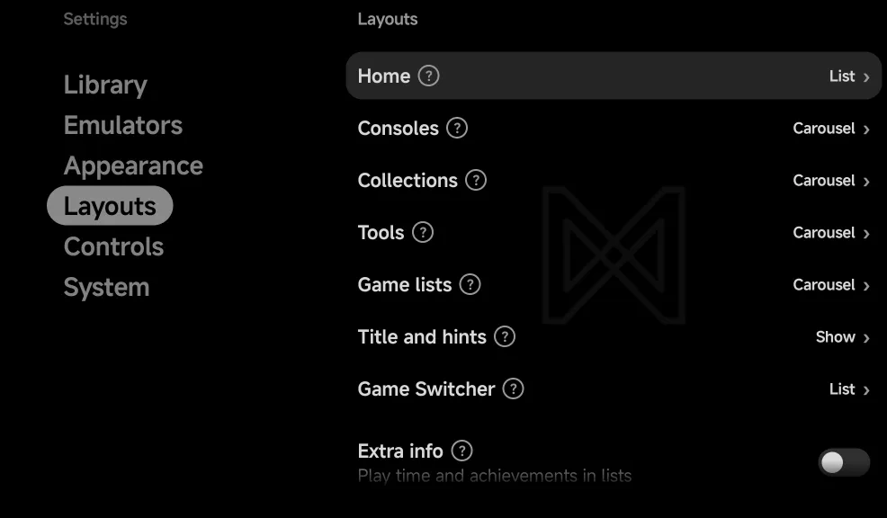
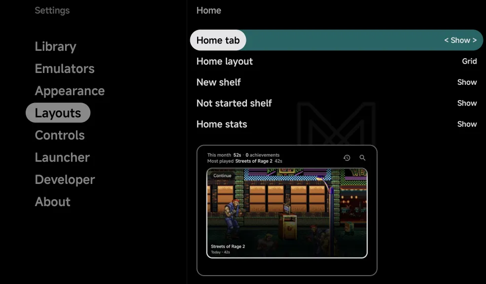
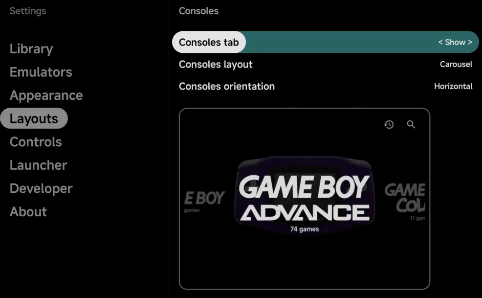
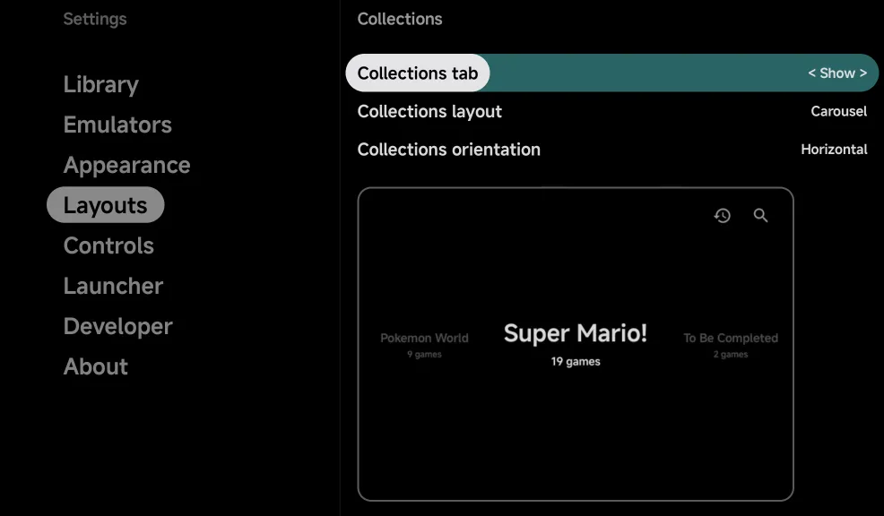
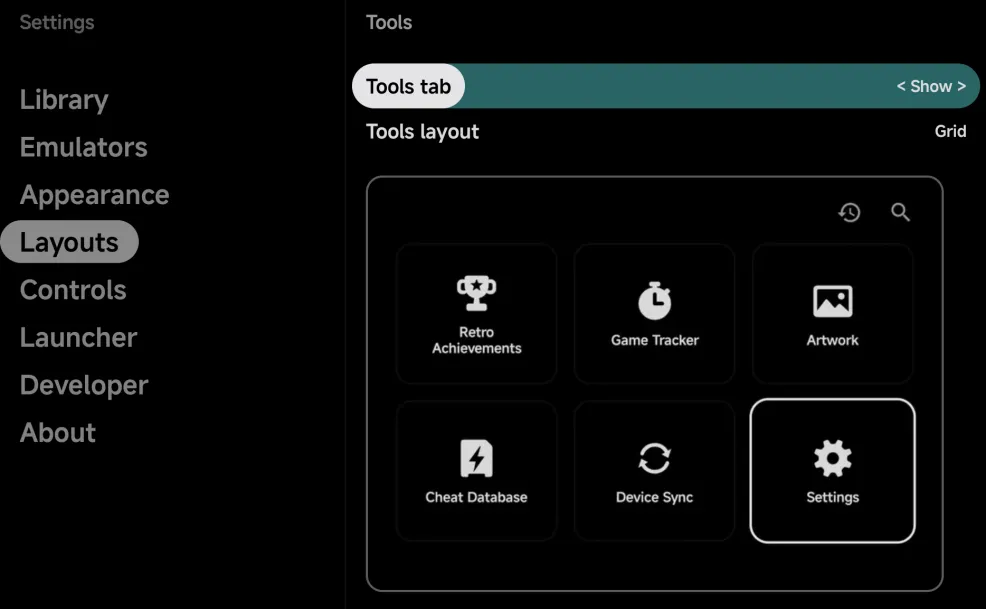
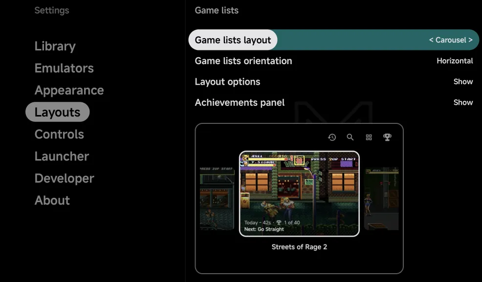
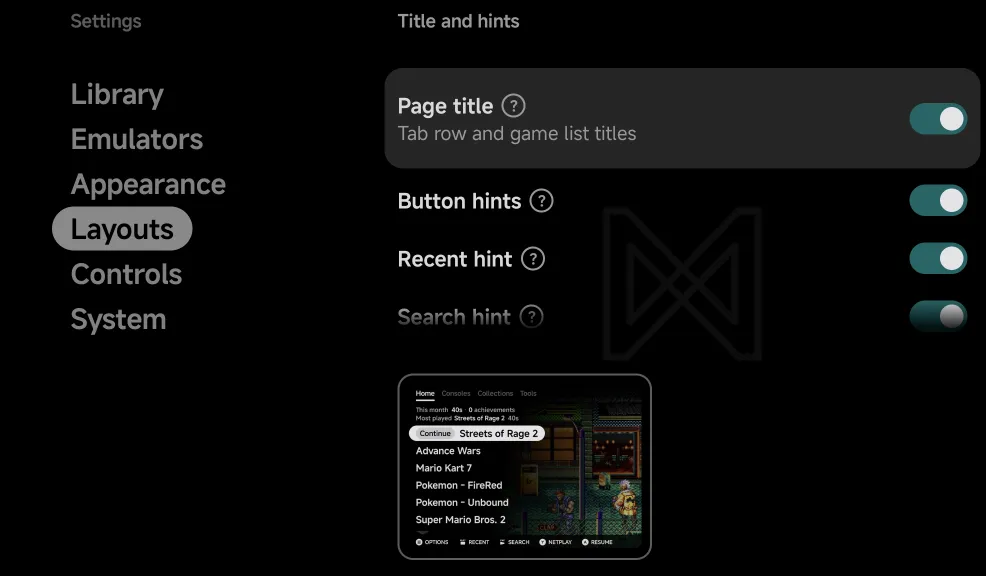
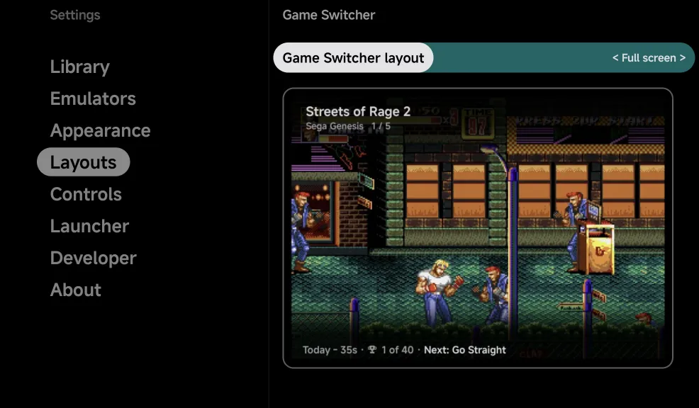

# Menu Layouts

**Tools → Settings → Layouts** sets each main menu tab's and the game lists'
style, hides tabs, picks the art behind consoles and beside games, sets the
Game Switcher's layout, and hides the page title, the button hints and the
game stats. For what each style looks like, see
[Main Menu](main-menu.md).

## The Layouts page

The Layouts page lists its groups, each with what it is set to now. Press `A`
on a group to open its page, and `B` to come back.

{ .nx-wide }

| Row | Shows |
| --- | --- |
| [**Home**](#home) | Home's layout, or **Hidden** |
| [**Consoles**](#consoles) | The Consoles tab's layout, or **Hidden** |
| [**Collections**](#collections) | The Collections tab's layout, or **Hidden** |
| [**Tools**](#tools) | The Tools tab's layout, or **Hidden** |
| [**Game lists**](#game-lists) | The game lists' layout |
| [**Title and hints**](#title-and-hints) | **Show**, **Title only**, **Hints only** or **Hide** |
| [**Game Switcher**](#game-switcher) | **Full screen** or **List** |
| [**Extra info**](#extra-info) | Show, Hide (default Show) |
| [**Reset to defaults**](#reset-to-defaults) | |

### Group pages

A group's page has its rows at the top and a picture of how they look below
(beside the rows on a wide landscape screen, such as a phone turned
sideways). The picture changes as you change a row.

- `Right` and `A` step the highlighted row to its next value, `Left` to the
  previous one.
- With touch alone, a row with three or more values opens a dropdown of them
  (see [Settings](settings.md)).
- Some rows only show when they apply.

??? info "More detail"
    - A hidden tab's page has no picture.
    - When a change adds or removes rows, the highlight stays on the row you
      changed.

## Home

{ .nx-wide }

| Row | Values | Default | Shows |
| --- | --- | --- | --- |
| [**Home tab**](#showing-and-hiding-tabs) | Show, Hide | Show | Always |
| **Home layout** | List, Grid, Carousel, Minimal | Grid | When Home tab is Show |
| [**New shelf**](foldables.md#shelves) | Show, Hide | Show | When Home tab is Show |
| [**Not started shelf**](foldables.md#shelves) | Show, Hide | Show | When Home tab is Show |
| [**Home stats**](#home-stats) | Show, Hide | Show | When Home tab is Show |

### Home stats

**Home stats** set to **Hide** removes Home's stats strip (**This month**,
**Most played**) in every Home layout. The cards keep their play time and
achievements; [Extra info](#extra-info) hides those.

??? info "More detail"
    The strip's space goes to the top section: the Continue card and the tool
    squares grow, and a column of squares gains one more only when a whole
    square fits. The group's picture shows Home without the strip.

## Consoles

{ .nx-wide }

| Row | Values | Default | Shows |
| --- | --- | --- | --- |
| [**Consoles tab**](#showing-and-hiding-tabs) | Show, Hide | Show | Always |
| **Consoles layout** | List, Grid, Carousel, Minimal | Carousel | When Consoles tab is Show |
| [**Consoles orientation**](main-menu.md#orientation) | Horizontal, Vertical | Horizontal | When Consoles tab is Show and Consoles layout is Carousel |
| [**Consoles background**](#consoles-background) | Controller, Background, None | Controller | When Consoles tab is Show and Consoles layout is List or Carousel |

### Consoles background

What shows with the consoles in the List and Carousel styles. The row hides
while **Consoles layout** is **Grid**.

- **Controller** (default): each console's controller, beside the list or
  behind its logo in the Carousel.
- **Background**: no controller. The selected console's own background
  picture fills the screen: as a game list's screenshot in the List style,
  dimmed as a Backdrop game list's picture in the Carousel.
- **None**: no controller and no background: plain black.

??? info "More detail"
    - The Background picture is `Roms/<console>/.media/bg.png`. A console
      without one shows plain black.
    - The Grid style shows each console's logo only.

## Collections

{ .nx-wide }

| Row | Values | Default | Shows |
| --- | --- | --- | --- |
| [**Collections tab**](#showing-and-hiding-tabs) | Show, Hide | Show | Always |
| **Collections layout** | List, Grid, Carousel, Minimal | Minimal | When Collections tab is Show |
| [**Collections orientation**](main-menu.md#orientation) | Horizontal, Vertical | Horizontal | When Collections tab is Show and Collections layout is Carousel |

## Tools

{ .nx-wide }

| Row | Values | Default | Shows |
| --- | --- | --- | --- |
| [**Tools tab**](#showing-and-hiding-tabs) | Show, Hide | Show | Always |
| **Tools layout** | List, Grid, Carousel, Minimal | Grid | When Tools tab is Show |
| [**Tools orientation**](main-menu.md#orientation) | Horizontal, Vertical | Horizontal | When Tools tab is Show and Tools layout is Carousel |

## Game lists

{ .nx-wide }

| Row | Values | Default | Shows |
| --- | --- | --- | --- |
| **Game lists layout** | List, Grid, Carousel, Backdrop, Minimal | Carousel | Always |
| [**Game lists orientation**](main-menu.md#orientation) | Horizontal, Vertical | Horizontal | When Game lists layout is Carousel or Backdrop |
| [**Game lists alignment**](main-menu.md#game-lists-alignment) | Left, Right | Left | When Game lists orientation is Vertical |
| [**List art**](#list-art) | Screenshot, Mix, 3D box art, 2D box art, Wheel, None | Screenshot | When Game lists layout is List |
| [**Backdrop art**](#backdrop-art) | 3D box art, 2D box art, Wheel | 3D box art | When Game lists layout is Backdrop |
| [**Layout options**](#layout-options-and-achievements-panel) | Show, Hide | Show | Always |
| [**Achievements panel**](#layout-options-and-achievements-panel) | Show, Hide | Show | Always |

### List art

The picture a game list shows in the List style:

- **Screenshot** (default): the game's screenshot fills the background.
- **Mix**, **3D box art**, **2D box art** or **Wheel**: that picture, whole,
  in a box on the right.
- **None**: no picture and no background.

A game without the picture you picked shows its screenshot full-screen
instead. Mix, 2D box art and Wheel come from [Artwork](artwork.md).

??? info "More detail"
    - With a box, the game names always stop short of it.
    - **None** applies to every List-style list below the tabs, game lists
      and collections alike.

### Backdrop art

The box in a Backdrop row: **3D box art** (default), **2D box art** or
**Wheel**. The background stays the screenshot.

??? info "More detail"
    - A wheel keeps its own shape instead of being cut into a case.
    - A game without the picture you picked shows its 3D box art, else a
      placeholder box.

### Layout options and achievements panel

On a phone with a touchscreen, a game list's title has
[icons](main-menu.md#title-icons) at its right: **Recent**, **Search**,
**Layout** and a trophy for the
[achievements panel](main-menu.md#achievements-panel). These two rows hide
the last two.

- **Layout options** set to **Hide** removes the **Layout** icon. That icon
  opens a dropdown of every game list layout, and picking one sets the
  [Game lists](#game-lists) rows for every game list. Hidden, change the
  layout here instead.
- **Achievements panel** set to **Hide** removes the trophy icon and the `X`
  **Achievements** hint. `X` still opens the panel, and the game's `MENU`
  menu gains an **Achievements** item.

??? info "More detail"
    - The Layout dropdown lists List, Grid, Carousel, Carousel vertical left
      and right, Backdrop, Backdrop vertical left and right, and Minimal.
    - The trophy icon, the hint and the **Achievements** item show only while
      you are signed in to [RetroAchievements](retroachievements.md).

## Title and hints

{ .nx-wide }

| Row | Values | Default | Shows |
| --- | --- | --- | --- |
| [**Page title**](#page-title-and-button-hints) | Show, Hide | Show | Always |
| [**Button hints**](#page-title-and-button-hints) | Show, Hide | Show | Always |
| [**Recent hint**](#single-hints) | Show, Hide | Show | When Button hints is Show |
| [**Search hint**](#single-hints) | Show, Hide | Show | When Button hints is Show |
| [**Netplay hint**](#single-hints) | Show, Hide | Show | When Button hints is Show, on a phone with netplay |

### Page title and button hints

- **Page title** set to **Hide** removes the main menu's tab row and a game
  list's title. `L1` / `R1` still switch tabs.
- **Button hints** set to **Hide** removes the hint bar along the bottom of
  the main menu and the game lists.

Other screens, such as Settings and the in-game menu, keep both. The
**Title and hints** row on the Layouts page sums up the two: **Show**,
**Title only**, **Hints only** or **Hide**.

!!! note
    These only take effect while a controller is connected or the portrait
    pad shows. With touch alone there is no hint bar at all, and the main
    menu keeps its tab row (a tap on a tab is the only touch way to switch
    tabs), while a game list's title still hides.

??? info "More detail: where the space goes"
    - With the title hidden, its space goes to the page. A List shows more
      rows. Home moves its stats strip up into the tab row's place, and a
      Grid Home's columns of tool squares gain one more. Grid, Carousel and
      Backdrop keep their size and centre in the full height. A game list's
      icons stay at the top right.
    - With the hints hidden, their space stays empty, Home included. In a
      List game list and in the
      [Game Switcher](game-switcher.md#play-time-and-achievements), the
      selected game's play time and achievements move down into that row.
      **Recent** and **Search** become icons at the right of the tab row.

#### Single hints

**Recent hint**, **Search hint** and **Netplay hint** each hide one hint
(`SELECT` **Recent**, `START` **Search** or `Y` **Netplay**) and leave the
rest of the bar. The button still works, and touch gets another way in:

- **Recent** and **Search** become icons at the right of the tab row, or of
  a game list's title.
- **Netplay** leads a game's `MENU` menu, after **Play from start**, in game
  lists and on Home.

With **Button hints** hidden, all three are handled this way.

## Game Switcher

{ .nx-wide }

| Row | Values | Default |
| --- | --- | --- |
| [**Game Switcher layout**](#game-switcher-layout) | Full screen, List | Full screen |

### Game Switcher layout

How the [Game Switcher](game-switcher.md) draws your recent games:

- **Full screen** (default): one game at a time, its picture filling the
  screen. `LEFT` / `RIGHT` move between games.
- **List**: the games as a List-style game list titled **Recent**, the
  selected game's picture behind the rows. `UP` / `DOWN` move between games.

## Extra info

**Extra info** set to **Hide** removes the game stats from the main menu,
the game lists and the Game Switcher, for a cleaner look. Unlike the page
title and hints, it works in every mode: touch alone, with a controller,
portrait or landscape.

??? info "More detail: what it hides"
    - **Home** leaves the play time and achievements off the Continue card,
      pinned games and the [shelves](foldables.md#shelves). Its stats strip
      follows [Home stats](#home-stats) instead.
    - A **List** game list leaves the selected game's play time,
      achievements and next achievement out of the hint row when the hints
      are hidden.
    - The selected **Grid** tile shows only the game's name.
    - **Carousel** and **Backdrop** captions show only the name, horizontal
      and vertical alike.
    - The [Game Switcher](game-switcher.md#play-time-and-achievements)
      leaves out its info line, in both layouts.
    - A console's or collection's game count stays, and the
      [in-game menu](in-game-menu.md), the [Game Tracker](game-tracker.md)
      and [RetroAchievements](retroachievements.md) keep all their info.

## Showing and hiding tabs

Set a tab's row to **Hide** to take it out of the tab row. Hide all of them
for a Home-only menu.

A hidden tab is still one press away, and so is Settings, which lives in
Tools:

- Press `MENU` on any item of the main menu. After the item's own options,
  the menu offers **Consoles**, **Collections** and **Tools** for each tab
  that is hidden and has something in it.
- Or touch and hold the tab row (or the **NX Redux** title).

The tab opens over the current one. `B` **Back** returns to the tab
underneath, where you left it.

??? info "More detail"
    - With only one tab left, the tab row is replaced by an **NX Redux**
      title, `L1` / `R1` have nothing to switch to, and `Up` never moves onto
      the title.
    - A `MENU` menu that holds only the hidden tabs is captioned **NX Redux**.
    - The opened tab uses its own layout, with its name as the title. `A`
      opens items as usual and `MENU` gives their options.
    - In it, `L1` / `R1` and `Left` / `Right` past the ends do not switch
      tabs; a Grid wraps around instead, and `Up` never moves onto the title.
    - A game you start from it brings you back to the main menu's own tab
      afterwards.
    - It drops back to the tab underneath by itself when you show its tab
      again, or when it is emptied.
    - Home's **+N** square and **Pick a game** open a hidden Tools or
      Consoles tab the same way. While that tab is hidden, a long press on
      **+N** or **Pick a game** also opens the hidden-tab menu, which is how
      touch reaches it when the tab row is hidden.

## Reset to defaults

**Reset to defaults** puts every row on the Layouts group pages back to its
default. It does not ask first.

??? info "More detail: what it resets"
    Every tab shown, each tab's layout and orientation, the shelves and
    **Home stats**, the game lists' layout, orientation and alignment,
    **Consoles background**, **List art**, **Backdrop art**, **Layout
    options**, **Achievements panel**, **Page title**, **Button hints** and
    the single hints, **Game Switcher layout** and **Extra info**.

??? info "Games without artwork"
    A game with no screenshot or box art gets a generated abstract picture,
    the same one every time. To fetch real art, press `MENU` on a game and
    choose **Fetch art**, or use [Artwork](artwork.md) for many games at
    once.
