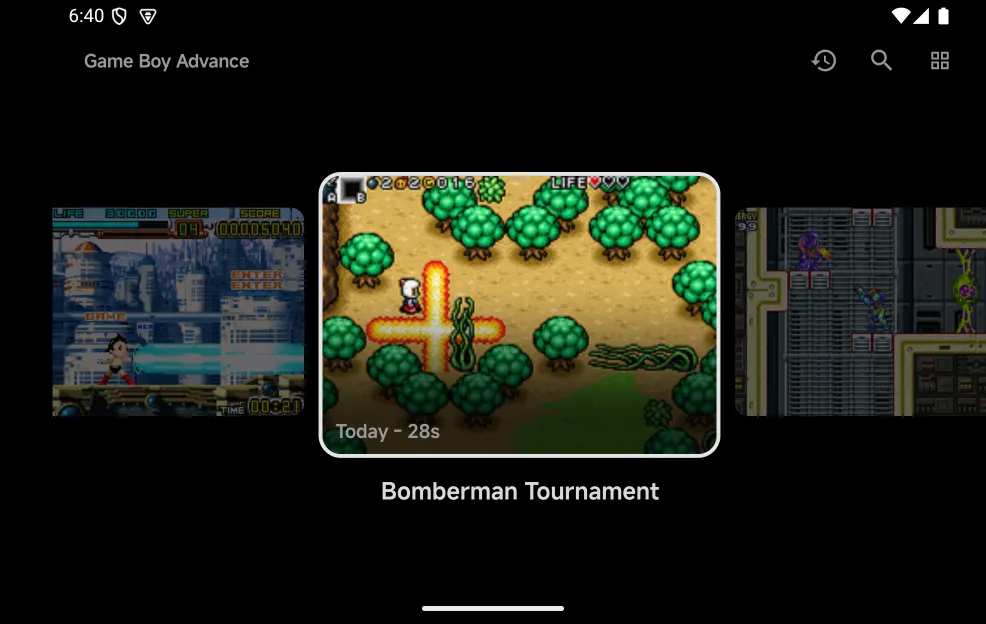
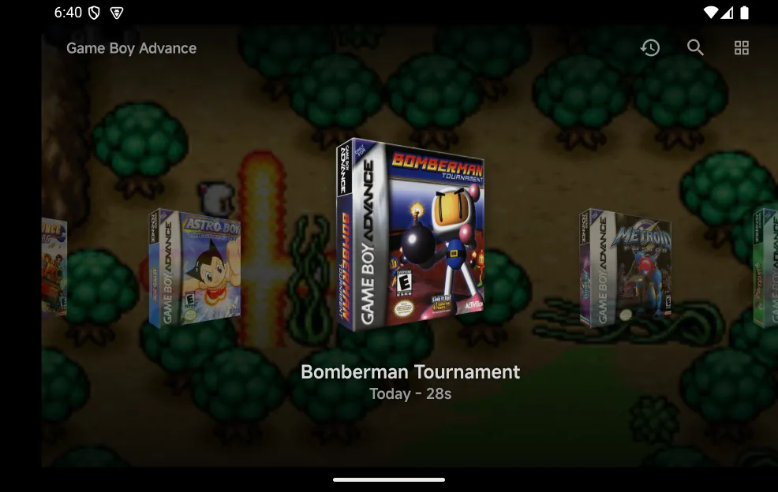

# Menu Layouts

Each main menu tab and the game lists can have their own style. Set them in
**Tools → Settings → Layouts**. The same page also hides tabs, picks the art
behind consoles and beside games, sets the Game Switcher's layout, and hides
the page title, the button hints and the game stats. Home has its own
layout: List, Grid or Carousel.

| Style | Tabs | Game lists | In short |
| --- | :---: | :---: | --- |
| [**List**](#list) | ✓ | ✓ | Text rows over the art, the most entries per screen |
| [**Grid**](#grid) | ✓ | ✓ | Rows of tiles that slide sideways |
| [**Carousel**](#carousel) | ✓ | ✓ | One large item at a time, across or down the screen |
| [**Backdrop**](#backdrop) | | ✓ | Box art over the game's screenshot |

Out of the box, Consoles, Collections and game lists use **Carousel**, and
Home and Tools use **Grid**.

## The Layouts page

The Layouts page lists its groups, each with what it is set to now. Press `A`
on a group to open its page, and `B` to come back.

| Row | Shows |
| --- | --- |
| [**Home**](#home) | Home's layout, or **Hidden** |
| [**Consoles**](#consoles-collections-and-tools) | The Consoles tab's layout, or **Hidden** |
| [**Collections**](#consoles-collections-and-tools) | The Collections tab's layout, or **Hidden** |
| [**Tools**](#consoles-collections-and-tools) | The Tools tab's layout, or **Hidden** |
| [**Game lists**](#game-lists) | The game lists' layout |
| [**Title and hints**](#title-and-hints) | **Show**, **Title only**, **Hints only** or **Hide** |
| [**Game Switcher**](#game-switcher-layout) | **Full screen** or **List** |
| [**Extra info**](#extra-info) | Show, Hide (default Show) |
| [**Reset to defaults**](#reset-to-defaults) | |

### Group pages

A group's page has its rows at the top and a picture of how they look below
(beside the rows on a wide landscape screen, such as a phone turned
sideways). The picture changes as you change a row.

- `Right` and `A` step the highlighted row to its next value, `Left` to the
  previous one.
- With touch alone, a row with three or more values opens a dropdown of them
  (see [Settings](settings.md)).
- Some rows only show when they apply.

??? info "More detail"
    - A hidden tab's page has no picture.
    - When a change adds or removes rows, the highlight stays on the row you
      changed.

#### Home

| Row | Values | Default | Shows |
| --- | --- | --- | --- |
| [**Home tab**](#showing-and-hiding-tabs) | Show, Hide | Show | Always |
| **Home layout** | List, Grid, Carousel | Grid | When Home tab is Show |
| [**New shelf**](foldables.md#shelves) | Show, Hide | Show | When Home tab is Show |
| [**Not started shelf**](foldables.md#shelves) | Show, Hide | Show | When Home tab is Show |
| [**Home stats**](#home-stats) | Show, Hide | Show | When Home tab is Show |

#### Consoles, Collections and Tools

Each of the three tabs has its own page with the same rows, named after the
tab. **Consoles controller** is on the Consoles page only.

| Row | Values | Default | Shows |
| --- | --- | --- | --- |
| [**Consoles tab**](#showing-and-hiding-tabs) | Show, Hide | Show | Always |
| **Consoles layout** | List, Grid, Carousel | Carousel (Tools: Grid) | When the tab is Show |
| [**Consoles orientation**](#orientation) | Horizontal, Vertical | Horizontal | When the tab is Show and its layout is Carousel |
| [**Consoles controller**](#consoles-controller) | Controller, Background, None | Controller | When Consoles tab is Show and Consoles layout is List |

#### Game lists

| Row | Values | Default | Shows |
| --- | --- | --- | --- |
| **Game lists layout** | List, Grid, Carousel, Backdrop | Carousel | Always |
| [**Game lists orientation**](#orientation) | Horizontal, Vertical | Horizontal | When Game lists layout is Carousel or Backdrop |
| [**Game lists alignment**](#game-lists-alignment) | Left, Right | Left | When Game lists orientation is Vertical |
| [**List art**](#list-art) | Screenshot, Mix, 3D box art, 2D box art, Wheel, None | Screenshot | When Game lists layout is List |
| [**Backdrop art**](#backdrop-art) | 3D box art, 2D box art, Wheel | 3D box art | When Game lists layout is Backdrop |
| [**Layout options**](#layout-options-and-achievements-panel) | Show, Hide | Show | Always |
| [**Achievements panel**](#layout-options-and-achievements-panel) | Show, Hide | Show | Always |

#### Title and hints

| Row | Values | Default | Shows |
| --- | --- | --- | --- |
| [**Page title**](#page-title-and-button-hints) | Show, Hide | Show | Always |
| [**Button hints**](#page-title-and-button-hints) | Show, Hide | Show | Always |
| [**Recent hint**](#single-hints) | Show, Hide | Show | When Button hints is Show |
| [**Search hint**](#single-hints) | Show, Hide | Show | When Button hints is Show |
| [**Netplay hint**](#single-hints) | Show, Hide | Show | When Button hints is Show, on a phone with netplay |

#### Game Switcher

| Row | Values | Default |
| --- | --- | --- |
| [**Game Switcher layout**](#game-switcher-layout) | Full screen, List | Full screen |

## Showing and hiding tabs

Set a tab's row to **Hide** to take it out of the tab row. Hide all of them
for a Home-only menu.

A hidden tab is still one press away, and so is Settings, which lives in
Tools:

- Press `MENU` on any item of the main menu. After the item's own options,
  the menu offers **Consoles**, **Collections** and **Tools** for each tab
  that is hidden and has something in it.
- Or touch and hold the tab row (or the **NX Redux** title).

The tab opens over the current one. `B` **Back** returns to the tab
underneath, where you left it.

??? info "More detail"
    - With only one tab left, the tab row is replaced by an **NX Redux**
      title, `L1` / `R1` have nothing to switch to, and `Up` never moves onto
      the title.
    - A `MENU` menu that holds only the hidden tabs is captioned **NX Redux**.
    - The opened tab uses its own layout, with its name as the title. `A`
      opens items as usual and `MENU` gives their options.
    - In it, `L1` / `R1` and `Left` / `Right` past the ends do not switch
      tabs; a Grid wraps around instead, and `Up` never moves onto the title.
    - A game you start from it brings you back to the main menu's own tab
      afterwards.
    - It drops back to the tab underneath by itself when you show its tab
      again, or when it is emptied.
    - Home's **+N** square and **Pick a game** open a hidden Tools or
      Consoles tab the same way. While that tab is hidden, a long press on
      **+N** or **Pick a game** also opens the hidden-tab menu, which is how
      touch reaches it when the tab row is hidden.

## List

A plain list. On the Consoles tab the selected console's controller sits
beside the list (see [Consoles controller](#consoles-controller)). In a game
list the selected game's picture fills the background or sits in a box (see
[List art](#list-art)).

*Consoles tab*

*Game list*

`Up` on the first row wraps to the last, and `Down` on the last row wraps to
the first.

??? info "More detail"
    - Only a fresh press wraps: holding the button stops at the end.
    - The scroll arrows sit at the bottom, above the button hints.
    - In a game list, the selected game's last-played time, achievements and
      next achievement show only where the hints would be: with
      [Button hints](#page-title-and-button-hints) hidden, or with touch
      alone. While the hint bar shows, they are left out.

## Grid

Rows of tiles that slide sideways as you move. Consoles show their logo and
game count. Games show their screenshot, and the selected tile adds its name,
last-played time and achievement count.

*Consoles tab*

*Game list*

??? info "More detail: rows and columns"
    - Two rows on most phones, three on a tall phone held upright (such as a
      Galaxy Z Flip), and three or four on a large screen.
    - On a phone held upright the Consoles tab shows two consoles across,
      each half the screen wide. Once you move past the second, the selected
      console stays in the middle with half of each neighbour showing on
      either side, as on the handheld.
    - A tall phone's Grid starts with two or three columns across, and once
      it scrolls the selected column stays in the middle the same way.

## Carousel

A single row with the selected item large in the middle and its neighbours
to the sides. Consoles show their logo over their controller, collections
their name, tools their icon. In a game list the selected game's name sits
below its picture, and its play time, achievement count and next achievement
sit at the bottom of the picture.

*Consoles tab*

*Game list*

??? info "More detail"
    - A game's stats sit over a dark fade. The side games get smaller the
      further they are from the middle.
    - On the Collections and Tools tabs each item is only as wide as its name
      or icon, and the space between neighbours stays the same, so short and
      long names sit evenly along the row.

## Backdrop

Game lists only. The selected game's box art stands over its dimmed
screenshot, with its neighbours' boxes to the sides. Its caption gives the
name, then the play time and achievement count, then the next achievement on
its own line. The Vertical orientation shows the same lines.

## Orientation

Carousel and Backdrop can also run **down** the screen instead of across:
set the **orientation** row under the style to **Vertical**.

- `Up` / `Down` move through the items, wrapping as a [List](#list) does.
- `Left` / `Right` switch tabs on a tab, and do nothing in a game list.

<figure markdown>

<figcaption>Consoles, Horizontal</figcaption>
</figure>

<figure markdown>

<figcaption>Consoles, Vertical</figcaption>
</figure>

## Game lists alignment

In a vertical game list the stack sits on the left and the details on the
right. Set **Game lists alignment** to **Right** to swap the sides.

<figure markdown>

<figcaption>Backdrop, Vertical, Left</figcaption>
</figure>

<figure markdown>

<figcaption>Backdrop, Vertical, Right</figcaption>
</figure>

## In landscape

Turn the phone sideways and the same layouts spread across the wider screen.
These are the Carousel and Backdrop game lists, both Horizontal.

<figure markdown>

<figcaption>Carousel, landscape</figcaption>
</figure>

<figure markdown>

<figcaption>Backdrop, landscape</figcaption>
</figure>

## List art

The picture a game list shows in the List style:

- **Screenshot** (default): the game's screenshot fills the background.
- **Mix**, **3D box art**, **2D box art** or **Wheel**: that picture, whole,
  in a box on the right.
- **None**: no picture and no background.

A game without the picture you picked shows its screenshot full-screen
instead. Mix, 2D box art and Wheel come from [Artwork](artwork.md).

??? info "More detail"
    - With a box, the game names always stop short of it.
    - **None** applies to every List-style list below the tabs, game lists
      and collections alike.

## Backdrop art

The box in a Backdrop row: **3D box art** (default), **2D box art** or
**Wheel**. The background stays the screenshot.

??? info "More detail"
    - A wheel keeps its own shape instead of being cut into a case.
    - A game without the picture you picked shows its 3D box art, else a
      placeholder box.

## Consoles controller

What shows behind the Consoles tab in the List style. The row shows only
while **Consoles layout** is **List**.

- **Controller** (default): each console's controller beside the list.
- **Background**: no controller. The selected console's own background
  picture fills the screen, as a game list's screenshot does.
- **None**: no controller and no background: a plain list on black.

??? info "More detail"
    - The Background picture is `Roms/<console>/.media/bg.png`. A console
      without one shows plain black.
    - The Carousel style always shows each console's controller.

## Home stats

**Home stats** set to **Hide** removes Home's stats strip (**This month**,
**Most played**) in every Home layout. The cards keep their play time and
achievements; [Extra info](#extra-info) hides those.

??? info "More detail"
    The strip's space goes to the top section: the Continue card and the tool
    squares grow, and a column of squares gains one more only when a whole
    square fits. The group's picture shows Home without the strip.

## Layout options and achievements panel

On a phone with a touchscreen, a game list's title has
[icons](main-menu.md#title-icons) at its right: **Recent**, **Search**,
**Layout** and a trophy for the
[achievements panel](main-menu.md#achievements-panel). These two rows hide
the last two.

- **Layout options** set to **Hide** removes the **Layout** icon. That icon
  opens a dropdown of every game list layout, and picking one sets the
  [Game lists](#game-lists) rows for every game list. Hidden, change the
  layout here instead.
- **Achievements panel** set to **Hide** removes the trophy icon and the `X`
  **Achievements** hint. `X` still opens the panel, and the game's `MENU`
  menu gains an **Achievements** item.

??? info "More detail"
    - The Layout dropdown lists List, Grid, Carousel, Carousel vertical left
      and right, Backdrop, and Backdrop vertical left and right.
    - The trophy icon, the hint and the **Achievements** item show only while
      you are signed in to [RetroAchievements](retroachievements.md).

## Page title and button hints

- **Page title** set to **Hide** removes the main menu's tab row and a game
  list's title. `L1` / `R1` still switch tabs.
- **Button hints** set to **Hide** removes the hint bar along the bottom of
  the main menu and the game lists.

Other screens, such as Settings and the in-game menu, keep both. The
**Title and hints** row on the Layouts page sums up the two: **Show**,
**Title only**, **Hints only** or **Hide**.

!!! note
    These only take effect while a controller is connected or the portrait
    pad shows. With touch alone there is no hint bar at all, and the main
    menu keeps its tab row (a tap on a tab is the only touch way to switch
    tabs), while a game list's title still hides.

??? info "More detail: where the space goes"
    - With the title hidden, its space goes to the page. A List shows more
      rows. Home moves its stats strip up into the tab row's place, and a
      Grid Home's columns of tool squares gain one more. Grid, Carousel and
      Backdrop keep their size and centre in the full height. A game list's
      icons stay at the top right.
    - With the hints hidden, their space stays empty, Home included. In a
      List game list and in the
      [Game Switcher](game-switcher.md#play-time-and-achievements), the
      selected game's play time and achievements move down into that row.
      **Recent** and **Search** become icons at the right of the tab row.

### Single hints

**Recent hint**, **Search hint** and **Netplay hint** each hide one hint
(`SELECT` **Recent**, `START` **Search** or `Y` **Netplay**) and leave the
rest of the bar. The button still works, and touch gets another way in:

- **Recent** and **Search** become icons at the right of the tab row, or of
  a game list's title.
- **Netplay** leads a game's `MENU` menu, after **Play from start**, in game
  lists and on Home.

With **Button hints** hidden, all three are handled this way.

## Game Switcher layout

How the [Game Switcher](game-switcher.md) draws your recent games:

- **Full screen** (default): one game at a time, its picture filling the
  screen. `LEFT` / `RIGHT` move between games.
- **List**: the games as a List-style game list titled **Recent**, the
  selected game's picture behind the rows. `UP` / `DOWN` move between games.

## Extra info

**Extra info** set to **Hide** removes the game stats from the main menu,
the game lists and the Game Switcher, for a cleaner look. Unlike the page
title and hints, it works in every mode: touch alone, with a controller,
portrait or landscape.

??? info "More detail: what it hides"
    - **Home** leaves the play time and achievements off the Continue card,
      pinned games and the [shelves](foldables.md#shelves). Its stats strip
      follows [Home stats](#home-stats) instead.
    - A **List** game list leaves the selected game's play time,
      achievements and next achievement out of the hint row when the hints
      are hidden.
    - The selected **Grid** tile shows only the game's name.
    - **Carousel** and **Backdrop** captions show only the name, horizontal
      and vertical alike.
    - The [Game Switcher](game-switcher.md#play-time-and-achievements)
      leaves out its info line, in both layouts.
    - A console's or collection's game count stays, and the
      [in-game menu](in-game-menu.md), the [Game Tracker](game-tracker.md)
      and [RetroAchievements](retroachievements.md) keep all their info.

## Reset to defaults

**Reset to defaults** puts every row on the Layouts group pages back to its
default. It does not ask first.

??? info "More detail: what it resets"
    Every tab shown, each tab's layout and orientation, the shelves and
    **Home stats**, the game lists' layout, orientation and alignment,
    **Consoles controller**, **List art**, **Backdrop art**, **Layout
    options**, **Achievements panel**, **Page title**, **Button hints** and
    the single hints, **Game Switcher layout** and **Extra info**.

??? info "Games without artwork"
    A game with no screenshot or box art gets a generated abstract picture,
    the same one every time. To fetch real art, press `MENU` on a game and
    choose **Fetch art**, or use [Artwork](artwork.md) for many games at
    once.
