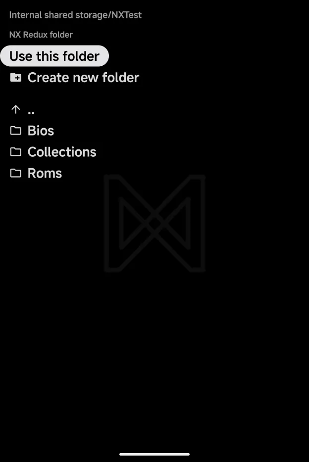

# Library & ROM folders

## Home folder and extra folders

The library comes from two kinds of folder:

- **The home folder**, laid out as `Roms/<Name (TAG)>/`, one folder per
  console, such as `Roms/Game Boy Advance (GBA)/`. The app created it and
  writes only inside it.
- **Extra folders**, any number of them, scanned in place and never written
  to.

The app matches the files in an extra folder to a console by the folder's
name or the file's extension. Anything left over lands in
[Unassigned games](#unassigned-games) until you pick its console.

The app never deletes a game. It moves games only while **Move them into
<home>/Roms** is on during setup.

??? info "More detail"
    During [first-run setup](getting-started.md#first-run-setup), the page
    that says what a folder holds offers **Move them into <home>/Roms**: on
    by default for the home folder's games outside `Roms/`, off for an extra
    folder.

    Files in an extra folder are matched to a console:

    1. by a `(TAG)` or an alias in the folder name (a short alias such as
       `GBA` may be followed only by roms, games or isos, singular or plural),
    2. then by an extension only one console uses (a zip by its first entry, a
       7z only by its folder).

    The console you pick for an Unassigned game is saved in a `systems.txt`
    (`<file><TAB><TAG>`). For extra folders this file lives in the home folder
    under `Roms/.sources/`, so the extra folder itself is never changed.

## Settings → Library

**Tools → Settings → Library** shows what the library holds (home folder,
game and console count, last scan), then its rows.


| Row | What it does |
| --- | --- |
| **Rescan library** | Scan every folder again. A notice then says how many games the library has. |
| **ROM folders** | Open the [ROM folders](#rom-folders) page. |
| **Unassigned games** | Only when some games have no console. Shows how many, and opens their list. See [Unassigned games](#unassigned-games). |
| **Hidden games** | Only when some games are hidden. Shows how many. `A` on a game shows it again. |

??? info "More detail: the lines at the top"
    - the home folder's path,
    - how many games and consoles the library has, such as **212 games · 20
      consoles**,
    - how many ROM folders it reads, the home folder included,
    - **Last scan:** with the date and time of the last full scan.

## ROM folders

**Tools → Settings → Library → ROM folders** lists every folder the library
reads.


| Row | What it does |
| --- | --- |
| **Home folder** | Shows the home folder's name. `A` picks a different one. |
| **All files access** | Android 11 and later. Shows **On** or **Off**. `A` opens Android's page for the app. |
| One row per extra folder | Shows the folder's name and its state. `A` offers to remove it. |
| **Add ROM folder** | Pick another extra folder to scan. |

Removing an extra folder only stops scanning it: the **Remove folder**
dialog asks **Stop scanning this folder? Its ROMs stay where they are.**
Choose **Remove**. Nothing in the folder is deleted.

??? info "More detail: folder states"
    An extra folder's row reads:

    | State | Meaning |
    | --- | --- |
    | **ROM folder** | The folder was found at the last scan. |
    | **Not available** | Its storage was missing, such as an SD card taken out. |
    | **Not ready yet** | Its storage is in, but Android didn't list it in time. Use **Rescan library** in a moment. |
    | **All files access off** | The folder was picked with All files access, which is now off. |

    While the home folder's storage is missing, its row reads
    **"<name> · not available"**.

## All files access

With **All files access** on, the app reads your folders directly, which is
faster on large libraries, and uses its own [folder picker](#the-folder-picker).

- Folders you picked earlier switch over by themselves. Nothing is lost.
- If you turn the access off, your folders are kept. Turn it back on and your
  games come back, with no rescan needed.

??? info "More detail"
    - Without it, the app reads through Android's storage picker. With it,
      every folder or file pick uses the app's own picker.
    - A home folder or extra folder picked through Android's picker, on the
      phone's storage or an SD card, switches over with its games, hidden
      games and names as they are.
    - While the access is off, the library keeps its last scan and says
      **All files access is off. Turn it on in Settings → All files access,
      or pick the home folder again.**

## The folder picker

With All files access, every folder or file pick (home folder, extra
folder, import, export) uses the app's own picker, a list like the rest of
the app.



- Open folders until you reach the one you want, then choose **Use this
  folder** (or **Save here** for an export).
- `A` **Select** opens a folder, or picks the row. `B` **Back** goes up a
  level, and at the storage list cancels.
- `X` **New folder**, or **Create new folder**, asks for a name and opens the
  new folder.

??? info "More detail"
    - It starts at your storage, **Internal storage** and any SD card, or
      next to your home folder. The title shows the folder's path, such as
      **Internal storage/NXRedux**.
    - The first rows are **Use this folder** (or **Save here**) and **Create
      new folder**, then **..** for the folder above. Folders follow, A–Z,
      then the files, dimmed: they show what a folder holds, but can't be
      picked. When importing a zip, the `.zip` files are the ones you pick.
      Hidden (dot) folders and files are not shown.
    - When picking the home folder, a line under the title says what the
      folder is: **Empty folder**, **NX Redux folder**, or **Has other files:
      games found in it will be sorted into Roms**. An SD card's root can be
      the home folder; the phone's storage root has no **Use this folder**
      row.
    - In landscape, the folder's entries sit in a column on the right.
    - An export over a file of the same name asks **Replace <name>?** first.

## Unassigned games

Games the app couldn't match to a console are listed under **Tools →
Settings → Library → Unassigned games**. The row shows only while there are
some. They don't show on the main menu.


An Unassigned game can't start until it has a console. To give it one:

1. Highlight the game and press `MENU`, or long-press it.
2. Choose **Console**. It lists the consoles that can run the file.
3. Pick the console. The game moves to that console's list, using the
   console's [default emulator](#default-emulators).

??? info "More detail"
    - **Console** lists every console whose emulator can run the file's type.
      A zip or 7z file is unpacked at launch, so every console is offered for
      it.
    - The context menu for an Unassigned game offers only **Hide Game**,
      **Rename Rom** and **Console**.

## Default emulators

A few consoles have more than one emulator. Each console's default is set
in **Tools → Settings → Emulators → Default emulators**. See
[Emulator Settings](emulator-settings.md#default-emulators) and
[Choosing an emulator](emulators/index.md#choosing-an-emulator).

To run one game on the other emulator, use **Emulator** in its context menu.
Both emulators share the console's battery saves, so the game picks up where
it left off. Save states stay per emulator.

??? info "More detail"
    - Each console has one folder, its saves and BIOS are kept per console,
      and a game runs on the console's emulator. Each emulator of a console
      has its own tag.
    - A game runs with the emulator from its `systems.txt` entry or its own
      **Emulator** choice. Without one, it uses the default emulator. This
      covers every folder of the console, whatever its `(TAG)`, extra folders
      such as one named `My Game Boy Advance`, and Unassigned games you give
      a console.
    - Battery saves are shared, so nothing is copied when you switch.

## Disc games in their own folder

A game with several files, such as a Dreamcast `.gdi` with its tracks, can
sit in its own subfolder of the console's folder. The subfolder is listed as
one game when it holds a `.m3u`, `.cue` or `.gdi` named after it:

```
Roms/Dreamcast (DC)/
└── Soulcalibur/
    ├── Soulcalibur.gdi
    ├── track01.bin
    ├── track02.raw
    └── track03.bin
```

!!! note "Name the sheet after its folder"
    A sheet named anything else, such as a TOSEC `disc.gdi`, doesn't make the
    folder a game. Rename the sheet after its folder. See
    [Dreamcast](emulators/dreamcast.md).

??? info "More detail"
    Saves, states and the VMU are keyed by the sheet's name, so games whose
    sheets share a name would share them.

## Android games as a console

Android games you add show as an **Android** console on the Consoles tab.
Add them on first setup, or later in **Tools → Settings → Launcher →
Android games**. See [Launcher Mode & Android Games](launcher.md).

## Rescanning

After adding or removing games outside the app, use **Rescan library** in
**Tools → Settings → Library**.

If you take out an SD card, the games from extra folders on it are left out
until the card is back. Nothing is lost.

??? info "More detail"
    - The app keeps the scanned library in an index, so it starts without
      walking your folders.
    - An extra folder that was deleted, or whose access was revoked, is
      dropped with a notice.
    - A home folder that is lost returns you to the folder picker.
    - A home on a removed SD card keeps the last index on screen, and **ROM
      folders** shows **"<name> · not available"**.

## Game names

Bracketed region and version text is dropped from names, as on the handheld:
"Tetris (World) (Rev 1)" shows as "Tetris". If two games would end up with the
same name, both show their file names.

## Custom display names (map.txt)

--8<-- "map-txt.md"

**Rename Rom** in the game-list context menu writes these aliases for you.

??? info "More detail"
    For games in an extra folder, the alias goes into a `map.txt` under
    `Roms/.sources/` in the home folder. It overrides the extra folder's own
    `map.txt`.

## Collections

Use **Add to Collection** in the game-list context menu.

--8<-- "collections.md"

## Saves

Battery saves and save states are kept inside the app, not in the home
folder.

- **Tools → Settings → Emulators → Saves → Export saves** writes one zip of
  your saves, states and slot pictures, which unzips onto a handheld card as it
  is.
- **Import saves**, on the same page, reads from the home folder, a zip file
  or another folder. A newer file replaces the app's copy, which is kept as a
  `.bak`.

!!! warning "Export before uninstalling"
    Saves are stored inside the app, so export them before you uninstall the
    app or clear its data.

Nothing in the app deletes a ROM.

??? info "More detail"
    - Saves are kept in the handheld's card layout. The home folder holds
      only `Roms/`, `Bios/` and `Collections/`.
    - Saves and BIOS are kept per console, in `Saves/<TAG>/` and
      `Bios/<TAG>/` with the console's tag, such as `GBA` for both gpSP and
      mGBA. BIOS files are read from `Bios/<TAG>/` before each launch.
    - Pinned and hidden games are stored inside the app. Hidden games can be
      shown again from **Tools → Settings → Library → Hidden games**.
    - Cores play from a private working copy of each battery save. The mirror
      in `Saves/<TAG>/` is updated after each save write and when you quit.
      Save states are kept per emulator, in `.userdata/shared/<TAG>-<core>/`.
    - An export writes each console's saves under its default emulator's
      handheld tag, such as `Saves/GPGX/` for a Sega console on Genesis Plus
      GX. When two consoles' saves would meet under one name there, both keep
      their console folders (`Saves/MD/`, `Saves/SMS/`), so neither is
      dropped.
    - An import puts a save from `Saves/GPGX/` with the console whose games
      hold its game. With none or several, it goes to Sega Genesis.

## Unpacked games cache

Zip and 7z games are unpacked into the app's cache on their first launch. The
app trims this cache on its own. Clearing the app's cache in Android's
settings is safe too: games are unpacked again when needed.

??? info "More detail"
    - Some cores get a copy of the game file in the cache too.
    - The app trims the cache when it starts and after **Download all game
      data** in [RetroAchievements](retroachievements.md).
    - Anything not used (played or checked for achievements) in 30 days goes
      first. Then the least recently used goes, until the cache holds at most
      256 MiB.
    - The game that is running is never removed. A file bigger than the cap on
      its own stays while its game runs, and goes at the next trim.
