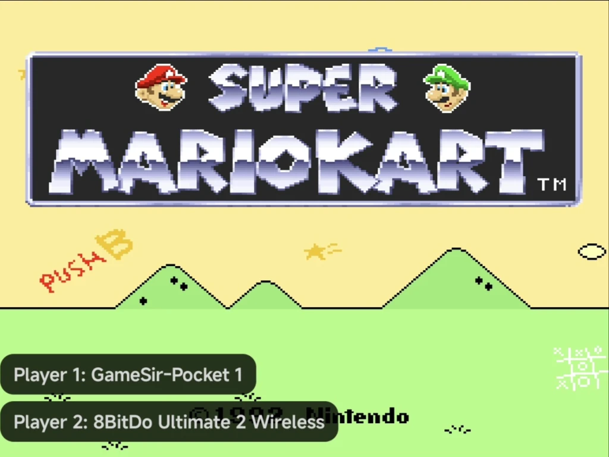

# Local Multiplayer

Two to four people can play one game on one phone or tablet, each on their
own controller. Any Android controller works, over Bluetooth or USB. There
is nothing to set up first:

- **Everyone on a controller:** stand the phone up or connect it to a TV,
  and give each player a pad.
- **A handheld plus a pad:** on an Android handheld, such as a Retroid, play
  on its built-in controls while a friend uses a Bluetooth pad.

The on-screen pad always controls Player 1. Each extra player needs a
controller.

Playing on two devices instead, such as two phones or a phone and an NX
Redux handheld? See [Netplay](netplay.md).

??? info "More detail"

    The on-screen pad is never a player of its own. In portrait, connecting a
    controller removes the on-screen pad and gives the game the whole screen,
    unless it is a clip-on controller such as the GameSir Pocket Taco. See
    [Controls](controls.md#on-screen-pad-and-controllers).

## Which systems

Each system has as many players as the console had controller ports.

| Players | Systems |
| --- | --- |
| Up to 4 | Nintendo 64, Nintendo Wii, Nintendo GameCube, Sega Dreamcast, Arcade (FBNeo), TurboGrafx-16 |
| 2 | NES and Famicom Disk System, Super Nintendo, Sega Genesis, Master System, SG-1000, Sega CD, 32X, PlayStation, Atari 2600, Atari 7800, Atari 5200, ColecoVision |
| 1 | Every other system, such as Game Gear, the Game Boys, Nintendo DS, Nintendo 3DS, PSP and PICO-8 |

??? info "More detail"

    - The TurboGrafx-16 is the exception: its multitap is always plugged in,
      so it has four. Other multitap adapters aren't supported.
    - On Arcade, each game uses as many players as the cabinet had.

## Joining a game

1. Start the game.
2. Press any button on a controller. It takes the next free player:
   Player 1 first, then Player 2, and so on.
3. A notice names the player and the controller, such as
   **Player 2: Xbox Wireless Controller**.

{ .nx-wide }

Close the [in-game menu](in-game-menu.md) first: a press while it is open
never joins. Players are kept until you quit the game.

??? info "More detail"

    - Moving the left stick or the d-pad joins too. Moving only the right
      stick doesn't.
    - Each launch starts with every player free again. Save states don't
      store who is which player.

## The in-game menu

- Only Player 1 opens the in-game menu with `SELECT` + `START`. For Players
  2 to 4, `SELECT` and `START` go to the game.
- The Home or Guide button (`MENU`) opens the menu from any controller.
- Any controller can move around the open menu.

## The Players page

In a game with more than one player, the [game panel](in-game-menu.md#the-game-panel)
has a **Players** tab. It's beside the in-game menu's first page, or on a
handheld's [second screen](dual-screen.md#the-game-panel) while you play.
With a controller, `A` on the tab's name opens it as a full page.

<!-- screenshot: the game panel's Players tab in the in-game menu, Player 1 and Player 2 with controller names -->

| Row | Value | `LEFT` / `RIGHT`, or a tap |
| --- | --- | --- |
| **Player 1** to **Player 4** | The controller's name, **Empty**, or the name with **(disconnected)** | Pick another connected controller, or **Empty**. Picking a controller another player has swaps the two players. |

??? info "More detail"

    - A tap on a row in the panel steps it to the next choice, as `RIGHT`
      does.
    - The page's footer reads **Close the menu, then press a button on a new
      controller to join.**
    - Two controllers with the same name are numbered, such as **Xbox
      Wireless Controller (2)**.

### Benching a controller

Set a player to **Empty** and the controller that was there sits out: its
presses no longer join the game. To bring it back, pick it for a player
again; benched controllers are in the list too. A bench lasts until you quit
the game.

!!! tip "Bench a handheld's built-in controls"
    Playing on an Android handheld with an external pad? Set the built-in
    controls' player to **Empty**, then press a button on your pad: it takes
    that player.

## When a controller disconnects

If a controller drops out, its player stays reserved, and its row reads, for
example, **Xbox Wireless Controller (disconnected)**. Reconnect the same
controller and it gets the same player back. The other players carry on.

??? info "More detail"

    - A drop-out can be a flat battery or a lost Bluetooth connection.
    - Any buttons the dropped player was holding are let go.

## Rumble

Each player's rumble goes to their own controller. **Game rumble** in
[**Tools → Settings → Controls**](controls-settings.md) sets the strength for
everyone.

??? info "More detail"

    - **Player 1** falls back to the phone's vibration motor when their
      controller has no motor Android can use, or when they play on the
      on-screen pad.
    - **Players 2 to 4** never vibrate the phone.
    - Some controllers' motors aren't available to Android over Bluetooth. An
      8BitDo Ultimate 2 over Bluetooth on a Galaxy Fold is one we tried. That
      player then gets no rumble.
    - Which games rumble: see [Controls → Game rumble](controls.md#game-rumble).

## System notes

| System | Note |
| --- | --- |
| [Sega Dreamcast](emulators/dreamcast.md#multiplayer) | Players 2 to 4 have the Vibration Pack but no memory card. Games save to Player 1's card. |
| [PlayStation](emulators/playstation.md#controls) | Player 2 gets the same DualShock pad as Player 1. |
| [Sega Genesis, Sega CD, 32X](emulators/sega.md#controller-type) | **Controller Type** applies to Player 2 too. |
| [Nintendo 64](emulators/nintendo-64.md#rumble) | Each player's Rumble Pak is set in Core Options, from **Player 1 Pak** to **Player 4 Pak**. |
| [Nintendo Wii, GameCube](emulators/wii-gamecube.md#multiplayer) | Every player gets Player 1's controller. On Wii, each player shakes with `R2`, and only Player 1 can point or use the phone's motion. |

## Limits

- A controller that Android sees as two devices, such as a pair of
  Joy-Cons, becomes two players.
- No multitap adapters yet, such as the NES Four Score, the Super Nintendo
  or PlayStation multitap, or the Sega Team Player.
- No link-cable play between players on one phone. Game Boy and Game Boy
  Advance link play works between two devices with [Netplay](netplay.md).
