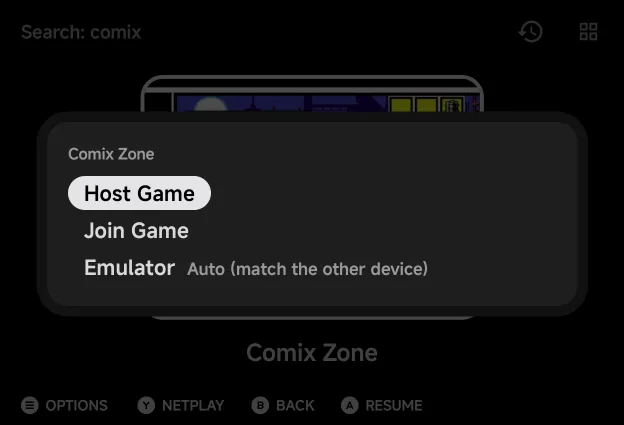
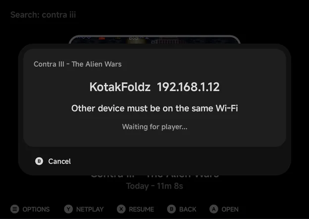
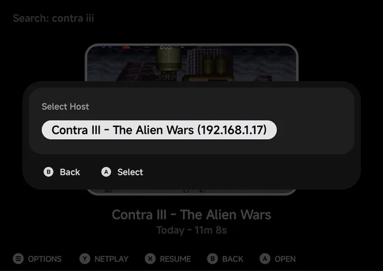
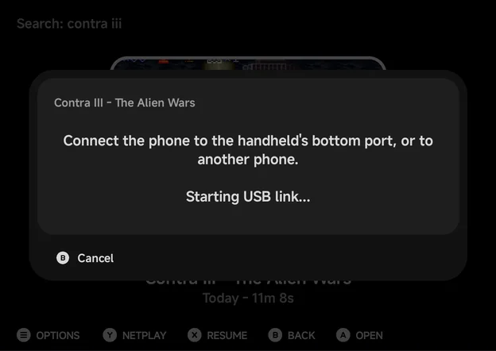
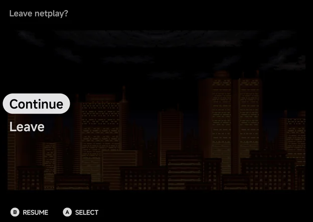

# Netplay

Two players, two devices, one game. Netplay links your phone with another
phone or with an NX Redux handheld (TrimUI Brick, Brick Pro or Smart Pro S),
over Wi-Fi or a USB-C cable. Game Boy and Game Boy Advance games get a link
cable too, for trades and versus battles.

There is no IP to type. Save data is copied before the match starts, and
your own save is never overwritten by someone else's.

Two people on one phone, each with a controller? That is
[Local Multiplayer](multiplayer.md) instead.

## Starting a session

1. Both players pick the same game. On the phone, highlight it on Home or
   in a game list and press `Y` **Netplay**.
2. The **Netplay** sheet opens, titled with the game.

    

3. Both players choose the same **Connection**: **Wi-Fi** or
   [**USB Cable**](#usb-cable).
4. One player picks **Host Game**, the other **Join Game**.
5. The joiner picks the host (over Wi-Fi), the host's save is copied, and
   the game starts on both devices.

On a handheld, press `Y` on the game and pick **Host Game** or **Join Game**,
then **WiFi** or **USB Cable**. See the handheld's
[Netplay](../handheld/netplay.md) page.

!!! note "Keep the handheld up to date"
    Keep the handheld on the latest NX Redux: older versions can't pair with
    the phone.

??? info "More detail"

    - In a game list, **Netplay** in the game's `MENU` menu does the same as
      `Y`. On a touchscreen with no controller there is no hint bar:
      long-press the game and pick **Netplay**, which then leads the menu.
    - `Y` **Netplay** only shows for games on a
      [supported system](#supported-systems). When the `Y` **Netplay** hint
      is hidden, **Netplay** moves to the top of the game's menu. See
      [Context menus](main-menu.md#context-menus).
    - The phone has no **Hotspot** choice, so don't pick it on the handheld.

### The Netplay sheet

| Row | What it does |
| --- | --- |
| **Connection** | **Wi-Fi** or **USB Cable**. `LEFT` / `RIGHT` or `A` switch. |
| **Host Game** | Wait for the other player to join. |
| **Join Game** | Find the host and join it. |
| **Emulator** | Which emulator runs the match. See [Emulator](#emulator). |
| **Wi-Fi settings** | Opens Android's Wi-Fi settings, when the phone isn't on Wi-Fi. |

`B` closes the sheet.

??? info "More detail"

    - **Connection** is remembered for next time, and only shown on phones
      that can use the cable.
    - **Emulator** only shows for systems with more than one.
    - **Wi-Fi settings** shows under **Connect to Wi-Fi first**.

### Hosting

The host's screen shows the phone's name and address and **Waiting for
player...**. The other device must be on the same Wi-Fi. When a player
connects, the game starts. `B` **Cancel** stops hosting.

??? info "More detail"

    - The screen stays on while it waits.
    - When a player connects, the status reads **Player connected**, then
      **Sending saves...**.
    - If a joiner is turned away, such as one on another emulator, the host
      keeps waiting for the next one.

### Joining

Over Wi-Fi, **Join Game** opens **Select Host**, listing every device hosting
on the same network, phones and handhelds alike, such as **Contra III - The
Alien Wars (192.168.1.23)**. Press `A` on the host to join. `B` goes back to
the sheet.

??? info "More detail"

    - After `A`, the screen reads **Connecting...**, then **Receiving
      saves...**, then **Connected - starting game...**.
    - The list reads **Searching for hosts...** until a host shows up. After
      two minutes with none it says **No host found.**

### Different versions of one game

You can join a host running a sister version of your game, such as Pokémon
Ruby and Sapphire. The phone asks first:

> The host is running *Pokemon - Ruby Version* 
> You are running *Pokemon - Sapphire Version* 
> Join anyway?

Press `A` **Join** to join, or `B` **Back** to pick another host. Only join
when you know the two games link: the app can't tell a sister version from
a different game.

## USB Cable

No Wi-Fi nearby, or a laggy one? Join the two devices with a USB-C data
cable. A cable is steadier than Wi-Fi, and the Game Boy Advance's real link
cable needs it.

**Phone and handheld:**

1. Plug the cable into the handheld's **bottom** USB-C port (the charging
   port) and into the phone.
2. On the phone, set **Connection** to **USB Cable** and pick **Host Game**
   or **Join Game**.
3. On the handheld, press `Y`, pick the other role and choose **USB Cable**.

**Two phones:**

1. Join them with a USB-C to USB-C cable.
2. Both set **Connection** to **USB Cable**. One picks **Host Game**, the
   other **Join Game**.
3. If they don't connect, open the USB notification on one phone and switch
   **USB controlled by** to the other phone.

- **Android asks once to allow a VPN.** It only carries the cable link.
  Turn off any other always-on VPN app first: it blocks the cable.
- **Same NX Redux version on both.** Otherwise the phone says **Both devices
  need the same NX Redux version.**
- **2 players only.** Either device can host.

??? info "More detail"

    - There is no host list: the joiner connects straight to the other end of
      the cable. The host's screen reads **USB** and **Connected by USB
      cable**.
    - Host and Join don't depend on the cable: either device can host,
      whichever end of the cable it has.
    - If no link comes up within about 30 seconds, the phone says **No USB
      link** and what to check: the handheld's bottom port, **USB Cable**
      picked on the handheld, or **USB controlled by** on two phones.
    - Pull the cable out mid-game and plug it back in before the countdown
      ends (about 28 seconds), and the match carries on.
    - A phone that can't use the cable has no **Connection** row, and plays
      over Wi-Fi only.
    - If the other phone took control of the USB connection, the phone says
      so and points to **USB controlled by**.

## Supported systems

Netplay works only for games in these folders. Every other system, such as
Nintendo 64, Dreamcast, Nintendo DS, Nintendo 3DS and PSP, has no
`Y` **Netplay**.

| System | `Roms` folder | Emulator for the match | Netplay type |
| --- | --- | --- | --- |
| NES / Famicom Disk System | `FC`, `FDS` | FCEUmm | Lockstep |
| Super Nintendo | `SFC` | Snes9x, or Supafaust | Lockstep |
| Super Nintendo | `SUPA` | Supafaust, or Snes9x | Lockstep |
| Sega Genesis, Master System, Game Gear, SG-1000, Sega CD | `MD`, `SMS`, `GG`, `SG1000`, `SEGACD` | PicoDrive, or Genesis Plus GX | Lockstep |
| Sega Genesis, Master System, Game Gear, SG-1000, Sega CD | `GPGX` | Genesis Plus GX, or PicoDrive | Lockstep |
| Sega 32X | `32X` | PicoDrive | Lockstep |
| PlayStation | `PS` | PCSX-ReARMed, or SwanStation | Lockstep |
| PlayStation | `PSX` | SwanStation, or PCSX-ReARMed | Lockstep |
| Arcade | `FBN` | FinalBurn Neo | Lockstep |
| Game Boy / Game Boy Color | `GB`, `GBC` | Gambatte | **GB Link** |
| Game Boy Advance | `GBA` | gpSP, or mGBA (USB Cable only) | **GBA Link** |
| Game Boy Advance | `MGBA` | mGBA, or gpSP | **GBA Link**, [USB Cable only](#game-boy-advance-link) |

| Netplay type | What it means |
| --- | --- |
| **Lockstep** | Both devices run the same game and swap controller input every frame. For games with a two-player mode. |
| **GB Link** / **GBA Link** | The link cable between two Game Boys. Trades and versus battles in single-player cartridges work between the two devices. |

!!! info "Game Gear"
    The Game Gear has one controller port, so only games that read a second
    pad react to the other player.

??? info "More detail"

    The Game Gear's two-player games used the link cable, which netplay
    doesn't connect. Both devices still play the same game in step.

### Emulator

Systems with two emulators have an **Emulator** row on the sheet.
`LEFT` / `RIGHT` change it.

- **Auto (match the other device)** (default): the phone runs whatever the
  other device runs. Leave it on Auto unless you need one emulator.
- **An emulator by name**: the phone runs only that one. A device on another
  emulator can't join.

If the two don't match, the joiner is told what to change.

??? info "More detail"

    - Auto follows the other device only when this folder offers its
      emulator. With two phones on Auto, the host's emulator wins. A handheld
      can't switch, so a phone always follows a handheld.
    - A mismatch message reads, for example, **The host is using PicoDrive
      (MD folder). Pick the game from the same folder on both devices.**, or
      **Set Emulator to PicoDrive.** when that is one of its own choices.
    - The host flashes **A player using Genesis Plus GX was turned away.**
      and keeps waiting.

### Game Boy Advance link

Game Boy Advance games link as two GBAs on a cable:

- **Over Wi-Fi** (gpSP): the link is emulated for the games that need it,
  and the wireless adapter works (the Union Room in FireRed, LeafGreen and
  Emerald).
- **Over the USB Cable**: a real link cable. Cable link play works as on
  real hardware, such as Pokémon trades and battles, cross-game trades like
  FireRed with Ruby, and The Legend of Zelda: Four Swords.
- **mGBA links over the USB Cable only.** A game in the `MGBA` folder offers
  only **USB Cable**.

For a cable trade between FireRed/LeafGreen and Ruby/Sapphire, the host sets
gpSP's **Link Cable Connectivity** core option to **Link Cable - Real (USB
only)** before hosting, in **Game Settings** or
[Emulator Settings](emulator-settings.md).

!!! tip "Give each device its own save"
    Two Pokémon games with the same save share a Trainer ID and refuse to
    trade.

??? info "More detail"

    - A phone that can't use the cable has no `Y` **Netplay** for `MGBA`
      games. Setting **Emulator** to **mGBA** on a `GBA` game over Wi-Fi says
      **mGBA links over the USB cable only.**
    - **Link Cable Connectivity** picks the link mode, and the host's choice
      is used by both devices. Otherwise leave it on **Automatic**.
    - It can't be changed in a match: the in-game menu has no Options during
      a match.

## Saves

Your own save is never overwritten by the other player's.

| Netplay type | Whose save is used |
| --- | --- |
| **Lockstep** | The host's. Its save is copied to the joiner, so both start from the host's progress. |
| **GB Link** and **GBA Link** | Each player's own. Nothing is copied. |

- **The joiner** plays on a copy: its own save is left as it was, and
  progress made in the match isn't kept.
- **The host** plays on its real save, so its progress is kept, unless the
  match runs on an emulator that doesn't share the folder's saves.
- If the host has no save for the game, both start fresh.

!!! note "Hosting clears the resume point"
    Hosting on your real save clears the game's resume point, so
    [Resume](game-switcher.md) can't roll the save back.

??? info "More detail"

    - The emulators that share saves: gpSP and mGBA, Snes9x and Supafaust,
      PCSX-ReARMed and SwanStation.
    - A host on another emulator, such as Genesis Plus GX for a Sega game on
      PicoDrive, plays on a copy. The game starts with **Using Genesis Plus
      GX for this match - progress won't be saved.**
    - Only battery saves travel (`.srm` and `.sav`). Save states are never
      copied.
    - If the copy fails, the join stops with **Could not copy the host's
      saves.** A host that can't share its saves starts the match on empty
      saves and says **Saves not copied - playing on empty saves.**

## During a match

A match has no save states, cheats, achievements, core options or disc
changes. Each device is one player: every controller on the phone, and the
on-screen pad, play as that player.

The in-game menu shows only **Leave netplay?**:

| Row | What it does |
| --- | --- |
| **Continue** | Back to the game. |
| **Leave** | Ends the match for both, and returns you to the game list. |

!!! warning "Come back within 30 seconds"
    While your menu is open, or the app is in the background, the other
    player sees **Other player paused (30 s)** counting down. Come back
    before it runs out, or the match ends.

| Notice | What it means |
| --- | --- |
| **Waiting for the other player... (N s)** | The other device stopped sending. The match ends if it doesn't come back within 30 seconds. |
| **Other player paused (N s)** | The other player opened their menu or left the app. |
| **Netplay ended** | The other player left or the connection was lost. You keep playing on your own. |

??? info "More detail"

    - The features are off to keep both devices in step.
    - The menu's line reads **Leaving ends the netplay session.** While it is
      open, your input stops.
    - Notices show at the top of the screen.
    - After **Netplay ended** the menu is **Continue** / **Quit**. On a copy
      the notice reads **Netplay ended - progress here won't be saved.**
    - If the match can't start or breaks, a **Netplay failed** dialog says
      why, such as **Could not reach the other device.** or
      **Netplay failed - the other device's emulator doesn't match.**, and
      you go back to the game list.

## Not supported

- More than two players.
- The handheld's **Hotspot** mode.
- Rollback netplay, such as the handheld's Dreamcast GGPO.
- Systems outside the [table above](#supported-systems).
- The Super Game Boy (`SGB`): put Game Boy games in `GB` or `GBC` for link
  play.
