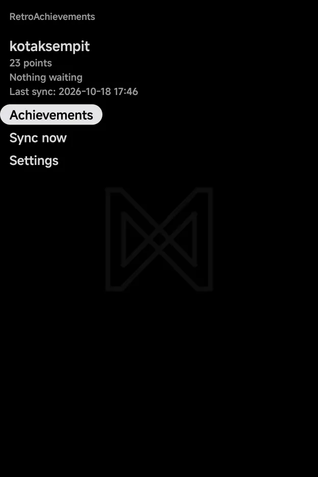
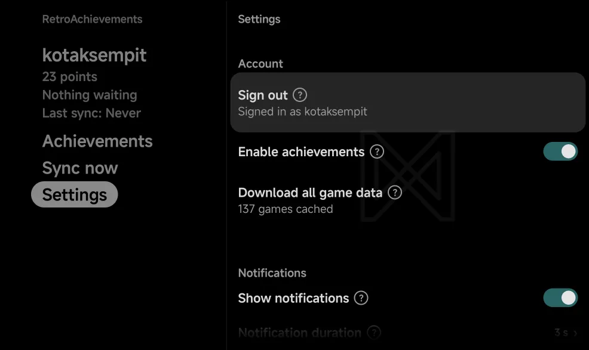
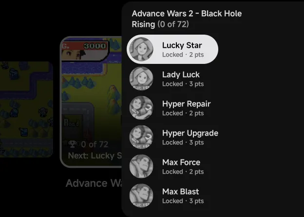
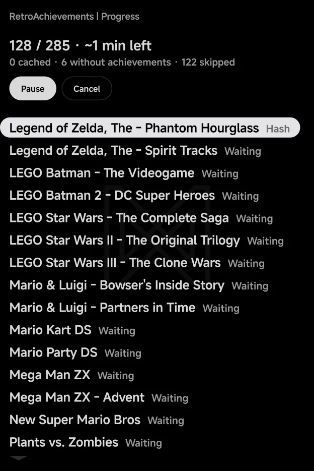
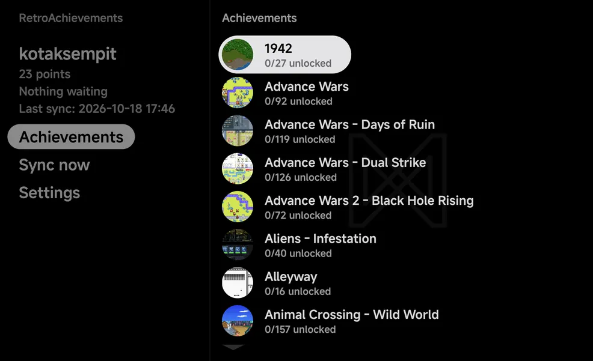
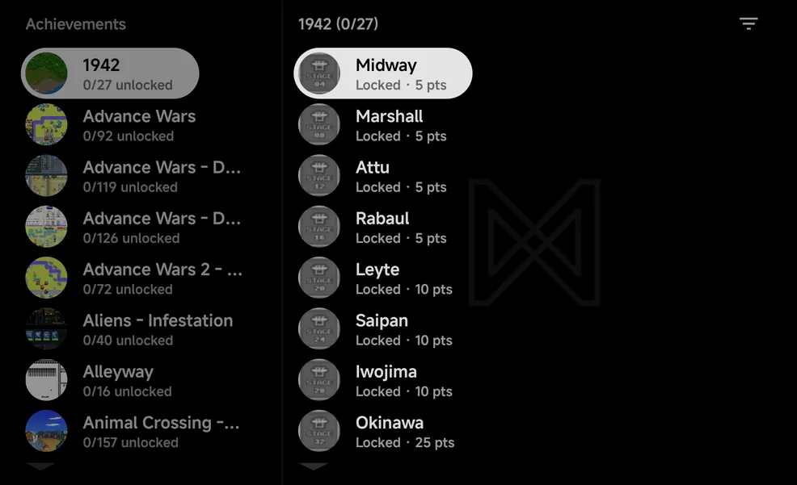

# RetroAchievements

NX Redux for Android supports [RetroAchievements](https://retroachievements.org/),
with offline play. **Tools → RetroAchievements** is the home for the feature:
sign in, browse your achievements and change its settings there. Once you are
signed in, game lists also show a game's achievements in a
[panel](#on-game-lists).

The home screen shows your username and points, with three rows:
**Achievements**, **Sync now** and **Settings**.

??? info "More detail"

    - The home screen also shows how many unlocks are waiting to be synced and
      when you last synced. Signed out, it reads **Not signed in** and **Sign
      in under Settings** instead.
    - After you start [Download all game data](#downloading-all-game-data), a
      fourth row, **Progress**, such as **Progress (12/340)**, opens its
      progress page.

!!! info "Softcore only"
    NX Redux for Android is not an RA-approved hardcore client, so there is no
    hardcore mode. Unlocks count as softcore, and nothing is blocked
    while achievements are on: cheats and save states work as usual.

## Setting up

You need a free [retroachievements.org](https://retroachievements.org/)
account.

1. Open **Tools → RetroAchievements → Settings**.
2. Choose **Sign in**, enter your **Username** and **Password**, and choose
   **Sign in**.
3. **Status** shows **Signed in as** your username, and **Enable
   achievements** turns **On**.

First-run setup asks you to sign in too, and can start
[Download all game data](#downloading-all-game-data) for you. See
[Getting Started](getting-started.md).

The settings page also has:

| Row | Default | What it does |
| --- | --- | --- |
| **Enable achievements** | On after you sign in | Track achievements in games. Needs a sign-in. |
| **Download all game data** | — | Cache achievement data for your whole library. See [Downloading all game data](#downloading-all-game-data). Needs a sign-in. |
| **Show notifications** | On | Show unlock and progress notices in games. |
| **Notification duration** | 3 s | How long achievement notices stay (1–5 s). |
| **Progress duration** | 1 s | How long a progress notice stays (Off, 1–5 s). |
| **Achievement sort order** | Unlocked first | How achievements are sorted, here and in the in-game menu. See [below](#sort-orders). |
| **Reset account data** | — | Sign out and forget sessions and unsynced unlocks. Game data and badges stay. |
| **Erase all achievement data** | — | Delete every cached game and unsynced unlock, and sign out. |
| **Reset settings to defaults** | — | Put the notification and sort settings back and turn **Enable achievements** off. You stay signed in. |

!!! warning "Reset and erase delete unsynced unlocks"
    **Reset account data** and **Erase all achievement data** forget unlocks
    that haven't been synced yet. Run [Sync now](#syncing) first. Both ask to
    confirm.

??? info "More detail"

    - The app keeps only the sign-in token RetroAchievements returns, not your
      password.
    - Signed out, **Enable achievements** and **Download all game data** are
      dimmed.
    - **Download all game data** shows how many games are cached, such as
      `48 games cached`.
    - `A` changes a value. On **Notification duration**, **Progress duration**
      and **Achievement sort order**, `LEFT` / `RIGHT` work too. On touch,
      with no controller and no on-screen pad, a tap on one of these three
      opens a list of its values to pick from.
    - **Sign out** asks to confirm too. Signing out turns achievements off,
      and signing in again needs your password. Your unsynced unlocks, game
      data and badges stay.
    - With **Erase all achievement data**, badges and game fingerprints kept
      in your ROM folders stay.
    - In first-run setup, **Achievement data** → **Download now** starts the
      download in the background.

## Earning achievements

Start a recognised game and unlocks are tracked as you play.

- When the game loads, a notice shows its name and how many achievements you
  have, or **No achievements for this game**.
- An **Achievement Unlocked** notice with the badge pops up when you earn one.
- The [in-game menu](in-game-menu.md#achievements)'s **Options** gains an
  **Achievements** row to browse the game's achievements.

??? info "More detail"

    - Progress notices, such as collectible counters, show for the **Progress
      duration**.
    - In the in-game menu's list, press `Y` to show only locked achievements,
      and `X` to mute one achievement's notices.
    - With **Show notifications** off, unlock and progress notices, **Game
      Mastered!**, server errors and the connection lost and reconnected
      notices are hidden. These still show: the game loading, no achievements
      for this game, sign-in failed, offline at the start, first-time setup
      and synced unlocks.

## On the Home tab

Home's stats strip shows how many achievements you unlocked this calendar
month, such as **12 achievements**, beside **This month** and your play time.
See [Home](main-menu.md#home).

??? info "More detail"

    Unlocks still waiting to be synced count too. Signed out, the strip leaves
    the achievements out.

## On game lists

Signed in, any game list can show the highlighted game's achievements in a
panel that slides in from the right. Open it with `X` (**Achievements** in
the hint bar), or on a touchscreen, the trophy icon at the right of the
list's title.

| Button | What it does |
| --- | --- |
| `UP` / `DOWN` | Move through the achievements |
| `LEFT` / `RIGHT` | Go to the previous or next game. The panel follows. |
| `A` | Show the highlighted achievement's details |
| `B` | Back from the details, or close the panel |
| `X` | Close the panel |

On touch, tap an achievement for its details. Android's Back, or a tap beside
the panel, closes it.

If the game has no cached data yet, the panel downloads its achievements and
shows **Downloading this game's achievements…** until they arrive.

??? info "More detail"

    - A tap on the highlighted game's name or info also opens the panel
      (Carousel and Backdrop, and List's info line).
    - The panel heads with the game's name and its progress, such as **Drill
      Dozer (3 of 56)**, and lists the achievements as [Browsing your
      achievements](#browsing-your-achievements) does, in the
      [sort order](#sort-orders) from Settings. It takes 60% of the screen's
      width in portrait and 45% in landscape, so the list shows beside it.
    - Android's Back leaves the details first, then closes the panel.
    - **No cached data yet:** the download is what [Download all game
      data](#downloading-all-game-data) does for one game, in the background.
      Moving on to another game doesn't stop it.
    - **Not recognised:** when RetroAchievements doesn't know the game's file,
      the panel says so with the file's hash: it may be a different version, a
      hack or a bad dump. A file that can't be read says **Couldn't read this
      game's file to identify it.** Neither is downloaded again.
    - **No connection:** the panel says **Couldn't download this game's
      achievements: no connection.** It tries again the next time you open it.
    - A game with no achievements, or on a console RetroAchievements doesn't
      cover, reads **This game has no achievements.**
    - Signed out, there is no panel: no trophy icon, no `X` hint and no menu
      entry.
    - **Settings → Layouts → Game lists → Achievements panel** set to
      **Hide** removes the trophy icon and the `X` hint; `X` still opens the
      panel, and the game's context menu (`MENU`) gains an **Achievements**
      entry instead. See [Menu Layouts](layouts.md).

## Offline play

- **Earn offline.** With no connection, unlocks are saved on the phone. They
  show as **Pending sync** until they reach RetroAchievements.
- **Automatic sending.** The next time you start a game with a connection,
  waiting unlocks are sent, and a notice says how many were synced.
- **Cached game data.** A game you have played online once keeps working
  offline. A game the app has never seen needs a connection the first time,
  and says so.
- To play every game offline, even ones you have never played online, use
  [Download all game data](#downloading-all-game-data).

## Downloading all game data

**Settings → Download all game data** caches achievement data and badges for
every game in your library, in the background. It needs a sign-in and a
connection, and opens its **Progress** page, which shows how far it is and the
time left, such as **12 / 340 · ~9 min left**.

| Button | What it does |
| --- | --- |
| `Y` **Pause** / **Resume** | Pauses before the next game, or carries on |
| `X` **Cancel** | Asks **Cancel download?** Games already downloaded keep their data. **Stop** ends the download. |
| `A` **Done** | Once it has ended: clears it, and the **Progress** row with it |
| `B` **Back** | Back to the RetroAchievements page. The download keeps running. |

On touch, **Pause**, **Cancel** and **Done** are buttons above the list.

The download keeps running when you leave the page or switch to another app,
with a **Downloading achievement data** notification. Running it again only
fetches what is new.

??? info "More detail"

    - It works through every game on a console RetroAchievements covers.
    - The first line can also read **paused**, **done**, **cancelled** or
      **stopped**, with the reason. The second line counts the games so far,
      such as **10 cached · 1 without achievements · 1 skipped**.
    - Below them is each game still to do, the current one first.

    | Status | Meaning |
    | --- | --- |
    | **Waiting** | Queued |
    | **Hashing** | Being identified. Zipped and 7z games are unpacked for this. |
    | **Downloading** | Its achievements and badges are being fetched |
    | **Skipped** / **Error** | It couldn't be done, followed by the reason, such as **couldn't read the file**. These stay listed. |

    - Games that finish well leave the list. A game already cached counts as
      skipped.
    - The notification has **Pause** and **Cancel** buttons. Paused, the
      notification goes away; resume it from the Progress page.
    - Android asks once whether the app may show notifications. If you say no,
      the download still runs, just without the notification.
    - A lost connection or a refused sign-in stops it. When it ends, a notice
      counts the games cached, without achievements and skipped.

## Syncing

**Sync now** on the home screen needs a connection. It sends any unlocks
still waiting, and refreshes your points and the progress of your cached
games. A notice then says how many unlocks were synced, **Up to date**, or
**Sync failed**.

??? info "More detail"

    `B` cancels a sync; unlocks not yet sent stay waiting. While game data
    downloads, Sync now says **Wait for the game data download to finish**.

## Browsing your achievements

**Achievements** on the home screen lists every cached game with its art and
progress, such as `12/40 unlocked`. It works offline.

Open a game to see its achievements. Each shows **Unlocked**, **Pending sync**
or **Locked**, with its points. `Y` (on touch, the filter icon) shows only
locked ones, or all again. `A` opens an achievement's details.

??? info "More detail"

    - The games list also shows how many unlocks are pending sync. With
      nothing cached yet it shows **No cached games** and **Play online once
      or download game data in Settings**.
    - **Unlocked**, **Pending sync** and **Locked** show in green, amber and
      grey.
    - `Y` switches between **Locked only** and **Show all**, and a notice says
      which: **Showing locked achievements only** or **Showing all
      achievements**.
    - The details show its badge, description, points, when it was unlocked or
      its progress, its unlock rate, its type (`[Missable]`, `[Progression]`
      or `[Win Condition]`) and whether it is muted.
    - On a wide landscape screen, such as an unfolded Fold held sideways, the
      details show beside the list instead. See
      [Foldables & Large Screens](foldables.md#two-pane-screens).

## Sort orders

**Achievement sort order** offers: **Unlocked first** (the default),
**Display order**, **Display order (reverse)**, **Most common first**,
**Rarest first**, **Most points first**, **Fewest points first**, **Title
A–Z**, **Title Z–A**, **Type** and **Type (reverse)**.
