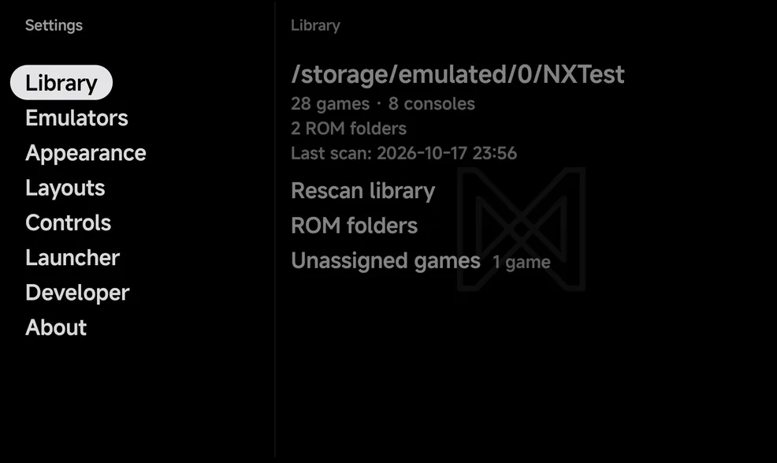

# Settings

Open **Tools → Settings** for the app's settings. They are split into eight
sections.

{ .nx-wide }

| Section | What it holds |
| --- | --- |
| [**Library**](library.md) | Rescan library, your ROM folders, and the Unassigned and Hidden games |
| [**Emulators**](emulator-settings.md) | **Default emulators**, **Settings** for each emulator's options, **Saves**, and **Second screen** while one is connected |
| [**Appearance**](appearance.md) | Pad theme, Accent, Secondary accent and Text size |
| [**Layouts**](layouts.md) | The style of each main menu tab and of the game lists, the page title and hints, and the Game Switcher |
| [**Controls**](controls-settings.md) | Pad vibration, Game rumble, Menu pad and Pad layout |
| [**Launcher**](launcher.md) | Use the app as your home screen, and pick Android apps and games |
| [**Developer**](#developer) | Debug log |
| [**About**](about.md) | The app's version and your device's details |

- Press `A` **Open** to open a section, and `B` **Back** to leave it.
- On a page, `A` **Select** runs the highlighted row or steps it to its next
  value. `Left` and `Right` step a value too.
- With touch alone, tap a row to run it, and use Android's Back gesture to
  leave. A tap on a value with two choices flips it; a value with three or
  more opens a dropdown: tap one to pick it.
- On a wide landscape screen, Settings shows the sections and the open page
  side by side. See [Foldables & Large Screens](foldables.md#two-pane-screens).

??? info "More detail"
    - "Touch alone" means no controller and no on-screen pad below the
      screen. There is no hint bar then.
    - The dropdown opens at the value and lists every choice, the current one
      highlighted. Tap outside it to close it.
    - The rows on [About](about.md) only show information.
    - In portrait, the on-screen pad shows on the **Appearance** and
      **Controls** pages only (while
      [Menu pad](controls-settings.md#menu-pad) is On), so you can see the
      pad you are changing. The other Settings pages use the full height.
    - The side-by-side view shows on screens such as an unfolded Fold held
      sideways or most phones turned sideways.

## Developer

**Debug log** (Off by default) writes the app's and the emulators' detailed
logs to Android's system log, for a bug report. With it off, only errors are
logged. It takes effect at once.
